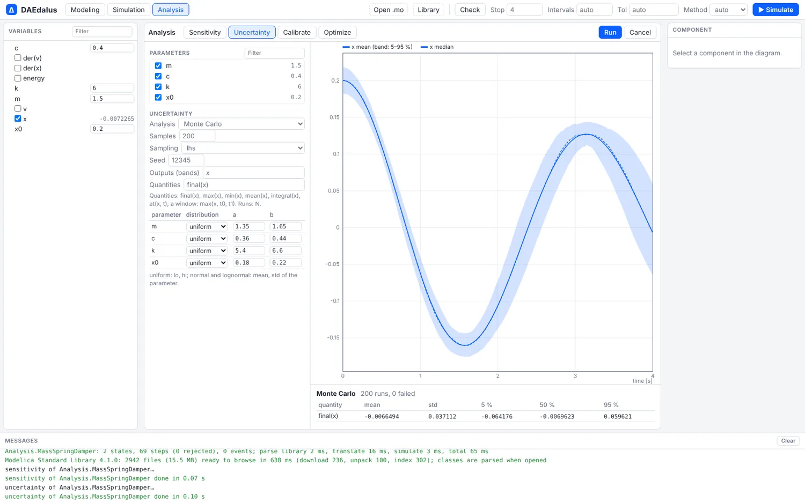
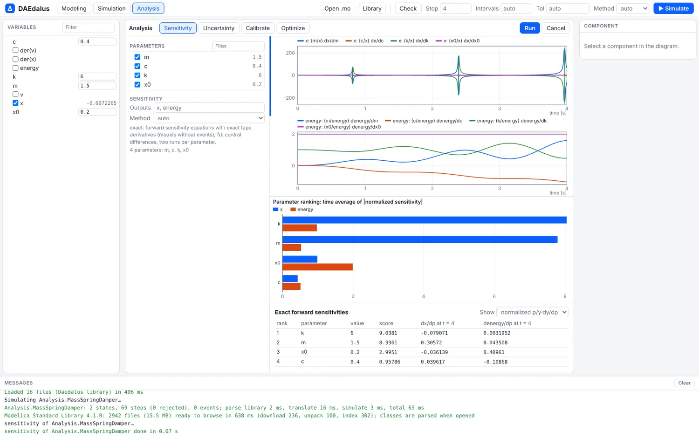
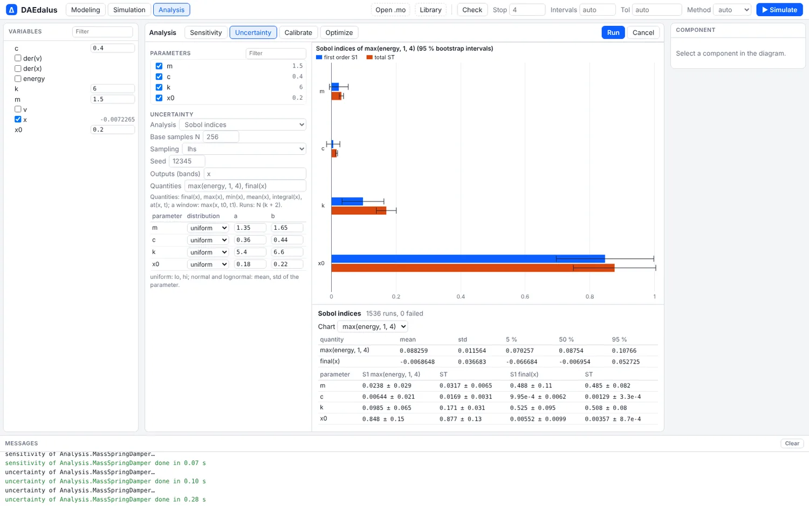
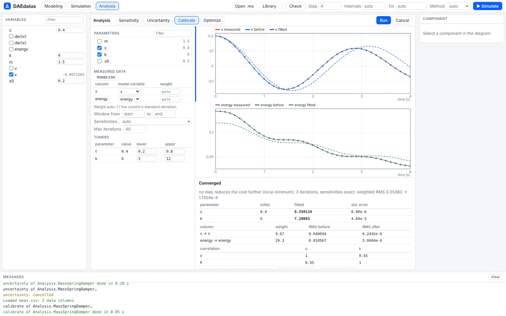
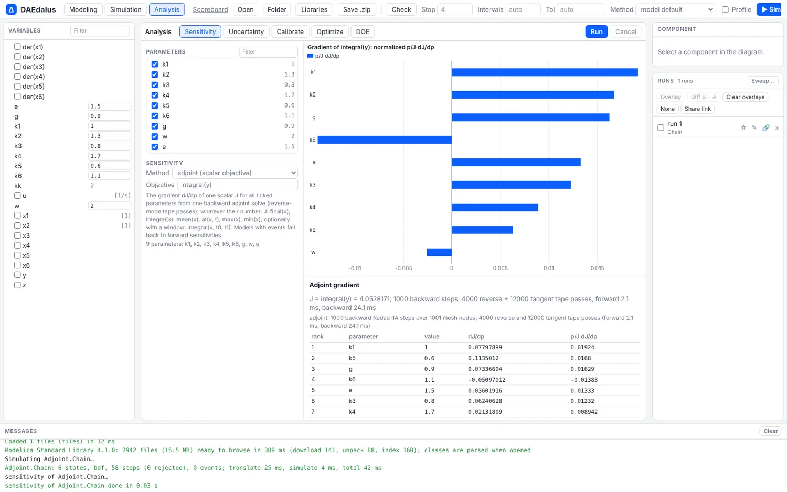
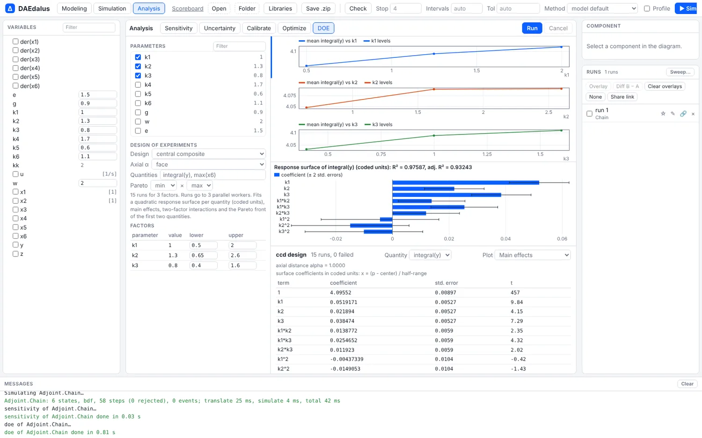

# Sensitivity, uncertainty and calibration

Which parameters matter, how much a result spreads when they are uncertain, which values
make the model match a measurement, and which value hits a design target: the
workbench's **Analysis** mode and four `daedalus` commands answer these on any model,
with no scripting.



| Question | Command | Analysis tab |
| --- | --- | --- |
| Which parameters drive this output, and when? | `sensitivity` | Sensitivity |
| How much does the result spread? Which inputs cause the spread? | `montecarlo`, `gsa` | Uncertainty |
| Which parameter values fit my measurements? | `calibrate` | Calibrate |
| Which value meets my target? | `optimize` | Optimize |
| How does a scalar depend on many parameters? | `sensitivity --adjoint` | Sensitivity (adjoint) |
| Which factors and interactions matter, over a designed set of runs? | `doe` | DOE |

Only free parameters can be varied: public parameters with a literal value, the ones
that are editable in the variable browser. Parameters computed from others, protected
ones and those evaluated at translation give an error that lists the free ones.

## In the workbench

Simulate a model, switch to **Analysis** in the toolbar and tick the parameters to vary.
Each tab has its own settings and **Run**; a progress bar shows while it runs and
**Cancel** stops it.

<div class="pair">
<figure><figcaption>Sensitivity: exact <code>dy/dp</code> over time for each parameter, and a ranking by the time average of the normalized sensitivity.</figcaption></figure>
<figure><figcaption>Uncertainty with Sobol indices: first-order and total effects of each parameter on the peak energy, with bootstrap intervals.</figcaption></figure>
</div>



The Calibrate tab loads a CSV, maps its columns to model variables and sets the bounds of
each tuner. It plots the measured data against the model before and after the fit, lists
the fitted values with standard errors and correlations, and **Copy as modifier** gives
the result as a Modelica modification.

## The math in brief

Write the model as $\dot{x} = f(t, x, p)$, $y = h(x, p)$, with parameters $p$.

**Sensitivities** are the partial derivatives $S_{ij} = \partial y_i / \partial p_j$: how much an
output moves when a parameter moves. The exact way is the forward sensitivity equation, which
DAEdalus solves together with the model,

$$
\dot{S} = \frac{\partial f}{\partial x}\,S + \frac{\partial f}{\partial p}, \qquad S(0) = \frac{\partial x_0}{\partial p}.
$$

When the exact method fails, a central difference is used instead,
$S_{ij} \approx \bigl(y_i(p + \delta e_j) - y_i(p - \delta e_j)\bigr) / (2\delta)$.

**Adjoint gradients** are for one scalar $J = \int_0^T g(x, p)\,dt$ and many parameters. One
backward solve of the adjoint equations gives every $\mathrm{d}J/\mathrm{d}p_j$ at once,

$$
\dot{\lambda} = -\Bigl(\frac{\partial f}{\partial x}\Bigr)^{\!T}\lambda - \Bigl(\frac{\partial g}{\partial x}\Bigr)^{\!T}, \qquad \lambda(T) = 0,
$$

$$
\frac{\mathrm{d}J}{\mathrm{d}p} = \int_0^T \Bigl(\lambda^T \frac{\partial f}{\partial p} + \frac{\partial g}{\partial p}\Bigr)\,dt .
$$

The formula above is for parameters that enter the model equations; a parameter in the initial state adds one more term, $\lambda(0)^T\,\partial x_0/\partial p$. Its cost does not grow with the number of parameters, so it suits a model with hundreds of them.

**Calibration** minimizes the weighted squared error between measurements $d_k$ and the model,

$$
\min_{p}\ \sum_k w_k \bigl(d_k - y_k(p)\bigr)^2 \qquad \text{subject to}\quad p_{\min} \le p \le p_{\max},
$$

by Levenberg–Marquardt steps $\bigl(J^T J + \mu I\bigr)\,\Delta p = -J^T r$, where $r$ holds the
residuals and $J$ the sensitivities of the outputs. The `--tune name=lo:hi` bounds are the
projection that keeps every step inside the box.

**Design of experiments** runs the model at chosen factor settings, then fits a quadratic
response surface. With factors $x$ coded to $[-1, 1]$ (`x = (p - center) / half-range`),

$$
\hat{y}(x) = \beta_0 + \sum_i \beta_i x_i + \sum_{i \le j} \beta_{ij} x_i x_j,
$$

and the reported $R^2$ tells how much of the variation of each quantity the surface explains.
Three factors give 10 terms, as in the example below.

## Sensitivity

```sh
daedalus sensitivity library/Daedalus -m Daedalus.Examples.QuarterCar.BumpComparison \
    --params linear.m_body,linear.c_spring,linear.c_tyre,bump.h --outputs linear.a_body
```

```
sensitivities of Daedalus.Examples.QuarterCar.BumpComparison (central finite differences), 2001 points from t = 0 to 2
  note: finite differences used because the exact method failed: step size too small at t = 0.008507344142682349
  note: central differences, relative step 1e-4, tolerance 1e-8

ranking (time average of |p/y dy/dp|, summed over outputs):
   1. linear.m_body                   2.60687e0   (p = 400)
   2. linear.c_spring                 1.74834e0   (p = 30000)
   3. bump.h                          1.20919e0   (p = 0.05)
   4. linear.c_tyre                  5.00763e-1   (p = 250000)
```

`--sens-method` chooses how:

- `exact` integrates the forward sensitivity equations `ds/dt = df/dx s + df/dp` next to
  the state, with exact tangents of the compiled model, algebraic loops included. It
  needs a model without `when` clauses and `delay()`, and a run without events.
- `fd` uses two runs per parameter with a relative step of 1e-4 at a tightened tolerance.
- `auto` (the default) uses `exact` where it applies and otherwise says why it used `fd`,
  as above, where the hydraulic damper's fast start stops the exact method.

The output holds the time series of `dy/dp` and of the normalized `p/y dy/dp`, and `-o`
writes them as JSON or CSV.

## Adjoint gradients

With many parameters and one scalar to differentiate, `--adjoint` computes the whole
gradient for about the cost of one forward and one backward solve, however many
parameters there are:

```sh
daedalus sensitivity crates/daedalus-core/tests/models/adjoint.mo -m Adjoint.Chain --adjoint \
    --objective 'integral(y)' --params k1,k2,k3,k4,k5,k6,g,w,e
```

```
gradient of integral(y) for Adjoint.Chain (adjoint: backward solve with reverse-mode tape passes)
  note: adjoint: 1000 backward Radau IIA steps over 1001 mesh nodes; 4000 reverse and 12000 tangent tape passes (forward 0.8 ms, backward 10.1 ms)

  J = 4.0528170837e0

  parameter                             value            dJ/dp    p/J dJ/dp
  k1                               1.000000e0    7.79789943e-2    1.9241e-2
  k5                              6.000000e-1    1.13501154e-1    1.6803e-2
  g                               9.000000e-1    7.33660425e-2    1.6292e-2
  k6                               1.100000e0   -5.09701197e-2   -1.3834e-2
  e                                1.500000e0    3.60191614e-2    1.3331e-2
  k3                              8.000000e-1    6.24062793e-2    1.2319e-2
  k4                               1.700000e0    2.13180931e-2    8.9421e-3
  k2                               1.300000e0    1.97269796e-2    6.3277e-3
  w                                2.000000e0   -5.16754637e-3   -2.5501e-3
```

Nine parameters, one backward solve of about 10 ms.

- Objectives: `final(x)`, `at(x,T)`, `integral(x)` or `mean(x)`, with an optional window
  such as `integral(x,T0,T1)`. `max` and `min` are differentiated at the maximum or
  minimum on the output grid.
- The backward pass solves `-dλ/dt = (df/dx)ᵀ λ + (dg/dx)ᵀ` with a two-stage Radau IIA
  step, and each `f_pᵀ λ` is one reverse pass over the compiled model, algebraic loops
  included.
- `--grad-method auto|adjoint|forward|fd`: `auto` uses the adjoint and falls back to
  forward sensitivities or differences for models with events, saying why.
- The gradients agree with forward sensitivities and central differences to about 1e-7
  relative on the test models (`crates/daedalus-core/tests/adjoint.rs`).

The same gradients drive `optimize --algorithm lbfgsb` and `calibrate --optimizer lbfgsb`
(bound-constrained L-BFGS-B). On a 6-state chain with 9 parameters, L-BFGS-B converges in
about 5 runs plus 5 gradients, where Nelder–Mead needs several hundred runs.



## Uncertainty and global sensitivity

`montecarlo` samples the parameters from their distributions and reports the mean,
standard deviation and the 5, 50 and 95 % bands of each output; `gsa` adds Sobol indices
(first-order and total, in N (k + 2) runs) or Morris screening (`--morris`). Runs use all
cores.

```sh
daedalus gsa library/Daedalus -m Daedalus.Examples.QuarterCar.BumpComparison \
    --dist linear.m_body=250:350 --dist linear.c_spring=20e3:40e3 --dist bump.h=normal:0.05:0.01 \
    --qoi 'max(linear.a_body)' -N 128
```

```
Sobol indices of Daedalus.Examples.QuarterCar.BumpComparison: 640 runs, 0 failed

quantity                             mean          std           5%          50%          95%
max(linear.a_body)              1.64112e1    3.72167e0    1.04179e1    1.62511e1    2.29829e1

max(linear.a_body) (mean 1.64266e1, variance 1.45367e1):
  parameter                              S1               ST
  linear.m_body              0.1981 +-0.088    0.1619 +-0.046
  linear.c_spring            0.0079 +-0.028    0.0111 +-0.003
  bump.h                     0.6979 +-0.191    0.6082 +-0.129
```

The bump height explains about 70 % of the spread in peak body acceleration and the
spring rate almost none. That took 14.5 s for 640 runs on four cores.

- Distributions: `p=lo:hi` (uniform), `p=normal:MEAN:STD`, `p=lognormal:MEAN:STD`;
  Latin hypercube or random sampling (`--sampling`), seeded (`--seed`).
- Quantities: `final(x)`, `max(x)`, `min(x)`, `mean(x)`, `integral(x)` and `at(x,T)`,
  each with an optional window such as `max(x,T0,T1)`.

## Calibration

`calibrate` fits parameters to measured data with a projected Levenberg–Marquardt method.
The CSV has a time column and measured columns, matched to variables by name or with
`--map column=var`. Here the measurement is a simulated run with `m_body = 360` and
`c_spring = 36000` plus noise, and the fit starts from the model's 400 and 30000:

```sh
daedalus calibrate library/Daedalus -m Daedalus.Examples.QuarterCar.BumpComparison \
    --data meas.csv --tune linear.m_body=250:500 --tune linear.c_spring=15e3:50e3
```

```
calibration of Daedalus.Examples.QuarterCar.BumpComparison: 4 iterations, 230 residuals, sensitivities: finite differences
  converged: no step reduces the cost further (local minimum)
  weighted residual RMS: 3.307286e-1 -> 8.723941e-2

  parameter                       initial         fitted   std. error
  linear.m_body               4.0000000e2    3.5971769e2      2.361e0
  linear.c_spring             3.0000000e4    3.5999803e4      3.545e2

  correlation:
    [  1.000   0.843]
    [  0.843   1.000]

modifier: (linear(m_body = 359.71769, c_spring = 35999.803))
```

Weights default to one over each column's standard deviation (`--weight` changes them),
and `--window T0:T1` restricts the fit in time.

## Optimization

`optimize` runs Nelder–Mead inside the bounds. The objective is the sum of
`--minimize q`, `--maximize q` and `--target q=v` terms, with the same quantities as
above. Which body mass brings the peak body acceleration over the bump down to 10 m/s²?

```sh
daedalus optimize library/Daedalus -m Daedalus.Examples.QuarterCar.BumpComparison \
    --tune linear.m_body=250:600 --target 'max(linear.a_body)=10'
```

```
optimization of Daedalus.Examples.QuarterCar.BumpComparison (Nelder-Mead): 29 iterations, 58 runs; simplex converged
  objective: 5.751422e0 -> 1.186965e-17
  max(linear.a_body): 1.239821e1 -> 1.000000e1

  parameter                       initial        optimal
  linear.m_body               4.0000000e2    5.0070892e2

modifier: (linear(m_body = 500.70892))
```

Dynamic optimization, where the inputs vary over time and constraints apply along the
trajectory, is the job of the [CasADi export](optimal-control.md).

## Design of experiments

`daedalus doe` runs a designed set of experiments and fits a quadratic response surface
to each quantity. Three factors on the quarter car, in a central composite design:

```sh
daedalus doe library/Daedalus -m Daedalus.Examples.QuarterCar.BumpComparison \
    --factor linear.m_body=300:500 --factor linear.c_spring=20e3:40e3 --factor bump.h=0.03:0.07 \
    --design ccd --qoi 'max(linear.a_body)' --qoi 'max(linear.body.s)' --pareto min,min
```

```
central composite design of Daedalus.Examples.QuarterCar.BumpComparison: 15 runs over linear.m_body, linear.c_spring, bump.h, 0 failed
  note: surface coefficients in coded units: x = (p - center) / half-range

max(linear.a_body): R^2 = 0.99959, adjusted R^2 = 0.99884, RMSE = 1.7867e-1 (15 runs, 10 terms)
  term                              coefficient    std error           t
  1                                  1.239930e1    9.6031e-2     1.291e2
  linear.m_body                     -3.124492e0    5.6500e-2    -5.530e1
  linear.c_spring                   4.985366e-1    5.6500e-2     8.824e0
  bump.h                             5.198308e0    5.6500e-2     9.201e1
  linear.m_body*bump.h              -1.249333e0    6.3169e-2    -1.978e1
  linear.m_body^2                   7.431336e-1    1.1142e-1     6.670e0
  ...

Pareto front of max(linear.a_body) (min) and max(linear.body.s) (min): 1 runs
  run    2:    5.77770e0   6.04319e-1   linear.m_body = 500.000000, linear.c_spring = 20000.000000, bump.h = 0.030000
```

In coded units, the bump height raises the peak acceleration by 5.2 m/s² over half its
range and the body mass lowers it by 3.1 m/s². A heavier body also softens the effect
of the bump (the `m_body*bump.h` interaction).

- Designs: `full` factorial with `p=lo:hi:levels`; `frac`, 2^(k−p) fractions with
  minimum-aberration generators, your own `--generators` or a `--resolution`; `ccd`
  (default), with `--alpha face|rotatable|orthogonal`; `bbd`, Box–Behnken; and `lhs`.
- Per quantity: R², adjusted R², RMSE and coefficients with standard errors and
  t-values. Terms the design cannot estimate are dropped and listed.
- Main effects, two-factor interaction tables and, with `--pareto` for two quantities,
  the non-dominated runs.

The workbench's **DOE** tab picks the design and the quantities and shows main effects,
interactions, coefficients and the Pareto front. **Use** applies a Pareto point's
parameters.



## Checked against known answers

`crates/daedalus-core/tests/analysis.rs` compares these analyses with analytic results:
exponential decay, a mass-spring-damper, the Ishigami function's Sobol indices, Monte
Carlo moments, and parameter recovery from synthetic data.
