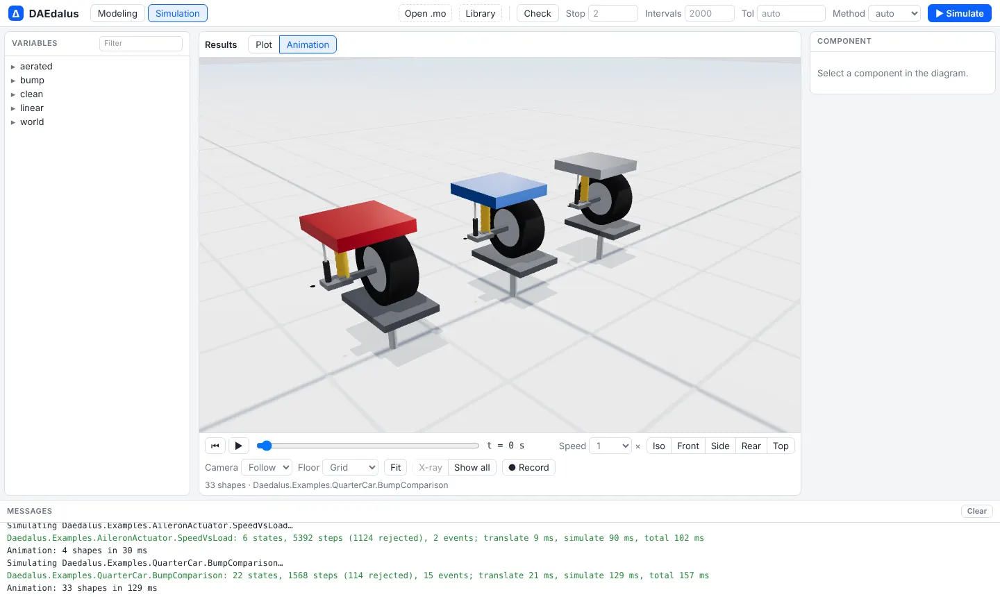
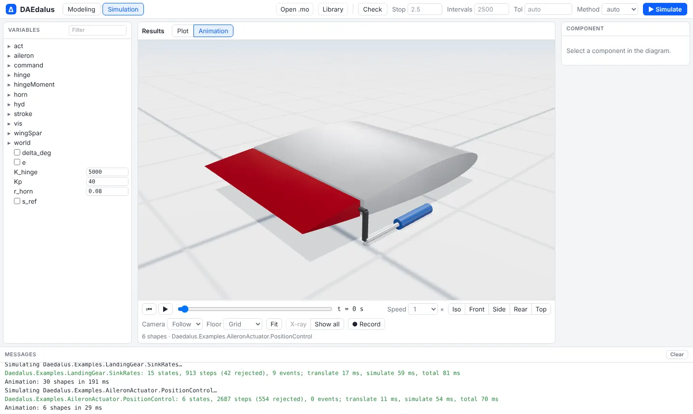
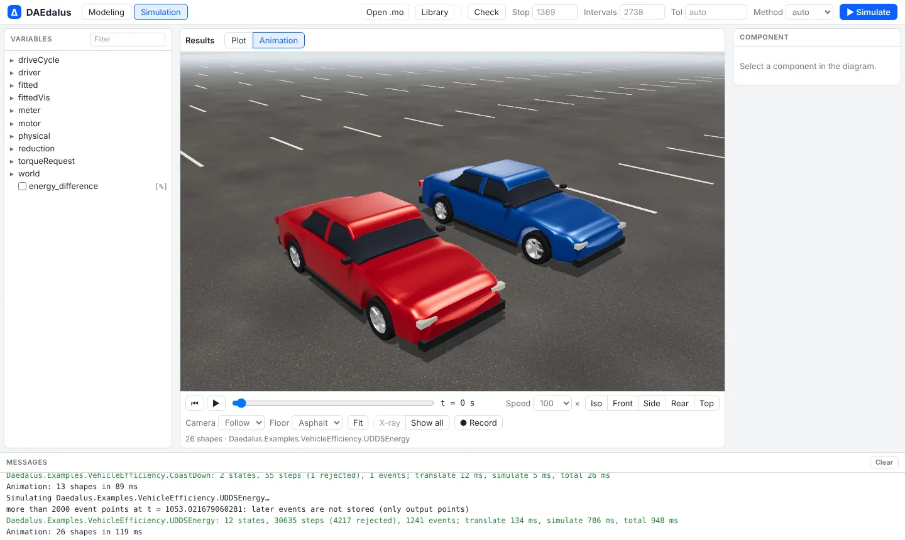
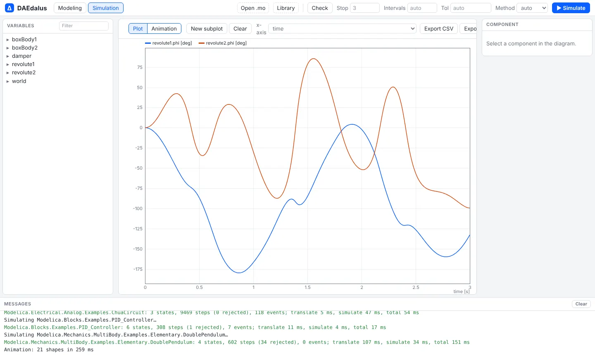

# 3-D animation

After **▶ Simulate**, the workbench replays any model with shapes in the **Animation**
view, like Dymola's animation window. It is a WebGL scene (three.js) that reads the shape
variables straight from the result, so no model-specific code is involved: what you
simulate is what you see.

<video src="media/stepsteer_chase.mp4" poster="img/multibody/stepsteer_chase.webp" controls muted loop playsinline preload="none"></video>

*MultiBodyVehicle.Examples.StepSteer with the chase camera: a 2° front-wheel step at
72 km/h.*

## What it draws

- **MultiBody shapes.** Every `Modelica.Mechanics.MultiBody` visual is an instance of
  `Visualizers.Advanced.Shape`, whose position, orientation, size and colour are ordinary
  result variables. The view finds them all: body cylinders and spheres, joint cylinders,
  springs, `FixedShape`, the world axes. Box, cylinder, sphere, cone, pipe and spring
  shapes are built in.
- **CAD meshes.** A `shapeType` that names an STL or OBJ file as a `modelica://` URI is
  drawn from that file. Libraries carry their meshes in `Resources/Shapes`; your own open
  with **Open .mo** next to the model.
- **1-D models, through `Daedalus.Visualizers`.** This package has the same result
  variables as MultiBody's shape without needing the MSL, so any model can be animated by
  binding a shape's position, angle or size to its own variables. It has a generic
  `Shape`, a `Car` that drives along the road with turning wheels, a `QuarterCar`, a
  `LandingGear`, an `Aileron`, a `RotatingDisc` and a `Gauge`. The visualizers only draw;
  they change no result.

## Every bundled example is animated

<div class="pair">
<figure><figcaption>QuarterCar.BumpComparison: road pad, tyre, spring, damper and body for each damper variant.</figcaption></figure>
<figure><figcaption>LandingGear.SinkRates: wing segment, oleo strut and twin wheels, one lane per sink rate.</figcaption></figure>
<figure><figcaption>AileronActuator.PositionControl: the aileron turning on its hinge, driven by the actuator rod.</figcaption></figure>
<figure><figcaption>VehicleEfficiency.UDDSEnergy: the physical car and the fitted road-load car side by side.</figcaption></figure>
</div>

## Controls


| Control | What it does |
| --- | --- |
| ▶ / ⏸, Home, ← → | Play and pause (space), rewind, and step one output interval |
| Time slider | Scrub to any time |
| Speed | Replay from 0.1× to 100×; long drive cycles start at 10× to 100× |
| Iso, Front, Side, Rear, Top | Camera presets |
| Camera: Off, Follow, Chase | Follow moves with the moving parts; Chase also turns with their direction of travel |
| Floor | Grid, asphalt road, or none |
| Fit | Frames the whole model |
| Click a part, X-ray, Show all | Select a component, make it transparent to see inside, and make everything opaque again |
| ● Record | Plays from the start and saves a WebM video |

Drag to orbit, right-drag to pan, and scroll to zoom. The scene has studio lighting and
shadows, and finds the up direction from the model's `world` (opposite to gravity).

## MultiBody from the MSL

Any MSL MultiBody example animates too:

<div class="pair">
<figure></figure>
<figure></figure>
</div>

[Open Modelica.Mechanics.MultiBody.Examples.Elementary.DoublePendulum](/#Modelica.Mechanics.MultiBody.Examples.Elementary.DoublePendulum)

## Animating your own model

For a model without MultiBody, add a `Daedalus.Visualizers.World` named `world` and bind
shapes to your variables:

```modelica
model Bouncing
  Daedalus.Visualizers.World world;
  Real h(start = 1, fixed = true);
  Real v;
  Daedalus.Visualizers.Shape ball(shapeType = "sphere", r = {0, 0, h},
    length = 0.2, width = 0.2, height = 0.2, color = {200, 60, 40});
equation
  der(h) = v;
  der(v) = -9.81;
  when h < 0 then
    reinit(v, -0.8*pre(v));
  end when;
  annotation (experiment(StopTime = 4));
end Bouncing;
```

The shape's length runs along its `lengthDirection` from `r + r_shape`, so the sphere
above sits on the point `{0, 0, h}` and extends 0.2 m along x.
