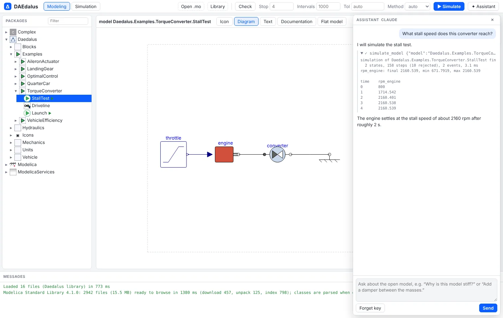
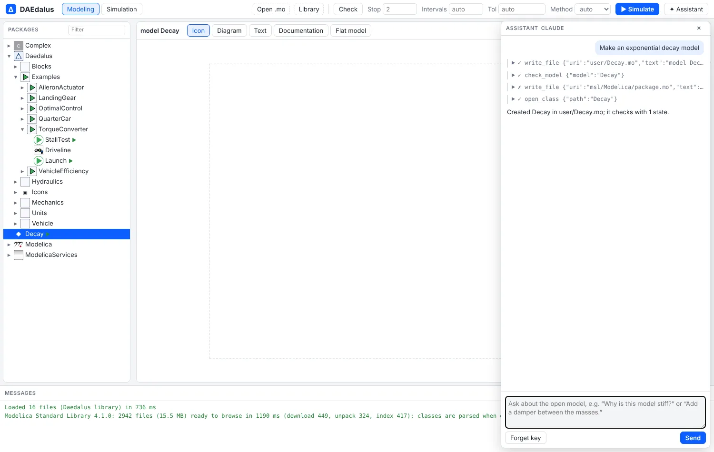

# AI assistant and MCP server

DAEdalus exposes its compiler to AI assistants as tools: browse the libraries, read and
write classes, check, simulate, linearize, and read the structure report and the
performance profile. In the workbench that is the **✦ Assistant**; on the command line
it is `daedalus mcp`, a Model Context Protocol server for Claude Code and other clients. The Model
Context Protocol (MCP) is a standard way for AI tools to call tools such as these, so an assistant can
act on your models rather than only describe them.

<div class="pair">
<figure><figcaption>"What stall speed does this converter reach?": the assistant simulates StallTest and reads the engine speed off the result, about 2160 rpm.</figcaption></figure>
<figure><figcaption>"Make an exponential decay model": it writes <code>user/Decay.mo</code>, checks it and opens it.</figcaption></figure>
</div>

## In the workbench

**✦ Assistant** in the toolbar opens a chat with Claude about the open model. It can:

- browse the package tree and read any class's source;
- write models to `user/*.mo` files (library files stay read-only) and check them;
- simulate, with the result filling the variable browser as if you had pressed
  **Simulate**;
- read the [structure report](structure.md) and the [performance profile](performance.md)
  to explain why a model is stiff, slow or chattering;
- open classes in the editor.

It uses your own Claude API key, which stays in that browser; requests go straight from
the page to the Claude API, and **Forget key** removes it. Other workbench features add
their own tools with `registerAssistantTool` in `web/src/assistant.ts`.

## MCP server

`daedalus mcp` serves the loaded libraries over stdio (newline-delimited JSON-RPC). Its
tools are `list_classes`, `get_class`, `set_source`, `check_model`, `simulate_model`,
`linearize_model`, `model_structure`, `profile_simulation`, `equations`,
`flatten_model`, `physics_check`, `autotune_controller` and `generate_embedded_c`. `physics_check` is a
preflight an assistant runs after building or editing a model: parameters with no value,
masses, inertias, resistances and other physical parameters with an impossible sign,
states that start from a guessed 0, unstable modes at the start, and a short run that
catches blow-ups and negative absolute temperatures or pressures.
`generate_embedded_c` returns the [embedded C code](embedded.md) of a controller. With `--workspace DIR`, `set_source` also writes the file to that
directory, and the `.mo` files already there are loaded at start.

```sh
# add DAEdalus to Claude Code
claude mcp add daedalus -- /path/to/daedalus mcp /path/to/library/Daedalus --workspace ./models
```

Then ask in Claude Code, for example, "simulate the landing gear at the three sink rates
and tell me which one exceeds 3 g", and it calls the tools above.
