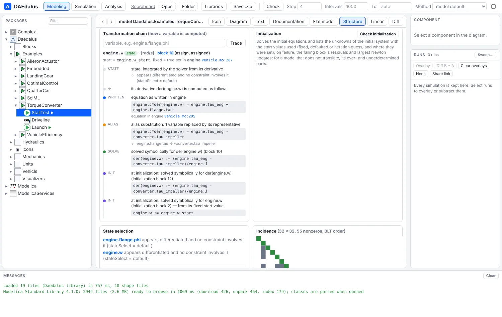
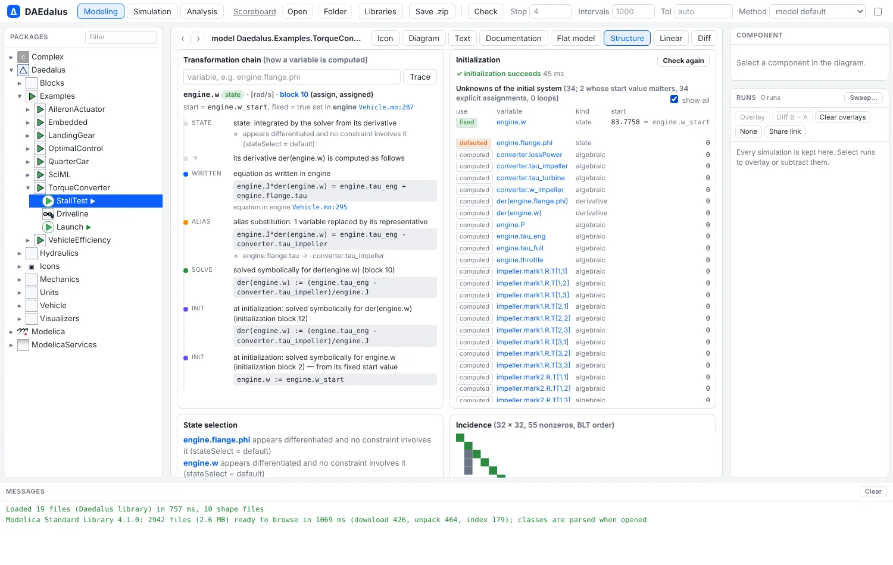

# Equation and initialization debugger

When a model does not translate, does not initialize, or computes a value you did not
expect, `daedalus debug` and the **Structure** tab explain why. Each explanation names
the equations as you wrote them, with their components and source lines.



## How is a variable computed?

`--var` follows a variable through every symbolic step: alias elimination, substitution,
differentiation for index reduction, dummy derivatives, solving for it and tearing. Each
step names the equation as written, the component it came from and its file and line.

```sh
daedalus debug crates/daedalus-core/tests/models/debug.mo -m Debug.DiodeLoop --var d.i
```

```
d.i (alias)
  alias of -src.i
  block 0 (nonlinear), tear
transformations:
  1. [alias] eliminated by alias elimination: relates d.i and d.p.i
       d.i = d.p.i
       from equation in d at crates/daedalus-core/tests/models/debug.mo:15:5
  2. [alias] eliminated by alias elimination: relates r.n.i and d.p.i
       r.n.i + d.p.i = 0
       from connection [d.p, r.n]
  ...
  8. [source] equation as written in d
       d.i = d.Is*(exp(d.v/d.Vt) - 1)
       from equation in d at crates/daedalus-core/tests/models/debug.mo:37:5
  9. [alias] alias substitution: 1 variable replaced by its representative
       -src.i = d.Is*(exp(d.v/d.Vt) - 1)
       - d.i → -src.i
  10. [tear] tear variable of a nonlinear loop (block 0, 3 unknowns, 1 tear): Newton iterates on it until the residual equations vanish
       - tear variables: src.i
```

`--equation N` does the same for an equation.

In the workbench, the **Transformation chain** card of the Structure tab shows the chain of
any variable or equation you click in the blocks or states. Each source position opens
the Text view at that line.

## Why does initialization fail?

`--init` lists the unknowns of the initial system and the start values it used. For each
start value it says whether it is fixed or only a guess, and which modification set it.
For a block that fails, it shows the residuals at the last iterate and the variables with
the largest Newton update.

```sh
daedalus debug crates/daedalus-core/tests/models/debug.mo -m Debug.InitFail --init
```

```
initialization of Debug.InitFail: FAILED (initialization)
  error: initialization: nonlinear system for [b.x, b.y] did not converge at t = 0 (residual 2.839e0)
  initial system: 4 unknowns (2 whose start value matters), 2 explicit assignments, 1 loops
start values used:
  fixed     state      s                                    start 0 set in the model at crates/daedalus-core/tests/models/debug.mo:101:20
  guess     algebraic  b.x                                  start 2 (= b.x0) set in b at crates/daedalus-core/tests/models/debug.mo:95:20
  loop (initialization block 0): nonlinear with tears [b.x]
initialization nonlinear solve failed at t = 0 (block 0): nonlinear 1 tear variable(s) [b.x], 1 inner
  solver residual 2.839e0; diagnostic damped Newton re-run: 50 iteration(s), residual 2.840e0
  residual history: 9.39e0 3.72e0 3.56e0 2.90e0 2.85e0 2.85e0 2.84e0 2.84e0 2.84e0 2.84e0 2.84e0 2.84e0
  residuals at the last iterate (largest first):
        2.8396e0  0 = exp(b.x) + b.y^2 - (-1)
                  from equation in Debug.InitFail at crates/daedalus-core/tests/models/debug.mo:104:5
  hint: the residual stops decreasing at a nonzero value: the iteration sits at a minimum of the residual norm, so the equations may have no solution near these values (check signs, parameter values, and the start values of the tear variables)
```

`exp(x) + y² = -1` has no real solution, and the hint says so. `simulate` prints the same
report when initialization fails. When a nonlinear block fails during a run, it names the
block, the time, the iteration count and the residuals of its equations. In the
workbench, the **Initialization** card shows the report, and a failed check or
simulation in the Messages panel links to it.



## Too many or too few equations

When translation fails, `debug` finds the smallest under- or over-determined subset of
equations and lists its equations and unknowns with their component paths. It also
reports physical connectors that are left unconnected:

```sh
daedalus debug crates/daedalus-core/tests/models/debug.mo -m Debug.OpenPin
```

```
  error: model is underdetermined: 6 equations for 7 unknowns (7 variables, 0 of them appear differentiated); no equation for: r3.p.v
structural analysis of the model problem (6 equations, 7 unknowns):
  underdetermined subset 1 (0 equations, 1 unknowns):
    no equation left for: r3.p.v
    components: r3.p
    unknowns: r3.p.v
  hint: r3.p.v belongs to r3, which has unconnected connectors: none of the 2 physical connectors of r3 is connected: the component has no effect
  warning: r2.n (r2.n.i): open end of r2: no current can flow through it (its current is set to zero)
  warning: r3.n (r3.n.i): none of the 2 physical connectors of r3 is connected: the component has no effect
```

Connectors whose unconnected flow is zero by the language rules, such as an open output
terminal, a free flange or a lone ground, only get notes. Over the 521 example models of
the MSL 4.1.0 and the Daedalus library that flatten, this gives two warnings. Both are
real (an `earth` resistor whose pin is left open in the transformer examples), and there
are no false positives.

See also [Structure and state selection](structure.md) for the block structure and the
Jacobian.
