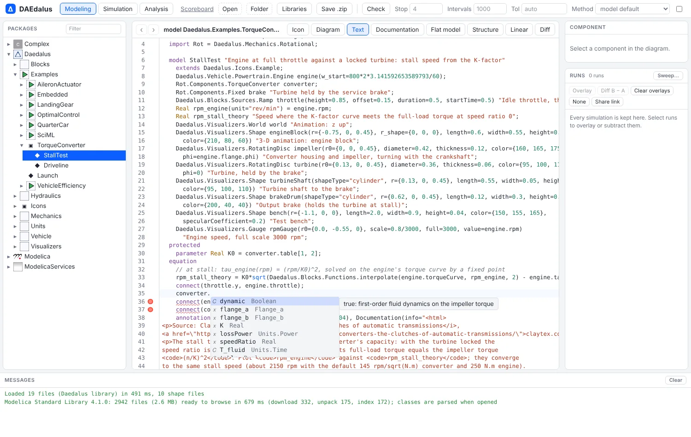
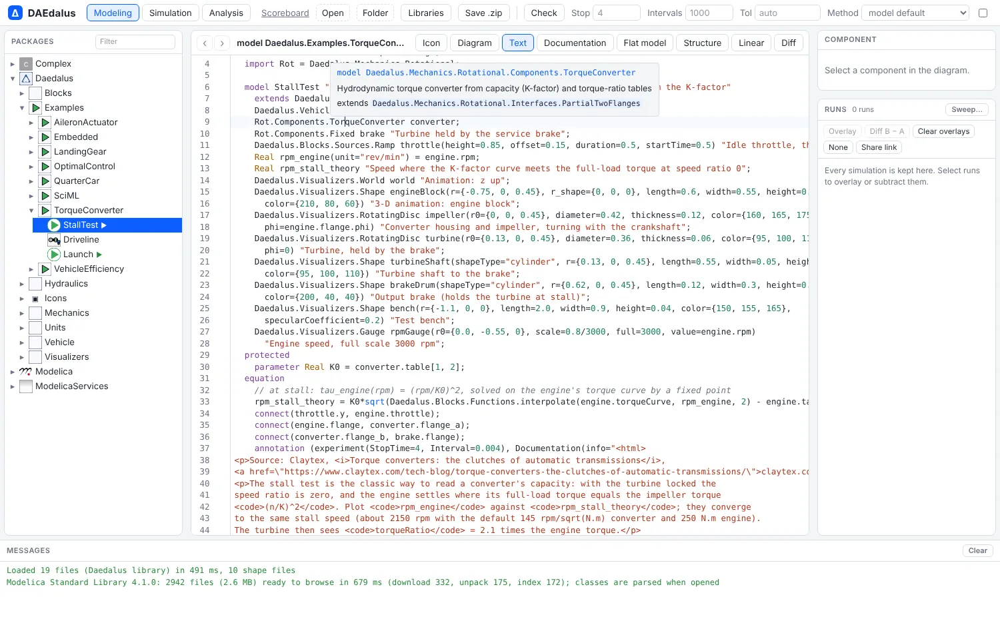
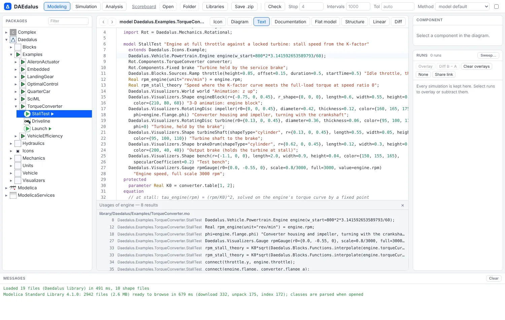

# Text editor

The workbench's Text view is a Modelica editor backed by the compiler's own name lookup
(`crates/daedalus-core/src/ide.rs`, running in the worker). So go-to-definition,
completion and rename follow the same rules the compiler does.

## Keys

| Key | Does |
| --- | --- |
| F12, or Ctrl/Cmd-click | Go to the definition: opens the class that declares the name and selects it |
| Shift+F12 | Find usages across the loaded documents, in a panel; click a row to go there |
| F2 | Rename a class, component or loop index everywhere it is named |
| Ctrl+Space, or just type | Complete: classes and components in scope, members after `a.b.`, modifier names inside `x(...)`, keywords |
| Hover | Declaration, description, declaring class, type and unit |
| Ctrl+Shift+O | Outline of the document's classes and components |

Syntax errors are underlined as you type. Unknown classes are errors, and unknown names,
members and modifiers are warnings. Pressing Enter, or typing `end`, `else` or `equation`,
indents the Modelica way.

<figure><figcaption>Hover on a component type: the class, its description and what it extends</figcaption></figure>
<figure><figcaption>Find usages of engine: 8 results</figcaption></figure>

## Name lookup

Names are resolved with the Modelica lookup rules:

- enclosing classes;
- imports: qualified, renamed, unqualified and selective;
- inherited elements;
- component types for dotted references in equations (`r1.p.v`);
- modifier and named-argument names against the type they modify;
- enumeration literals and `for` indices.

Go to definition on an `outer` component also lists the matching `inner` declarations.
Rename refuses names already taken, keywords, classes stored in their own file, and any
edit to the read-only MSL bundle.

## Speed

Only the edited document is parsed again on each keystroke. While it does not parse, the
last version that did stands in for it, so completion keeps working mid-edit. With the
whole MSL parsed (2,554 files), an update plus completion takes about 6 ms natively. Finding
the 38 uses of `Modelica.Blocks.Sources.Step` takes about 85 ms.
`cargo test -p daedalus-core --test ide` checks that every MSL file and the Daedalus
library resolve without a single diagnostic.

For editing in the diagram, see [Graphical editing](workbench.md#graphical-editing).
