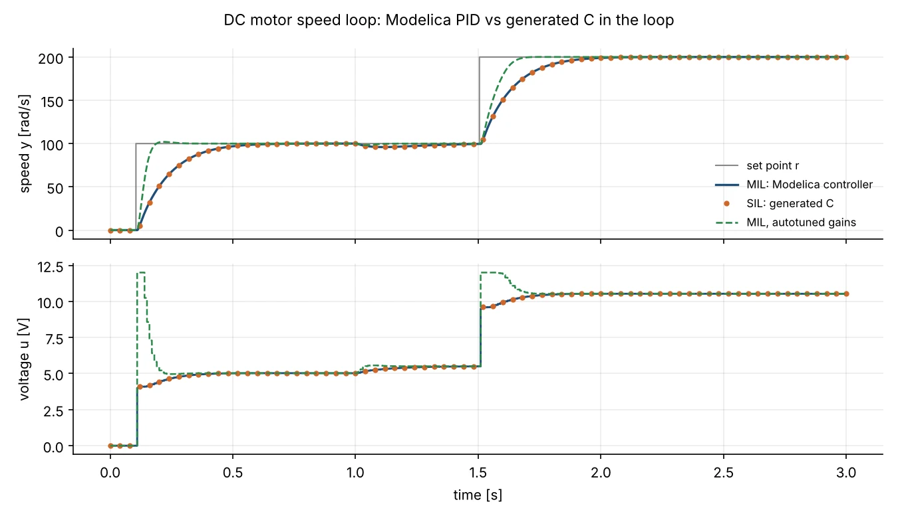

# Embedded C code and processor in the loop

`daedalus codegen-c` turns a Modelica model with top-level inputs and outputs, typically a
controller block, into portable C99 that advances it by a fixed step. `daedalus hil` then
runs that code in closed loop with a plant model simulated by DAEdalus: on your computer
(software in the loop), on an emulated Arduino Uno or ESP32, or on a real board over its
serial port (processor in the loop). Every pull request runs the whole ladder in CI and
compares it with the all-Modelica loop.

| Step | Where the controller runs | Where the plant runs | Command |
| --- | --- | --- | --- |
| Model in the loop (MIL) | DAEdalus | DAEdalus | `daedalus simulate ... -m ClosedLoop` |
| Software in the loop (SIL) | generated C, host build | DAEdalus | `daedalus hil ... --exec ./pid_sil` |
| Processor in the loop (PIL) | generated C on an ATmega328P in simavr, or an ESP32 in QEMU | DAEdalus | `daedalus hil ... --exec "simavr_bridge pid.elf"` |
| Hardware board | generated C on a real Arduino or ESP32 | DAEdalus | `daedalus hil ... --serial /dev/ttyACM0` |

The gains themselves can be tuned on the closed loop first with `daedalus autotune`
(see [Tuning the gains](#tuning-the-gains)).

## The generated code

```sh
daedalus codegen-c library/Daedalus -m Daedalus.Examples.Embedded.DiscretePID \
  --step 0.01 --prefix pid --hil -o pid
```

```text
wrote 19 files to pid: 2 inputs, 1 outputs, 0 states, 0 algebraic loops;
36 persistent registers (151 bytes of RAM per instance, float)
  input  0   r (PID_IN_r)
  input  1   y (PID_IN_y)
  output 0   u (PID_OUT_u)
```

`pid.h` and `pid.c` are all a project needs:

```c
#include "pid.h"

static pid_t ctl;

void setup(void)
{
    pid_init(&ctl);                       /* parameters and default inputs */
    pid_set_input(&ctl, PID_IN_r, 0.0f);
    pid_set_input(&ctl, PID_IN_y, read_speed());
    pid_start(&ctl);                      /* initial equations and events at t = 0 */
}

void every_10_ms(void)                     /* timer interrupt or RTOS task */
{
    pid_set_input(&ctl, PID_IN_r, setpoint);
    pid_set_input(&ctl, PID_IN_y, read_speed());
    if (pid_step(&ctl) != PID_OK) fault();
    write_pwm(pid_get_output(&ctl, PID_OUT_u));
}
```

What the code does and does not do:

- **No heap, no recursion, no I/O.** One `struct` per instance holds all state, so several
  controllers can run side by side. Every loop has a fixed bound.
- **`float` or `double`** (`--real`), chosen at generation time. Use `float` on AVR (where
  `double` is 32-bit anyway) and on the ESP32's single-precision FPU.
- **Continuous states** are integrated with classic RK4 (default) or explicit Euler
  (`--integrator euler`), one step per call. Inputs are held for the step.
- **Events.** Relations are latched during the step and checked at its end; `when`,
  `sample`, `pre`, `reinit`, `terminate` and `assert` follow the same event iteration as the
  simulator. A `sample(start, interval)` whose instants fall on step boundaries fires
  exactly there, so a discrete controller sampled at the step size is reproduced to
  rounding.
- **Algebraic loops** are solved with damped Newton on the exact symbolic Jacobian and a
  small LU with partial pivoting on the stack.
- **Lookup tables** (linear, constant and Akima/Fritsch-Butland segments, periodic
  extrapolation) become `const` arrays.
- **Small.** A register used by one function only becomes a local variable, constants
  become literals, and dead code is removed, so the persistent state is only what has to
  survive between calls: the discrete PID above needs 151 bytes of RAM and 5.2 kB of flash
  on an ATmega328P.
- **Clean.** The generated code compiles without warnings under
  `-std=c99 -Wall -Wextra -Wconversion -Wshadow -pedantic`.
- **Parameters** are computed once in `init`; `-p name=value` bakes other values in.
- **Assertions** outside `when` clauses are checked after every step and set the
  `ASSERTION` status bit, as the simulator would stop on them.
- **Long runs.** Time is the start time plus the step count times the step. In `float`
  consecutive sample times stay distinct for 2^24 steps (4.6 hours at 1 ms; `codegen-c`
  prints the limit): restart the controller (`start`) before then, or use `double`.
- **Not supported yet:** `delay()`, functions with `while` loops, external C functions
  and 2-D tables (`codegen-c` says so and stops). Fixed-step integration of a stiff
  plant needs a small step: generate code for controllers and simple plants, and
  simulate stiff physics in DAEdalus.

`pid.json` lists the inputs, outputs, step and RAM size; `daedalus hil` reads it.
`pid_main.c` is a small host driver that reads one line of inputs per step on stdin and
prints the outputs, for scripted tests.

## The controller in symbols

The PID controller computes the control signal from the error $e = r - y$ (set point minus
measurement):

$$
u(t) = K_p\Bigl(e(t) + \frac{1}{T_i}\int_0^t e\,d\tau - T_d\,\frac{dy}{dt}\Bigr)
$$

The integral term removes steady error, and the derivative term reacts to how fast the output
moves. The `DiscretePID` model runs the same law once every sample $T_s$ (10 ms here). The derivative
is a filtered backward-Euler difference of the measurement, with filter time constant $T_f$:

$$
D_k = \frac{T_f\,D_{k-1} - K_d\,(y_k - y_{k-1})}{T_f + T_s}
$$

It acts on $y$, not on the error, so a step in the set point does not kick the output. The
integral is updated only while the output is not saturated (conditional integration), which
is the anti-windup.

Tuning means choosing $K_p$, $T_i$ and $T_d$. Two ways are shown below: a closed-form rule from a
step response, as in [Linear analysis](linear-analysis.md), and a search on the closed loop
with `autotune`, which accounts for sampling and limits.

## Closing the loop

The example package `Daedalus.Examples.Embedded` holds a DC motor speed loop:

- `DiscretePID`: a sampled PID (10 ms) with anti-windup and derivative on the measurement,
  written the way it runs on a microcontroller;
- `SpeedPI`: the library's continuous PI with output limits, discretised by the generator;
- `MotorBench`: the plant side (DC motor, load step at 1 s, set-point profile), with the
  motor voltage `u` as its top-level input and `r` and `y` as outputs;
- `ClosedLoop` and `ClosedLoopPI`: the bench and a controller connected, the MIL reference.

`daedalus hil` simulates the bench and, at every sample, sends the bench variables named
like the controller's inputs to the controller and applies its outputs to the bench inputs
of the same name (`--map port=variable` wires them otherwise):

```sh
make -C pid/hil/host
daedalus hil library/Daedalus -m Daedalus.Examples.Embedded.MotorBench \
  --controller pid/pid.json --exec pid/hil/host/pid_sil --stop 3 -o sil.csv
```

The result has one row per sample: time, the controller's inputs and outputs, the cycles
the step took on the target, and any bench variables given with `--vars`.



The generated C (dots) follows the Modelica controller (line) sample for sample, through
the set-point steps at 0.1 s and 1.5 s and the load step at 1 s. The dashed curve uses the
gains `autotune` finds below.

### Tuning the gains

`daedalus autotune` tunes controller parameters on the closed loop against a step-response
specification: it minimizes an error integral (ITAE by default) over a window around a
set-point step while keeping overshoot, control effort and settling time within limits.
It simulates the nonlinear loop, so sampling, output limits and anti-windup are part of
the tuning, and searches the gains on a log scale between their bounds:

```sh
daedalus autotune library/Daedalus -m Daedalus.Examples.Embedded.ClosedLoop \
  --gain pid.kp=0.004:0.4 --gain pid.ki=0.04:4 --gain pid.kd=0.00005:0.005 \
  --reference bench.r --measurement bench.y --control pid.u \
  --window 0.1,1.5 --overshoot 2
```

```text
autotune of Daedalus.Examples.Embedded.ClosedLoop: 192 runs, 98 iterations; meets the specification

gain                             before          tuned
pid.kp                      4.000000e-2    1.932174e-1
pid.ki                      4.000000e-1     3.656807e0
pid.kd                      5.000000e-4    6.751172e-5

response                         before          tuned   limit
ITAE                             2.7004         0.2348
overshoot (%)                    0.0240         2.0000   2
rise time 10-90 % (s)            0.2560         0.0470
settling time 2 % (s)            1.2000         0.0800
final error (%)                  0.5048         0.0000
max |control|                    5.4973        12.0000

modifier: (pid(kp = 0.1932174, ki = 3.6568069, kd = 6.7511716e-5))
```

The window here covers the set-point step at 0.1 s and the load step at 1 s, so the
tuning trades tracking against disturbance rejection; the run takes under a second. Bake
the tuned gains into the firmware with `codegen-c -p kp=0.193 -p ki=3.66 -p kd=6.75e-5`.
`--max-control` limits the controller output, `--settling` the 2 % settling time, and
`--criterion iae|ise` changes what is minimized. A good starting point for the bounds
is the hand-tuned gain divided and multiplied by 10.

### Arduino Uno in simavr

`pid/hil/avr` builds the firmware with avr-gcc (no Arduino core needed) for an ATmega328P
at 16 MHz, talking over USART0 at 115200 baud. `tools/embedded/simavr_bridge.c` runs it in
[simavr](https://github.com/buserror/simavr), cycle-accurate, with the serial port on
stdin/stdout:

```sh
sudo apt install gcc-avr avr-libc simavr libsimavr-dev libelf-dev
cc -O2 -o simavr_bridge tools/embedded/simavr_bridge.c -lsimavr -lelf
make -C pid/hil/avr
daedalus hil library/Daedalus -m Daedalus.Examples.Embedded.MotorBench \
  --controller pid/pid.json --exec "./simavr_bridge pid/hil/avr/pid.elf" --stop 3 -o avr.csv
```

```text
301 samples of 0.01 s in closed loop in 0.16 s wall-clock
controller step: 33358 cycles on average, 35832 at most
```

At 16 MHz the PID step takes about 2.1 ms of its 10 ms period; the firmware measures it
with Timer1. Flash the same `pid.hex` with avrdude and replace `--exec` with
`--serial /dev/ttyACM0` to run on a real Uno.

### ESP32 in QEMU

`pid/hil/esp32` builds a bare-metal ESP32 program (no ESP-IDF): the mask ROM loads it from
flash offset 0x1000, it enables the FPU, switches off the watchdogs and talks on UART0.
It runs on a real ESP32 and in Espressif's QEMU:

```sh
# Espressif's toolchain and QEMU: see the "embedded" job in .github/workflows/ci.yml
pip install esptool
make -C pid/hil/esp32
daedalus hil library/Daedalus -m Daedalus.Examples.Embedded.MotorBench --controller pid/pid.json \
  --exec "qemu-system-xtensa -machine esp32 -nographic -monitor none -serial stdio \
          -drive file=pid/hil/esp32/pid_flash.bin,if=mtd,format=raw -nic none" -o esp32.csv
```

QEMU is not cycle-accurate, so its cycle counts are only indicative; on a real board the
firmware reads the CCOUNT register.

### Any Arduino board

`pid/hil/arduino/pid_hil/` is a complete sketch (the generated code included) for the
Arduino IDE or `arduino-cli`, for Uno, Nano, Mega and ESP32 boards. It uses the Arduino
core's `Serial` and `micros()`, so it runs on any board with a serial port:

```sh
arduino-cli compile --fqbn arduino:avr:uno pid/hil/arduino/pid_hil --output-dir uno
arduino-cli upload  --fqbn arduino:avr:uno -p /dev/ttyACM0 pid/hil/arduino/pid_hil
daedalus hil library/Daedalus -m Daedalus.Examples.Embedded.MotorBench \
  --controller pid/pid.json --serial /dev/ttyACM0 -o board.csv
```

The Uno build also runs in simavr (`--exec "./simavr_bridge uno/pid_hil.ino.elf"`): with
the Arduino core it uses 6.1 kB of flash and 483 bytes of RAM, and the step takes 32,000
cycles. The ESP32 build (`--fqbn esp32:esp32:esp32`, Arduino-ESP32 3.x) runs on a real
board; Espressif's QEMU does not boot the Arduino-ESP32 runtime (it stops on a cache
error during start-up), which is why the emulated ESP32 run uses the bare-metal build.

## Checking the results

`tools/embedded/pil_test.sh` runs the whole ladder and compares every run with the
Modelica loop (`tools/embedded/compare.py`); CI runs it with the `arduino` target too:

| Controller | Target | Max relative error u | Max relative error y | Cycles per step |
| --- | --- | --- | --- | --- |
| discrete PID, float | host | 3.2e-07 | 2.4e-07 | |
| discrete PID, double | host | 9.1e-08 | 7.5e-08 | |
| continuous PI, RK4 1 ms | host | 3.8e-03 | 1.3e-03 | |
| discrete PID, float | ATmega328P (simavr) | 3.2e-07 | 2.4e-07 | 33,358 (2.1 ms at 16 MHz) |
| continuous PI, RK4 1 ms | ATmega328P (simavr) | 3.8e-03 | 1.3e-03 | 14,212 (0.9 ms) |
| discrete PID, float | ESP32 (QEMU) | 3.2e-07 | 2.4e-07 | not cycle-accurate |
| discrete PID, double | ESP32 (QEMU) | 9.1e-08 | 7.5e-08 | not cycle-accurate |
| discrete PID, float, Arduino sketch | Uno (simavr) | 3.2e-07 | 2.4e-07 | 32,150 |

The discrete PID matches to single-precision rounding on every target. The continuous PI
differs by the sampling of the measurement (zero-order hold at 1 ms) that any digital
implementation adds.

## Wire protocol

The firmware prints `DAEDALUS-HIL <prefix> <inputs> <outputs> <bytes per real>` when it is
ready; anything before that line (boot ROM messages) is ignored. The host then sends
`0xA5 'I'` (first sample) or `0xA5 'S'` (every later sample) followed by the inputs, and
the firmware answers `0x5A status`, the outputs and a 32-bit cycle count. Numbers are
little-endian `float` or `double`, as generated. The board support is four functions in
`hil_hal.h`, so other boards (STM32, RP2040, any RTOS) need only those.

## A note on certification

The generated code is designed to be reviewable (no dynamic memory, bounded loops, one
`struct` of state, warning-free under strict flags), but DAEdalus is not qualified for
DO-178C or ISO 26262 work. Treat the code as you would hand-written code: review it, test
it on the target, and use the SIL and PIL runs above as back-to-back evidence.
