# Examples

`Daedalus.Examples` rebuilds the systems from six public engineering blog posts
by Modelon and Claytex, using components from the bundled library.

The vendor models and parameter sets behind those posts are not public.
Each example therefore states:
- its source;
- what it reproduces;
- the parameter values that were assumed.

The aim is the same physics and the same kind of result plot, not identical
numbers. Every example has a regression test in
`crates/daedalus-core/tests/library.rs`, and CI simulates them all.

Every example also has a [3-D animation](animation.md), as Dymola gives 1-D libraries: open it
in the workbench, **Simulate**, and switch to **Animation**. The shapes come
from `Daedalus.Visualizers`, which has the result variables of MultiBody's
`Advanced.Shape` without needing the Modelica Standard Library, bound to the
example's positions, angles and speeds. They draw only and change no result.
- QuarterCar and OptimalControl.ActiveSuspension: road pad, tyre, coil spring,
  damper and body for each lane, with the actuator force as an arrow.
- LandingGear: a wing segment, the oleo strut stroking and the twin wheels on
  the runway, one lane per sink rate.
- AileronActuator and OptimalControl.AileronServo: the wing, the aileron
  turning on its hinge, the control horn and the actuator rod; SpeedVsLoad
  shows the load pushed along the bench.
- TorqueConverter.StallTest: engine, the converter turning with the crankshaft,
  the held turbine and brake, and an engine-speed gauge.
- TorqueConverter.Launch and VehicleEfficiency: saloon cars (meshes in
  `Resources/Shapes`, made by `generate.py` there) driving side by side, one
  per variant, with the wheels turning. Long drive cycles replay at 10 to 100x.

<div class="pair">
<figure></figure>
<figure></figure>
</div>

Run any one of them with:

```sh
./target/release/daedalus simulate library/Daedalus -m Daedalus.Examples.<Package>.<Model> -o out.mat
```

Or open it in the workbench and press **Simulate**.

| Example | Source | States | Steps | CPU |
| --- | --- | ---: | ---: | ---: |
| TorqueConverter.StallTest | Claytex | 2 | 158 | 2 ms |
| TorqueConverter.Launch | Claytex | 9 | 644 | 13 ms |
| LandingGear.SinkRates | Modelon | 15 | 913 | 10 ms |
| AileronActuator.PositionControl | Modelon | 6 | 2,718 | 15 ms |
| AileronActuator.SpeedVsLoad | Modelon | 6 | 5,392 | 24 ms |
| QuarterCar.BumpComparison | Claytex | 22 | 1,563 | 28 ms |
| VehicleEfficiency.NEDCSensitivity | Claytex | 28 | 108,900 | 2.3 s |
| VehicleEfficiency.CoastDown | Modelon | 2 | 55 | 1 ms |
| VehicleEfficiency.UDDSEnergy | Modelon | 12 | 30,715 | 0.34 s |

Times are from `daedalus test-library library/Daedalus -m Daedalus` in a
release build, including translation.

## Mechanical and automotive

### Torque converter: stall test and launch

*Source: Claytex, "Torque converters: the clutches of automatic transmissions"
(claytex.com/tech-blog/torque-converters-the-clutches-of-automatic-transmissions/).*

**StallTest** holds the turbine and runs the engine at full throttle. The engine
settles where its full-load torque equals the impeller torque `(n/K)^2`.
- Simulated stall speed: **2160 rpm**.
- The K-factor prediction agrees to within 1 rpm.
- The turbine sees 2.1 times the engine torque.

**Launch** runs a full-throttle launch twice:
- once with a static K-factor converter;
- once with a 50 ms fluid torque build-up lag.

In both cases the engine flares toward stall speed and the torque ratio falls
to 1 at the coupling point. The lock-up clutch then closes and pulls the engine
down to turbine speed.

Assumed values:
- a generic three-element converter, K = 145 rpm/√(N·m);
- a 250 N·m engine;
- a 1700 kg car, first gear 4.2, final drive 3.2.

<div class="pair">
<figure>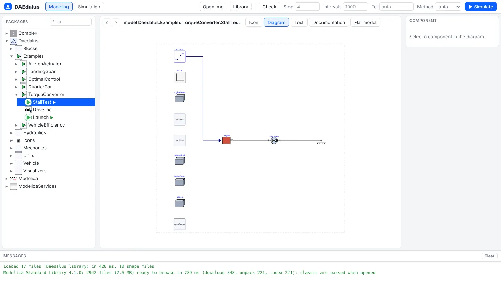</figure>
<figure></figure>
</div>

[Open TorqueConverter.StallTest](https://daedalus.apps.ezkeel.com/#Daedalus.Examples.TorqueConverter.StallTest)

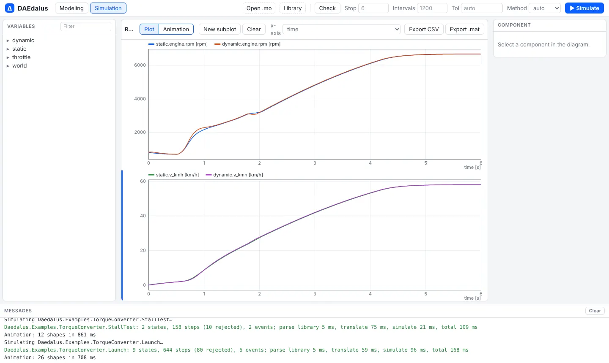

[Open TorqueConverter.Launch](https://daedalus.apps.ezkeel.com/#Daedalus.Examples.TorqueConverter.Launch)

### Quarter car with a physical hydraulic damper

*Source: Claytex, "A look inside VeSyMA's quarter car models"
(claytex.com/tech-blog/a-look-inside-vesymas-quarter-car-models/).*

Three identical corners cross the same 50 mm bump at 10 m/s:
- one with an ideal linear damper;
- two with a monotube damper built from hydraulic components (rebound and
  compression valves, a bleed orifice and a gas-charged floating piston), once
  with clean oil and once with 2 % entrained air.

The tyre is an `ElastoGap`, so the wheel can leave the road.

Results:
- The hydraulic damper's force-velocity curve is asymmetric and digressive
  (`clean.damper.F_damper` against `clean.damper.v_damper`).
- Aerated oil adds series compliance, which shows as a hysteresis loop.
- All three bodies return to ride height (0.6 m) within 2 mm.

Assumed values:
- 400 kg quarter body and 40 kg wheel;
- 30 kN/m spring and 250 kN/m tyre;
- 46 mm piston and a 20 bar gas charge.

<div class="pair">
<figure>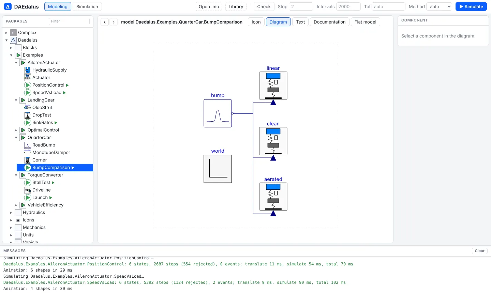</figure>
<figure></figure>
</div>

[Open QuarterCar.BumpComparison](https://daedalus.apps.ezkeel.com/#Daedalus.Examples.QuarterCar.BumpComparison)

### Vehicle efficiency sensitivity over NEDC

*Source: Claytex, "Sensitivity testing of vehicle efficiency using VeSyMA drive
cycle" (claytex.com/tech-blog/sensitivity-testing-of-vehicle-efficiency-using-vesyma-drive-cycle/).*

Four copies of an electric car drive 11 back-to-back NEDC cycles (12,980 s):

| Case | Wh/km | vs baseline |
| --- | ---: | ---: |
| Baseline, flat road, still air | 100 | |
| 2 % grade | 192 | +92 % |
| 25 mph wind at 30° yaw | 156 | +56 % |
| Roof box (+50 kg, +0.12 m² drag area) | 109 | +8.9 % |

Crosswind raises drag through the yaw-dependent drag coefficient
`Cd·(1 + k_yaw·β²)`.

Assumed values:
- 1650 kg car, Cd 0.29, frontal area 2.3 m², crr 0.009;
- 350 N·m / 150 kW machine with copper and iron losses;
- 9:1 reduction;
- 75 kWh pack.

<div class="pair">
<figure>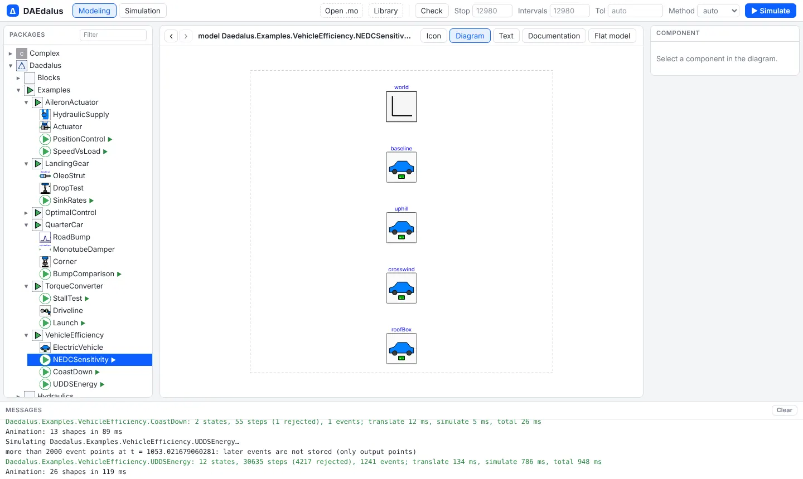</figure>
<figure>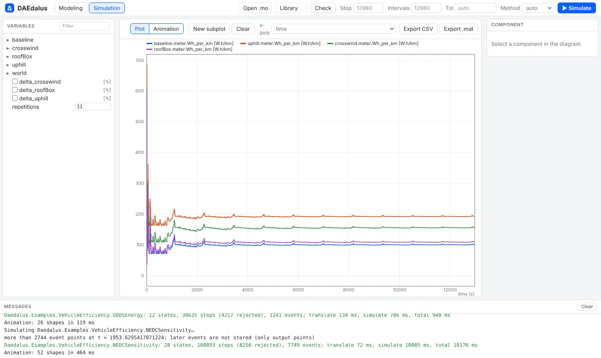</figure>
</div>

[Open VehicleEfficiency.NEDCSensitivity](https://daedalus.apps.ezkeel.com/#Daedalus.Examples.VehicleEfficiency.NEDCSensitivity)

### Coast-down and road-load coefficients

*Source: Modelon, "Advancing your vehicle's energy-efficient design"
(modelon.com/blog/advancing-your-vehicles-energy-efficient-design/).*

**CoastDown** lets the car roll from 130 km/h in neutral and terminates at
15 km/h. `tools/fit_coastdown.py` fits the recovered force to
`F0 + F1·v + F2·v²`, giving F0 = 145.7 N, F1 = 0 and F2 = 0.4002 N/(m/s)².
That is exactly the physical rolling resistance and aerodynamic drag, as
expected.

**UDDSEnergy** drives the EPA UDDS cycle twice:
- once with the physical body;
- once with a road-load vehicle that uses the fitted coefficients.

The two energy consumptions differ by **0.007 %**. The UDDS schedule comes from
NREL FASTSim.

<div class="pair">
<figure>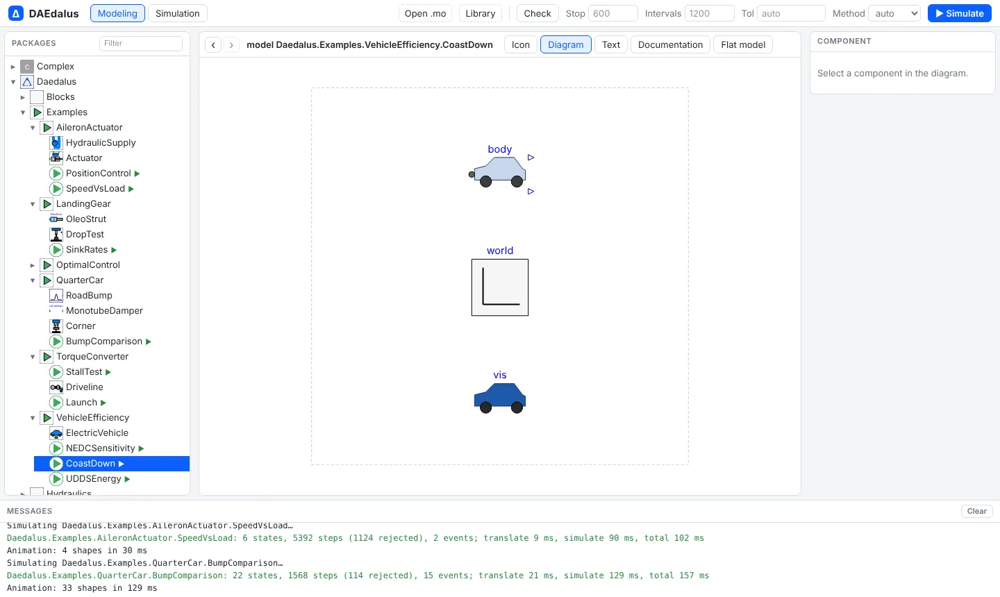</figure>
<figure>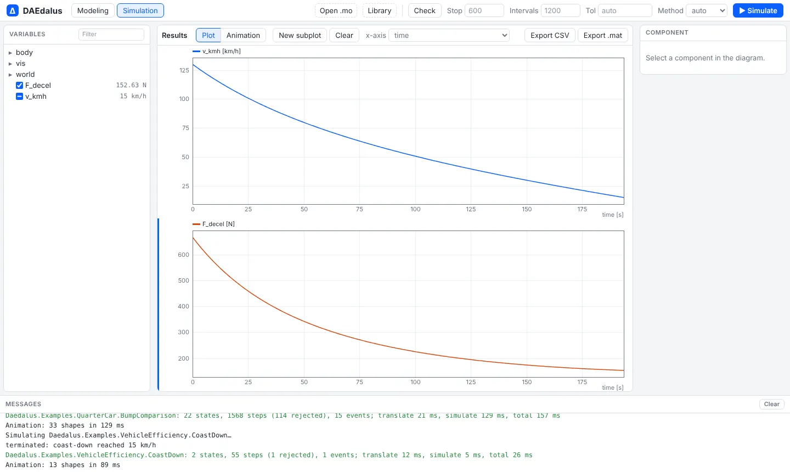</figure>
</div>

[Open VehicleEfficiency.CoastDown](https://daedalus.apps.ezkeel.com/#Daedalus.Examples.VehicleEfficiency.CoastDown)

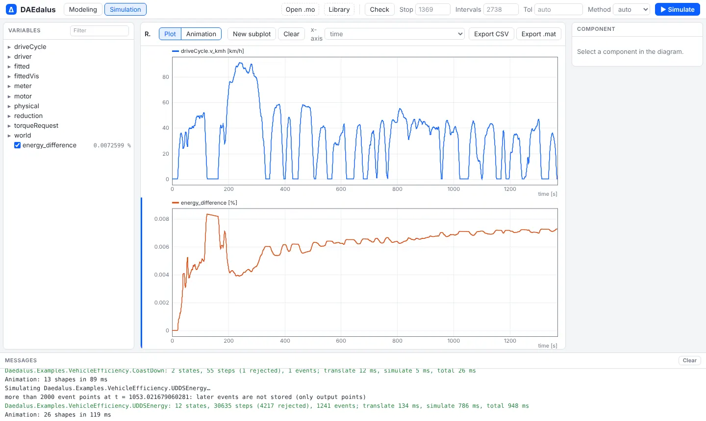

[Open VehicleEfficiency.UDDSEnergy](https://daedalus.apps.ezkeel.com/#Daedalus.Examples.VehicleEfficiency.UDDSEnergy)

## Hydraulic and aerospace

### Landing-gear drop test

*Source: Modelon, "Aircraft landing gear design"
(modelon.com/blog/aircraft-landing-gear-design/).*

This is a CS/FAR 25.723 style drop test. The sprung mass sits on an
oleo-pneumatic strut, with a polytropic gas spring, a quadratic orifice, seal
friction and end stops. The unsprung axle rides on a tyre, and wing lift equals
the weight.

| Sink rate | Load factor |
| ---: | ---: |
| 2.0 m/s | 1.03 |
| 3.05 m/s (limit) | 1.56 |
| 3.66 m/s (reserve energy) | 1.93 |

The strut does not bottom out in the reserve-energy drop. The force-stroke loop
(`limit.strut.F_strut` against `limit.strut.x`) gives a shock-absorber
efficiency near 0.9.

Assumed values:
- 10 t per main gear;
- 150 mm piston and 0.4 m stroke;
- 30 bar precharge and a 5 cm² orifice;
- polytropic exponent 1.3;
- 2 MN/m tyre.

<div class="pair">
<figure>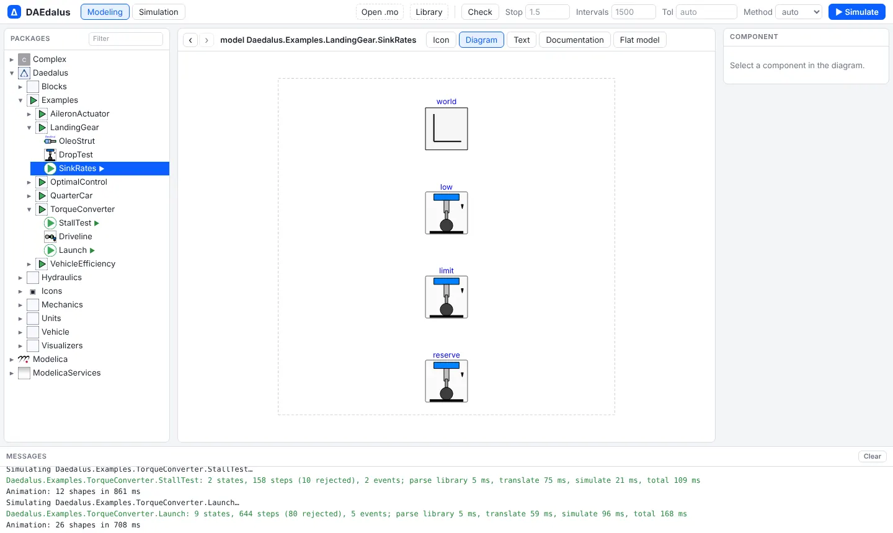</figure>
<figure>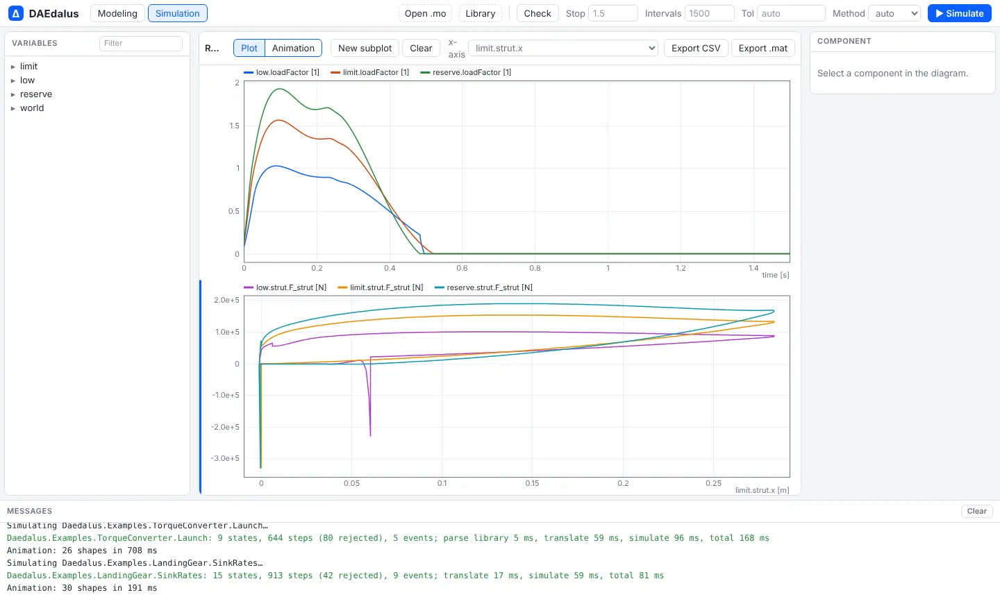</figure>
</div>

[Open LandingGear.SinkRates](https://daedalus.apps.ezkeel.com/#Daedalus.Examples.LandingGear.SinkRates)

### Aileron actuator

*Source: Modelon, "Modeling and simulation of aircraft aileron actuator"
(modelon.com/blog/modeling-and-simulation-of-aircraft-aileron-actuator/).*

The system:
- a 3000 psi supply with a 50 psi return and 3 m lines;
- a flow-control servo valve with second-order spool dynamics;
- a balanced through-rod cylinder that moves the aileron through a control
  horn, against an aerodynamic hinge moment.

**PositionControl** steps the command to +10° and then to −10°, followed by a
sine. The surface reaches each step within 0.2°.

**SpeedVsLoad** holds the valve fully open and ramps the opposing force to 95 %
of stall force. The rod speed falls monotonically with load and stays below the
ideal square-root valve law, because of line losses, friction and laminar flow
at small openings. It is still moving at 95 % load.

Assumed values:
- 40 mm bore, 20 mm rods, 60 mm stroke;
- a 20 l/min valve at 70 bar with a 100 Hz spool;
- an 80 mm horn.

<div class="pair">
<figure>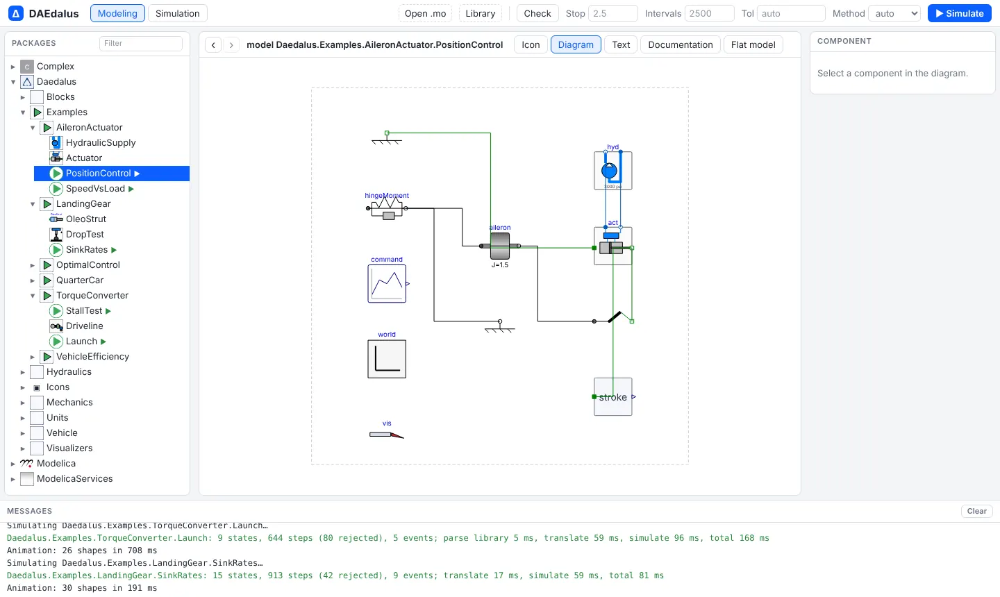</figure>
<figure>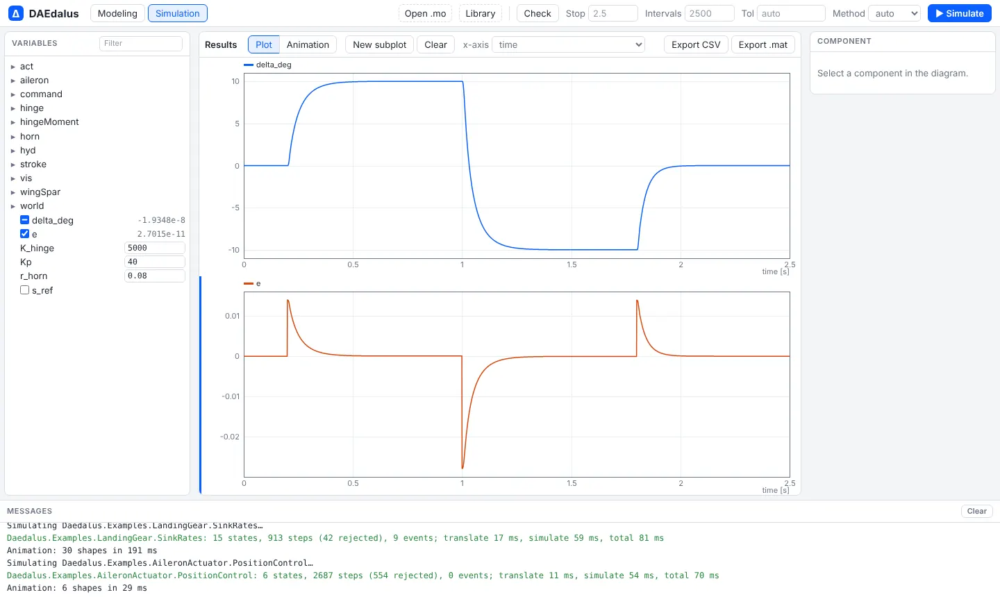</figure>
</div>

[Open AileronActuator.PositionControl](https://daedalus.apps.ezkeel.com/#Daedalus.Examples.AileronActuator.PositionControl)

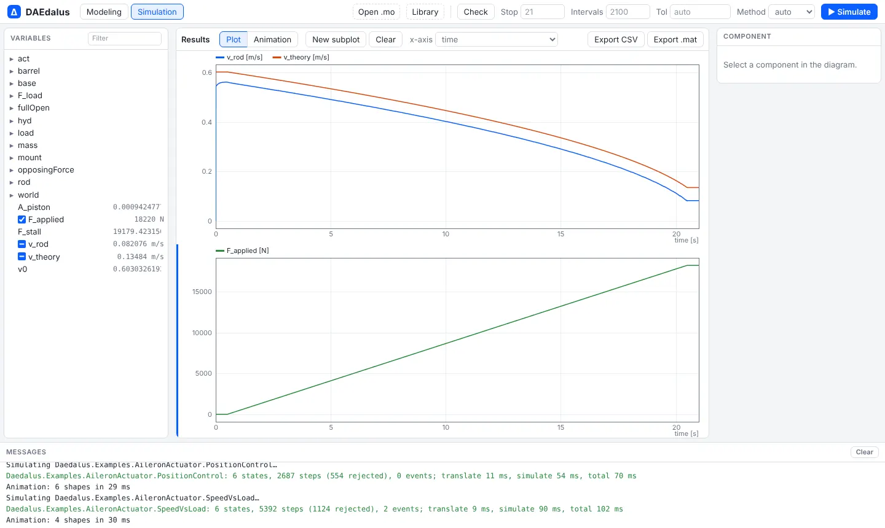

[Open AileronActuator.SpeedVsLoad](https://daedalus.apps.ezkeel.com/#Daedalus.Examples.AileronActuator.SpeedVsLoad)

## Multibody suspension and full vehicle

`library/MultiBodyVehicle` has suspension corners, test rigs and a full car built on
`Modelica.Mechanics.MultiBody`, with nine examples checked against OpenModelica. They have
their own page: [Multibody vehicles](multibody.md).

## Optimal control plants

`Daedalus.Examples.OptimalControl` holds three plants whose control or unknown
inputs are top-level `input` variables or free parameters. They are solved with
CasADi from `python/examples/`; see [optimal-control.md](optimal-control.md).
- **AileronServo**: the aileron actuator without its position loop. The
  servo-valve command `u` is the input.
- **ActiveSuspension**: a quarter car with a force actuator `F_act` and a soft
  passive damper, over the same 50 mm bump.
- **CoastDownTest**: the coast-down without the stop at 15 km/h. It is used to
  estimate `body.Cd` and `body.crr`.

## Note on sources

From the build environment, modelon.com and claytex.com returned HTTP 403.
The examples were therefore built from what the posts describe:
- the system;
- the test procedure;
- the quantities plotted.

They were not checked against the posts' exact figures.
