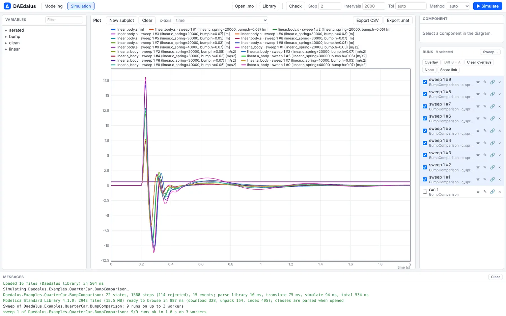
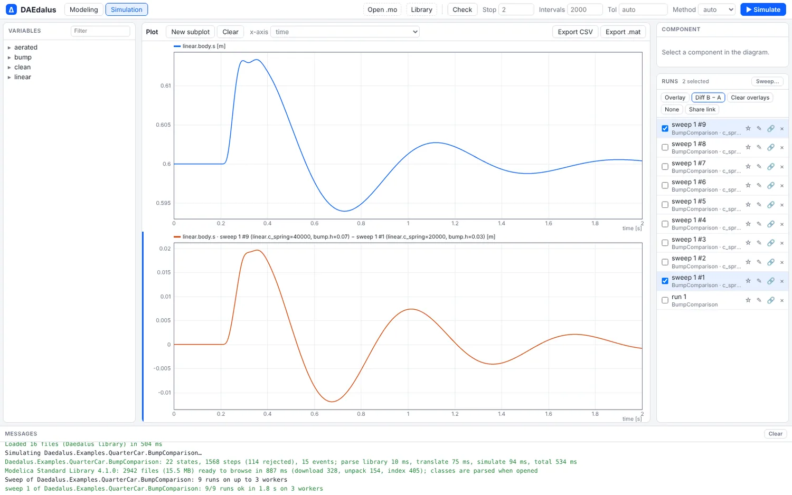
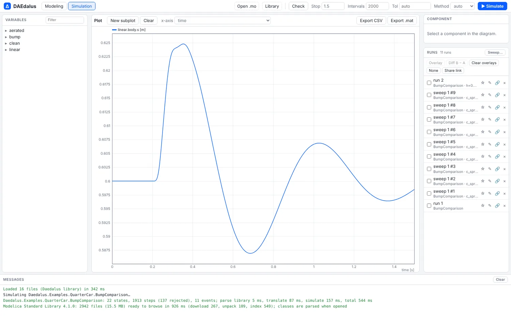
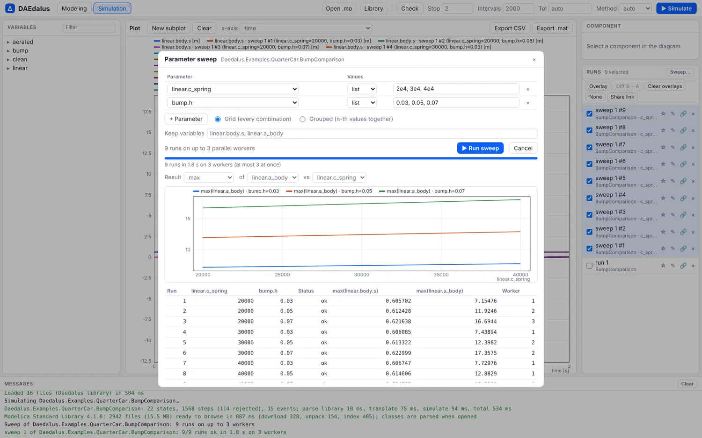

# Experiments: sweeps, runs and share links

Every simulation in the workbench is kept as a run you can overlay, subtract or share,
and a parameter sweep fans out over all your cores, in the browser or on the command
line.



## Runs

Each **Simulate** stores a run in the **Runs** pane: the model, its parameter overrides,
the settings, the time and the plotted variables. Runs are kept in the browser across
reloads and can be renamed, pinned and deleted.

- **Overlay** plots the active subplot's variables for every selected run. The legend
  names the run and the parameter values that differ.
- **Diff B − A** plots the newer of two selected runs minus the older one, interpolated on
  the union of their time grids.

<div class="pair">
<figure><figcaption>Diff B − A: the stiffest, highest-bump run minus the softest, lowest-bump one.</figcaption></figure>
<figure><figcaption>A share link reopens the model, applies the overrides, simulates and plots.</figcaption></figure>
</div>

## Sweeps in the workbench

**Sweep…** in the Runs pane picks one or more editable parameters, each with a list,
linear or logarithmic set of values, combined as a full grid or grouped (the n-th values
together), and the variables to keep. The runs fan out over a pool of Web Workers, one
per core up to eight, each of which translates the model once and reuses it for every
run. A summary table and a plot of a scalar result (final value, maximum, minimum or
mean) against a parameter follow, and the runs are overlaid in the plot.



## Share links

**Share link** copies an address that reopens the model with its overrides and settings,
simulates it and plots the chosen variables. This one opens the quarter car with a 7 cm
bump and a 40 kN/m spring:

[QuarterCar.BumpComparison with h = 0.07 and c = 40000](https://daedalus.apps.ezkeel.com/#Daedalus.Examples.QuarterCar.BumpComparison?p.bump.h=0.07&p.linear.c_spring=40000&stop=1.5&plot=linear.body.s)

A plain `#Model.Name` still just opens the model.

## Sweeps on the command line

`daedalus sweep` translates the model once and simulates every combination on its own
thread:

```sh
daedalus sweep library/Daedalus -m Daedalus.Examples.QuarterCar.BumpComparison \
    -s linear.c_spring=lin:20e3:40e3:3 -s bump.h=0.03,0.05,0.07 \
    --vars linear.body.s,linear.a_body --stats max
```

```
sweep of Daedalus.Examples.QuarterCar.BumpComparison: 9 runs (2 parameters, grid), 0 extra translations in 0 ms, 4 threads
9/9 runs ok in 268 ms
run  linear.c_spring  bump.h  status  max(linear.body.s)  max(linear.a_body)  error
  1            20000    0.03      ok            0.605702             7.15476
  2            20000    0.05      ok            0.612428             11.9246
  3            20000    0.07      ok            0.621638             16.6944
  4            30000    0.03      ok            0.606085             7.43894
  5            30000    0.05      ok            0.613322             12.3982
  6            30000    0.07      ok            0.622999             17.3575
  7            40000    0.03      ok            0.606747             7.72976
  8            40000    0.05      ok            0.614606             12.8829
  9            40000    0.07      ok            0.624765             18.0361
```

- Values: a list `1,2,3`, `lin:START:STOP:N` or `log:START:STOP:N`. `--grouped` runs the
  n-th values together instead of the full grid.
- `--stats`: `initial`, `final`, `min`, `max`, `mean` (time average) or `at=T` per kept
  variable.
- `-o FILE.csv` writes every run into one CSV; `-o DIR` writes `run_001.csv` and so on
  (or `.mat` with `--format mat`) plus `summary.csv`.
- Free Real parameters change at run time on the shared compiled model. Integer, Boolean
  and computed parameters, which can be structural, are applied as modifiers and
  translated once per distinct value; `--retranslate` forces that for all.

For a sweep inside a Dymola or OpenModelica script, see
[Scripts and steady states](scripting.md); for Python, [Python API](python.md).
