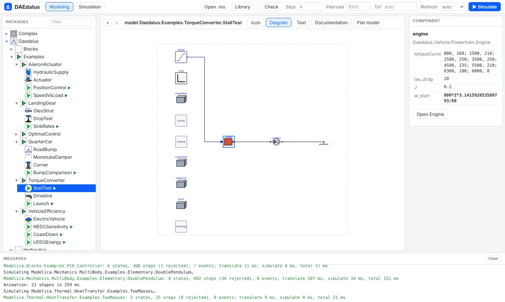
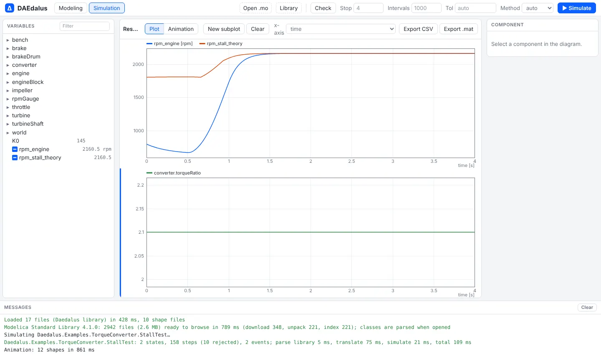

# Getting started

There are three ways to run DAEdalus. The live workbench needs nothing installed; the
release binaries give you the command line; building from source gives you everything,
including the workbench on your own machine.

In plain terms: a release binary is a ready-built program that you download and run. Building
from source means compiling the code yourself, which needs the Rust toolchain.

## 1. The live workbench

Open [daedalus.apps.ezkeel.com](https://daedalus.apps.ezkeel.com/#Daedalus.Examples.TorqueConverter.StallTest). The page
loads the bundled `Daedalus` library first, then the Modelica Standard Library 4.1.0 in the
background (about 2.6 MB, unpacked in the browser).

1. Pick a model in the **Packages** tree on the left. Models with a ▶ have an
   `experiment` annotation and can be simulated as they are; try
   `Daedalus.Examples.TorqueConverter.StallTest`.
2. Look at it in one of the eight views: **Icon**, **Diagram**, **Text**, **Documentation**,
   **Flat model**, **Structure**, **Linear** or **Diff**. Click a component in the diagram
   to see its parameters on the right.
3. The header switches among **Modeling**, **Simulation** and **Analysis**. Press
   **▶ Simulate** (or Ctrl+Enter). The page switches to **Simulation**: the left pane
   becomes the variable browser, and models with shapes open in **Animation**.
4. Switch to **Plot** and tick variables to plot them. **New subplot** adds a plot below,
   and the **x-axis** list turns a subplot into a parametric plot.





Every class has its own address: the URL ends in `#` and the class name, so a link such as
[`/#Modelica.Electrical.Analog.Examples.ChuaCircuit`](https://daedalus.apps.ezkeel.com/#Modelica.Electrical.Analog.Examples.ChuaCircuit)
opens that model directly, and the browser's Back and Forward buttons (or Alt+← and Alt+→)
walk through the classes you opened.

Your own models open with **Open** (single files, plus `.stl` and `.obj` meshes for
3-D shapes), **Folder** (a whole folder, such as a library checkout) or **Libraries**
(a package from the index). **Save .zip** downloads the open model with the files it needs.

Simulation in the page, or through `daedalus serve` on this computer, stays on the machine.
**✦ Assistant** sends the text it reads and the numbers it asks for to OpenRouter, and to the provider of the selected model.

## 2. Release binaries

Each [GitHub Release](https://github.com/ferax564/DAEdalus/releases) has archives for
Linux (x86_64), macOS (Apple Silicon and Intel) and Windows (x86_64). An archive holds the
`daedalus` command line tool, the FMI runtime it bundles into FMUs, and the
`library/Daedalus` example library:

```sh
tar xzf daedalus-v0.2.0-x86_64-unknown-linux-gnu.tar.gz
cd daedalus-v0.2.0-x86_64-unknown-linux-gnu
./daedalus simulate library/Daedalus -m Daedalus.Examples.LandingGear.SinkRates -o sink.mat
```

On macOS, clear the download quarantine first with
`xattr -dr com.apple.quarantine <folder>`, since the binaries are not notarized.

The release also carries the `daedalus-casadi` Python wheel for
[optimal control](optimal-control.md): `pip install daedalus_casadi-*.whl`, with the
extracted folder on `PATH` (or `DAEDALUS_BIN` pointing at the executable).

## 3. From source

You need a Rust toolchain; the workbench also needs Node 22 and `wasm-bindgen-cli` 0.2.129.

```sh
git clone https://github.com/ferax564/DAEdalus
cd DAEdalus
cargo build --release

# Translate a model and print statistics
./target/release/daedalus check library/Daedalus -m Daedalus.Examples.TorqueConverter.StallTest

# Simulate it; results as a Dymola .mat file or as CSV
./target/release/daedalus simulate library/Daedalus -m Daedalus.Examples.QuarterCar.BumpComparison \
    -o bump.csv --vars clean.body.s,aerated.body.s
```

`check` prints what the backend did with the model:

```
model Daedalus.Examples.TorqueConverter.StallTest
  parse 40.2 ms, flatten 4.6 ms, backend 1.6 ms
  flat: 551 variables, 425 equations
  aliases removed: 393
  states: 2 (0 dummy derivatives)
  differentiated equations: 0
  blocks: 32, algebraic loops: 0 (largest 0, 0 tearing vars, 0 linear)
  initialization: 34 blocks, 0 loops
  events: 2 relations, 0 when-clauses
  tape: 317 instructions, 1425 registers
```

To run the workbench locally:

```sh
cd web
npm ci
npm run wasm     # builds crates/daedalus-wasm and runs wasm-bindgen
npm run msl      # downloads MSL 4.1.0 and packs it into public/msl/
npm run dev      # http://localhost:5173
```

Or build the same container the live site runs, which serves the workbench and these docs
with nginx:

```sh
docker build -t daedalus-web .
docker run --rm -p 8080:80 daedalus-web   # workbench at http://localhost:8080, docs at /docs/
```

## Writing a model

DAEdalus reads standard Modelica. A first model, saved as `Pendulum.mo`:

```modelica
model Pendulum "Nonlinear pendulum with damping"
  parameter Real L = 1 "Length [m]";
  parameter Real g = 9.81;
  parameter Real d = 0.2 "Damping";
  Real phi(start = 0.5, fixed = true) "Angle [rad]";
  Real w(start = 0, fixed = true) "Angular velocity [rad/s]";
equation
  der(phi) = w;
  L^2*der(w) = -g*L*sin(phi) - d*w;
  annotation (experiment(StopTime = 10));
end Pendulum;
```

```sh
./target/release/daedalus simulate Pendulum.mo -m Pendulum -o pendulum.csv --vars phi,w
```

In the workbench, **Open** loads the same file into the package browser. Models that
use the bundled library or the MSL need no extra setup in the workbench; on the command
line pass those libraries as extra sources (see [Command line](cli.md)).
