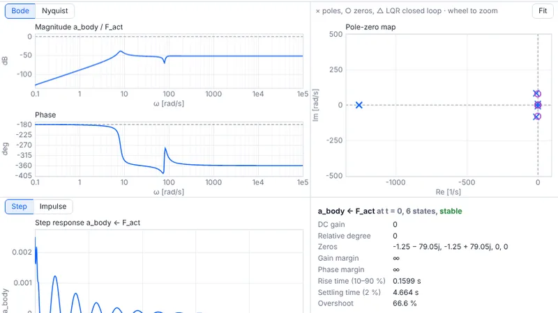
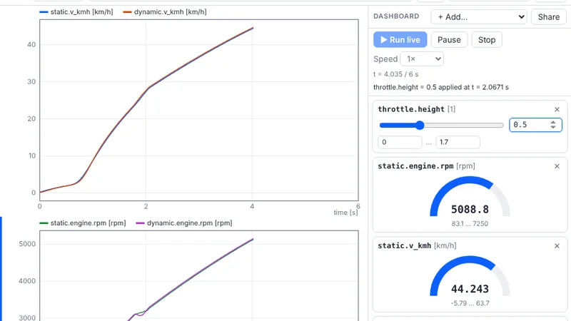
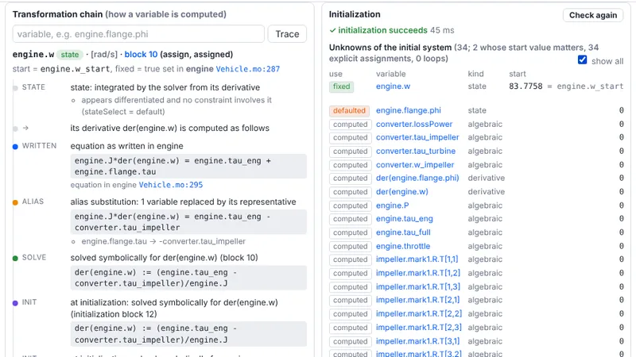
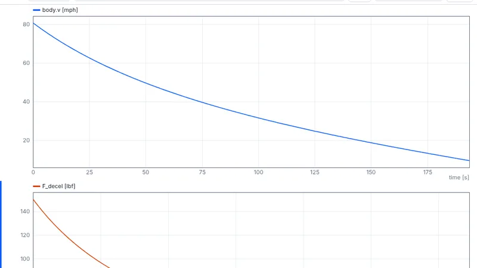
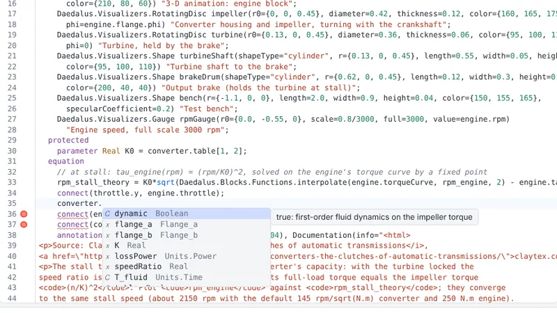
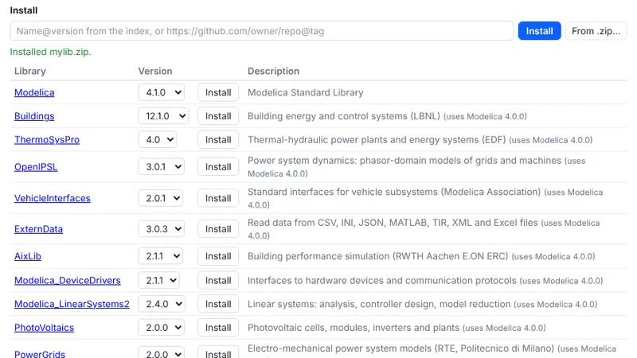
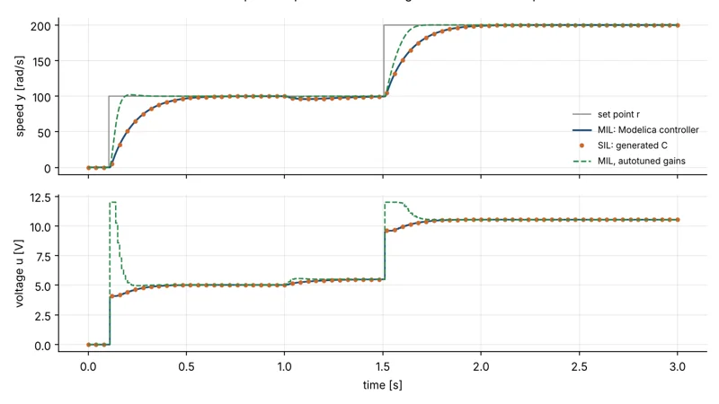
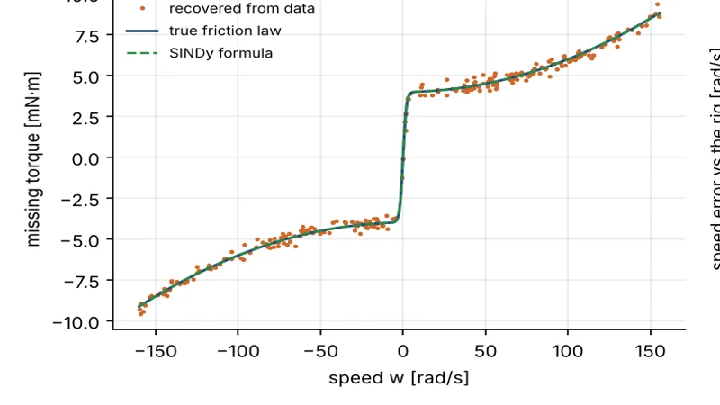
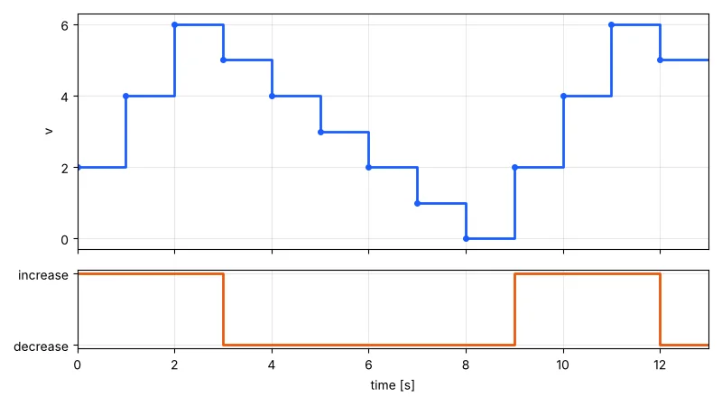

# DAEdalus

An open (Apache-2.0) Modelica modeling and simulation environment. One Rust compiler
and solver runs on the command line, on a server and in a browser tab, with a Dymola-style
workbench, the Modelica Standard Library 4.1.0, 3-D animation, sensitivity and calibration,
FMI export and CasADi optimal control.

  <a class="btn primary" href="https://daedalus.apps.ezkeel.com/#Daedalus.Examples.TorqueConverter.Launch">Open the workbench</a>
  <a class="btn" href="getting-started.md">Get started</a>
  <a class="btn" href="whats-new.md">What's new</a>

The workbench runs entirely in the browser: the compiler and solvers are compiled to
WebAssembly and run in a Web Worker, so nothing is installed and nothing is sent to a
server. Pick a model in the package browser, press **Simulate**, then plot any variable or
watch the 3-D animation.

## Features

  <a class="card" href="linear-analysis.md"><b>Linear analysis New</b>Bode, Nyquist, step and impulse responses, poles and zeros, model reduction and LQR, from the exact linearization.</a>
  <a class="card" href="plotting.md"><b>Live plots and dashboards New</b>Results stream in while the model runs; sliders change parameters mid-run; matrix layouts, expressions, FFT and statistics.</a>
  <a class="card" href="debugger.md"><b>Equation and init debugger New</b>Trace how any variable is computed, from the source equation to the solved form, and see why initialization fails.</a>
  <a class="card" href="units.md"><b>Unit checking New</b>Every equation checked for consistent units, units inferred for undeclared variables, and imperial display units.</a>
  <a class="card" href="editor.md"><b>Text editor New</b>Go to definition, completion, hover, find usages and rename, with the compiler's own name lookup.</a>
  <a class="card" href="libraries.md"><b>Libraries and packages New</b>Install Buildings, OpenIPSL and other libraries by name, pack models as zips, diff versions, import parameter tables.</a>
  <a class="card" href="fmi.md"><b>FMI and SSP New</b>Export FMI 2.0 and 3.0 FMUs, import FMUs from other tools as components, and run SSP systems.</a>
  <a class="card" href="analysis.md"><b>Sensitivity, DOE and calibration New</b>Adjoint gradients for many parameters, designs of experiments with response surfaces, Sobol indices and fitting to data.</a>
  <a class="card" href="embedded.md"><b>Embedded C and HIL New</b>Controllers as dependency-free C for Arduino and ESP32, software and processor in the loop, and PID autotuning.</a>
  <a class="card" href="sciml.md"><b>Scientific machine learning New</b>Neural surrogates, sparse regression of missing physics and physics checks, on top of the Python API.</a>
  <a class="card" href="msl.md"><b>Modelica Standard Library New</b>MSL 4.1.0 in the browser, with native external C functions and exact lookup tables; 488 of its 534 examples match the reference.</a>
  <a class="card" href="state-machines.md"><b>State machines New</b>Modelica state machines with transitions, hierarchy, parallel machines and clocks, natively and in the browser.</a>
  <a class="card" href="workbench.md"><b>Browser workbench</b>Package browser, icon, diagram, text and documentation views, variable browser, plots with display units.</a>
  <a class="card" href="structure.md"><b>Structure and state selection</b>BLT blocks, incidence, why each state was chosen, Jacobian eigenvalues and stiffness; pick other states without editing the model.</a>
  <a class="card" href="solvers.md"><b>Solvers</b>BDF, Radau IIA, ESDIRK and automatic Dopri5/BDF switching with exact Jacobians, and a hint when another method would do better.</a>
  <a class="card" href="experiments.md"><b>Experiments and sweeps</b>Every run kept for overlays and differences, parallel parameter sweeps, and links that reopen a run.</a>
  <a class="card" href="performance.md"><b>Performance analyzer</b>Step sizes, the states that limit them, time per algebraic loop, the event log and chattering detection.</a>
  <a class="card" href="workbench.md#graphical-editing"><b>Graphical editing</b>Drag components onto the diagram, connect, rotate and set parameters; the source keeps its comments and layout.</a>
  <a class="card" href="assistant.md"><b>AI assistant and MCP</b>Ask Claude to build, check, simulate and explain models, in the workbench or from Claude Code.</a>
  <a class="card" href="animation.md"><b>3-D animation</b>Replays MultiBody results and every example in 3-D, with camera presets, chase cameras and video recording.</a>
  <a class="card" href="multibody.md"><b>Multibody vehicles</b>Double wishbone, pushrod, multilink and MacPherson corners, K&amp;C and seven-post rigs, a full car.</a>
  <a class="card" href="https://daedalus.apps.ezkeel.com/scoreboard.html"><b>Accuracy scoreboard</b>Every MSL example compared with the reference results, signal by signal, by package.</a>
  <a class="card" href="python.md"><b>Python API</b><code>import daedalus</code>: load, set parameters, simulate to NumPy, linearize and export FMUs in-process.</a>
  <a class="card" href="scripting.md"><b>.mos scripts and trim</b>Run Dymola and OpenModelica regression scripts; find steady states and trim with exact Jacobians.</a>
  <a class="card" href="examples.md"><b>Example library</b>Torque converters, landing gear, aileron actuator, hydraulic quarter car and EV efficiency, rebuilt from engineering blog posts.</a>
  <a class="card" href="linearize.md"><b>Linearization</b>Exact A, B, C, D matrices at any time, as text, JSON or an OpenModelica-style <code>linearized_model</code>.</a>
  <a class="card" href="optimal-control.md"><b>Optimal control</b>Minimum-time moves, MPC and moving horizon estimation with CasADi, straight from Modelica models.</a>

## Under the hood

DAEdalus does the symbolic work the commercial tools do before any numerics:

- alias elimination, Pantelides index reduction with dummy derivatives, BLT sorting and
  tearing, and exact symbolic Jacobians;
- a compiled register tape that evaluates the model, natively or in WebAssembly;
- variable-order BDF with dense or sparse LU, plus Dopri5, RK4 and Euler, with
  zero-crossing events, `when` and `reinit`;
- results as Dymola-format `.mat` files (readable by Dymola, OMEdit and DyMat) or CSV.

It scales close to linearly: a chain of 10,000 masses (130,000 unknowns after alias
elimination) translates in 2.5 s and simulates for one second in 3.9 s. See
[Architecture](architecture.md) for how each stage works.

## Where to go next

- [Getting started](getting-started.md): use the live workbench, install a release, or
  build from source.
- [What's new](whats-new.md): the features added most recently.
- [Example library](examples.md): every bundled example, with its results.
- [Command line](cli.md): every `daedalus` command and option.
- [Python API](python.md): scripting DAEdalus from Python and Jupyter, and
  [scientific machine learning](sciml.md) on top of it.
- [Embedded C and processor in the loop](embedded.md): controllers on Arduino and ESP32.
- [Structure and state selection](structure.md) and [Sensitivity and calibration](analysis.md):
  understanding a model and its parameters.

> DAEdalus is under active development. Modelica is a registered trademark of the
> Modelica Association; DAEdalus is not affiliated with or endorsed by it.
