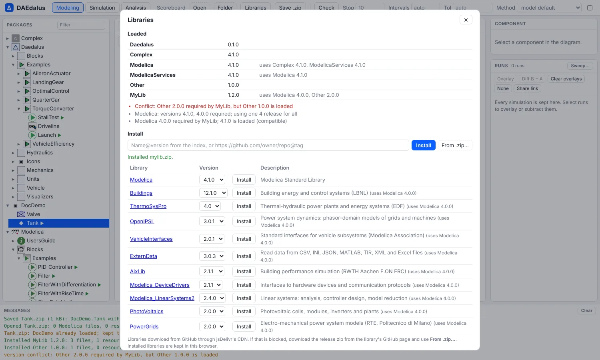
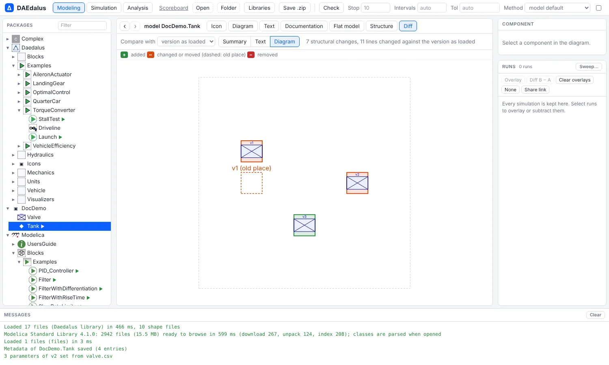

# Libraries, packages and parameter data

A **library** is a package of ready-made model parts, such as motors, pipes or springs, that your own
models can use. DAEdalus installs open Modelica libraries by name and checks their versions. It packs a
model with the files it needs into one zip, compares two versions of a class structurally,
and turns parameter tables into Modelica modifiers.



## Installing libraries

```sh
daedalus lib index                                    # the index of open libraries
daedalus lib install Buildings@12.1.0                 # by name and version
daedalus lib install https://github.com/owner/MyLib@v1.2.0
daedalus lib install ~/Downloads/OpenIPSL-3.0.1.zip   # a downloaded release
daedalus lib list
daedalus lib resolve model.mo                         # uses(...) -> installed versions, conflicts
```

```
Modelica                 4.1.0, 4.0.0         Modelica Standard Library
Buildings                12.1.0, 11.1.0, 10.0.0 Building energy and control systems (LBNL)
ThermoSysPro             4.0                  Thermal-hydraulic power plants and energy systems (EDF)
OpenIPSL                 3.0.1, 2.0.0         Power system dynamics: phasor-domain models of grids and machines
VehicleInterfaces        2.0.1, 1.2.5         Standard interfaces for vehicle subsystems (Modelica Association)
ExternData               3.0.3                Read data from CSV, INI, JSON, MATLAB, TIR, XML and Excel files
AixLib                   2.1.1, 1.3.2         Building performance simulation (RWTH Aachen E.ON ERC)
Modelica_DeviceDrivers   2.1.1                Interfaces to hardware devices and communication protocols
Modelica_LinearSystems2  2.4.0                Linear systems: analysis, controller design, model reduction
PhotoVoltaics            2.0.0                Photovoltaic cells, modules, inverters and plants
...
```

Libraries go to `$DAEDALUS_LIBRARIES` (default `~/.daedalus/libraries`). Every command
resolves the `uses(...)` annotations of what it loads against the installed libraries,
picking the exact version, or else the newest of the same major version. It warns about
conflicting requirements.

In the workbench, **Libraries** lists the loaded libraries with their versions, any
`uses` conflicts and missing libraries. It installs a library from the index, a GitHub
URL or a zip you pick, and keeps installed libraries in the browser for the next visit.

## Packages

```sh
daedalus package library/Daedalus -m Daedalus.Examples.TorqueConverter.Launch -o Launch.zip
daedalus simulate Launch.zip -o launch.mat
```

A package is a zip of the model with the files and `modelica://` resources it needs. The
MSL is named in its manifest, not copied. Any command opens a `.zip` source again, and so
does **Open** in the workbench; **Save .zip** writes the open model as a package.

## Comparing versions

`daedalus diff` compares a class structurally: components, parameters, modifiers,
placements, connections and equations. `--text` adds the unified text diff and
`--format json` gives it as data.

```sh
daedalus diff old/Demo.mo new/Demo.mo -m Demo.Plant
```

```
class Demo.Plant
  components:
    ~ r : Modelica.Electrical.Analog.Basic.Resistor
        modifier R: 100 -> 220
    ~ c : Modelica.Electrical.Analog.Basic.Capacitor
        placement changed (moved in the diagram)
    + leak : Modelica.Electrical.Analog.Basic.Resistor
  connections:
    + connect(leak.p, c.p)
    + connect(leak.n, ground.p)
```

In the workbench, **Diff** compares the open class with the version as loaded, or with a
file you pick. It shows a summary, the text diff, and the diagram. Added, changed and
removed components and connections are highlighted, and moved ones show their old place
dashed.



## Parameter data

`params-from` reads parameter values from a CSV file (`name,value[,unit]`) or an SSP
`.ssv` file. It checks them against the component's type, converts them to its units
(mm to m, bar to Pa, rpm to rad/s and so on) and prints a modifier:

```sh
daedalus params-from library/Daedalus -m Daedalus.Examples.TorqueConverter.StallTest -c engine engine.csv
```

```
note: w_start = 1000 rpm converted to 104.71975511966 rad/s
engine(J = 0.25, tau_drag = 25, w_start = 104.71975511966)
```

`--record Name` prints a record instead, and `--apply` writes the modifier into the
source. In the workbench, **Import parameters…** in the component inspector does the same
and applies the values to the declaration, with undo.

## Documentation

The **Documentation** view renders a class's `info` and `revisions` HTML, sanitized,
with `modelica://` class links that navigate and images from library resources.
Documentation that does not start with a tag is treated as Markdown, with `$...$` and
`$$...$$` LaTeX. The `__Daedalus_metadata(key = "value", ...)` annotation is shown and
edited there.
