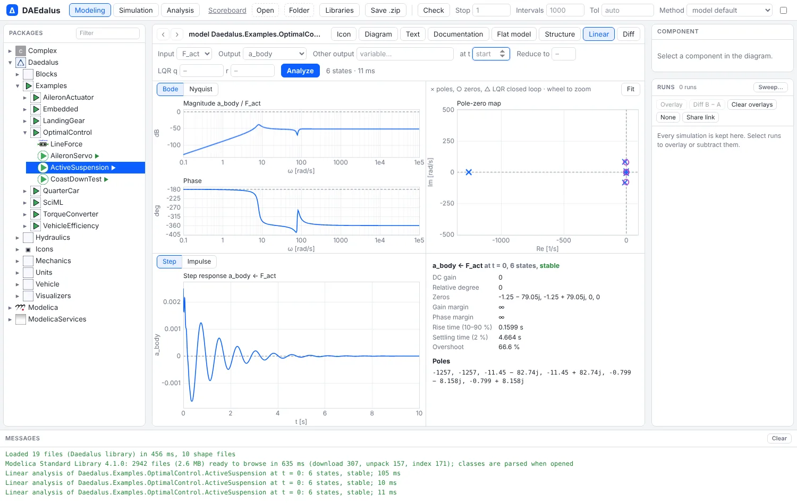
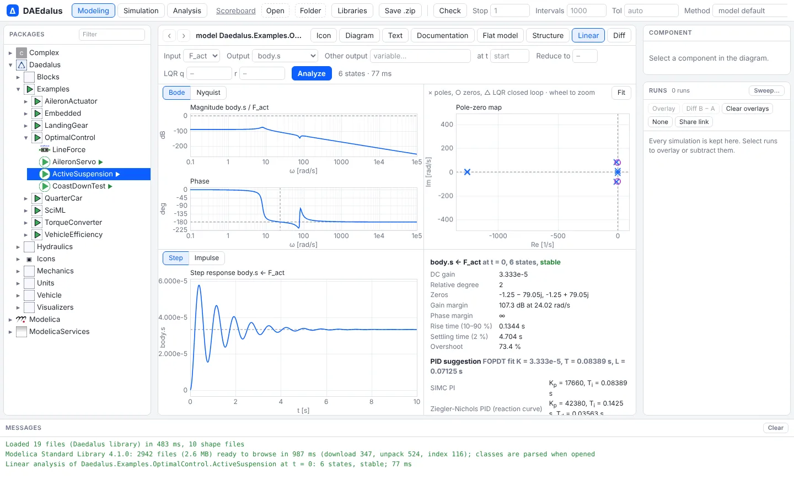

# Linear analysis

`daedalus linear-analysis` and the workbench's **Linear** tab linearize a model around an
operating point and analyze its input-output pairs. You get poles and zeros, Bode and
Nyquist plots with margins, and step and impulse responses. It also suggests PID
settings, reduces the model by balanced truncation and computes an LQR gain. It is the
classical control toolbox, applied directly to the Modelica model.



## What it computes

For the chosen inputs and outputs, after linearizing like [`linearize`](linearize.md) at
the start or after simulating to `--at T`:

- **poles**, with natural frequency and damping, and whether the model is stable;
- per input → output pair:
  - transmission **zeros**, **DC gain** and **relative degree**;
  - **Bode** and **Nyquist** data with gain and phase margins;
  - **step** and **impulse** responses with rise time, settling time and overshoot;
  - **PID suggestions**: SIMC PI and Ziegler–Nichols PID, from a first-order-plus-dead-time
    fit of the step response;
- `--reduce N`: **balanced truncation** to N states, with the Hankel singular values, the
  H∞ error bound and the reduced model's responses for comparison;
- `--lqr q,r`: the **LQR gain** for `Q = q·I`, `R = r·I`, with its closed-loop poles.

Outputs can be any continuous variable or state, not only top-level outputs.



## The math in brief

Near the operating point the model is a linear state-space system,

$$
\dot{x} = A\,x + B\,u, \qquad y = C\,x + D\,u
$$

and each input-output pair has the transfer function

$$
G(s) = C\,(sI - A)^{-1} B + D .
$$

- **Poles** are the eigenvalues of $A$. The model is stable when all of them have a negative
  real part. A pole $p$ has damping $\zeta = -\operatorname{Re}(p)\,/\,|p|$.
- **DC gain** is $G(0)$: the steady change of $y$ for a unit step in $u$.
- **Zeros** are the values of $s$ where $G(s)$ drops to zero.
- **Balanced truncation** keeps the states that are easiest to excite and to observe. The
  Hankel singular values $\sigma_i$ rank them, and the error of the reduced model is bounded by
  $\|G - G_r\|_\infty \le 2\sum_{i > r}\sigma_i$.

## Step response and PID suggestions

Each step response is fitted with a first-order model plus dead time,

$$
G(s) \approx \frac{K\,e^{-Ls}}{\tau\,s + 1},
$$

using Smith's two-point method. The times $t_{28}$ and $t_{63}$ at which the response reaches
28.3 % and 63.2 % of its final value give $\tau = 1.5\,(t_{63} - t_{28})$ and $L = t_{63} - \tau$.
From that fit:

- **SIMC PI** (Skogestad), with closed-loop time constant $\tau_c = \max(L,\ 0.1\,\tau)$:

  $$
  K_p = \frac{\tau}{K\,(\tau_c + L)}, \qquad T_i = \min\bigl(\tau,\ 4\,(\tau_c + L)\bigr)
  $$

- **Ziegler–Nichols** reaction-curve PID, only when there is dead time:

  $$
  K_p = \frac{1.2\,\tau}{K\,L}, \qquad T_i = 2L, \qquad T_d = 0.5\,L
  $$

A first-order fit is rough when the response overshoots. The tool says so, and the gains are a
starting point to check by simulation.

## LQR gain

`--lqr q,r` minimizes the cost

$$
J = \int_0^\infty \left( x^T Q\,x + u^T R\,u \right) dt, \qquad Q = q\,I,\quad R = r\,I,
$$

over the feedback law $u = -Kx$, with $K = R^{-1} B^T P$. The matrix $P$ solves the algebraic
Riccati equation

$$
A^T P + P A - P\,B\,R^{-1} B^T P + Q = 0 .
$$

The closed-loop poles are the eigenvalues of $A - BK$. Small $r$ compared with $q$ means cheap
control: the gain is large and the poles move far to the left.

## Example: an active suspension

`Daedalus.Examples.OptimalControl.ActiveSuspension` is a quarter car with an actuator force
`F_act` between body and wheel. How do body acceleration and suspension travel respond to
it?

```sh
daedalus linear-analysis library/Daedalus -m Daedalus.Examples.OptimalControl.ActiveSuspension \
    --inputs F_act --outputs a_body,travel --reduce 2 --lqr 1,1e-6
```

```
linear analysis of Daedalus.Examples.OptimalControl.ActiveSuspension at t = 0 (6 states, 1 inputs, 2 outputs)

poles (stable):
  -1.256637e3                          |p| = 1.2566e3 rad/s, damping 1.000
  -1.256637e3                          |p| = 1.2566e3 rad/s, damping 1.000
  -1.145095e1 - 8.273502e1i            |p| = 8.3524e1 rad/s, damping 0.137
  -1.145095e1 + 8.273502e1i            |p| = 8.3524e1 rad/s, damping 0.137
  -7.990487e-1 - 8.158075e0i           |p| = 8.1971e0 rad/s, damping 0.097
  -7.990487e-1 + 8.158075e0i           |p| = 8.1971e0 rad/s, damping 0.097

F_act -> travel:
  DC gain        3.333e-5
  rel. degree    2 (high-frequency gain 2.7500e-2)
  zeros:
    -1.136364e-1 - 2.383629e1i
    -1.136364e-1 + 2.383629e1i
  step: rise 0.1742 s, settling (2 %) 4.684 s, overshoot 65.37 %, peak 5.5123e-5 at 0.3926 s
  FOPDT fit: K = 3.3333e-5, T = 9.7278e-2 s, L = 5.7253e-2 s
  SIMC PI: Kp = 2.5487e4, Ti = 9.7278e-2 s, Td = 0.0000e0 s
  Ziegler-Nichols PID (reaction curve): Kp = 6.1168e4, Ti = 1.1451e-1 s, Td = 2.8626e-2 s
  note: the step response overshoots: a first-order fit is rough, check the loop by simulation

balanced truncation to 2 states:
  Hankel singular values: 6.328e-3 5.226e-3 1.227e-3 1.078e-3 0.000e0 0.000e0
  H-infinity error bound: 4.610e-3
  reduced poles:
    -7.857228e-1 - 8.074004e0i
    -7.857228e-1 + 8.074004e0i

LQR (Q = 1 I, R = 0.000001 I), u = -K x:
  [   -2.3481e3     5.7678e2    -4.3634e2     2.3814e3    -3.1016e3    -1.6380e0]
  closed-loop poles:
    -1.256637e3
    -1.256637e3
    -1.703504e1 - 8.179908e1i
    -1.703504e1 + 8.179908e1i
    -1.390127e0 - 8.079972e0i
    -1.390127e0 + 8.079972e0i
```

The body mode at 8.2 rad/s (1.3 Hz) is barely damped (ζ = 0.097), and the wheel hop
mode sits at 84 rad/s (13 Hz). The two fast real poles at 1257 rad/s are the actuator.
Two states keep the body mode, and the LQR gain raises its damping from 0.097 to 0.17.

## In the workbench

Open a model and pick the **Linear** tab of the model view. Choose the inputs and outputs,
the operating point (start, or after simulating to a time) and the plot: Bode or Nyquist,
the pole-zero map, and the step or impulse response, next to the same summary as the
command line.


## Output files

A text summary goes to stdout. `-o file.json` writes everything; `-o file.csv` writes the
Bode data (`--bode`) and the step responses (`--step`, to `<file>_step.csv`):

```sh
daedalus linear-analysis model.mo -m MyModel --at 2 --bode --step -o bode.csv
```

## How it is computed

The numerics are in `crates/daedalus-core/src/lti.rs`, with no extra dependencies:

- Bode points cost `O(n²)` each, after a Householder Hessenberg reduction;
- step responses are exact for a step (zero-order hold with the Padé matrix exponential);
- Lyapunov and Riccati equations are solved with the matrix sign function;
- transmission zeros are the zero-dynamics eigenvalues of a minimal realization of each
  pair.

Balanced truncation needs a stable model, and the dense algorithms are meant for models
with up to a few hundred states. For a fully tuned controller on the closed loop, see
`daedalus autotune` in [Embedded C and processor in the loop](embedded.md).
