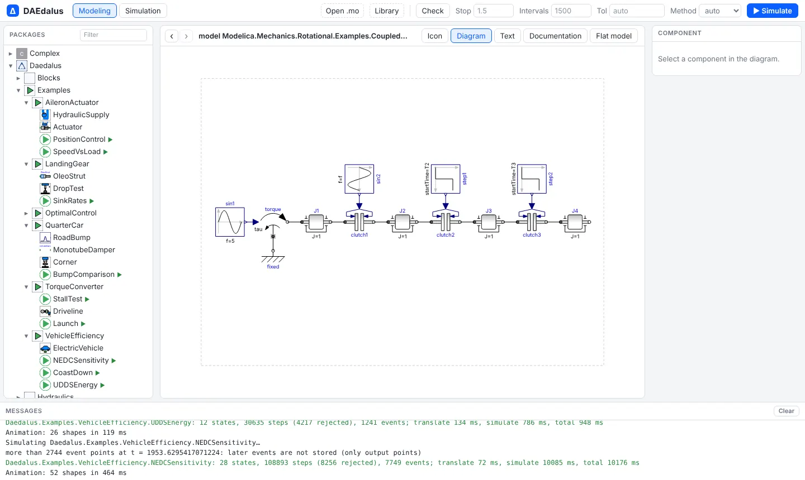
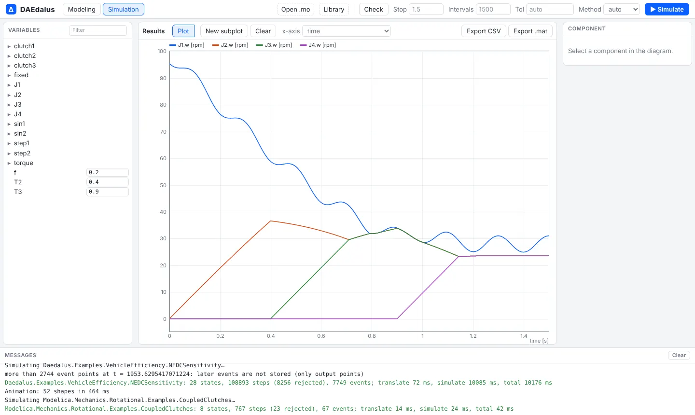
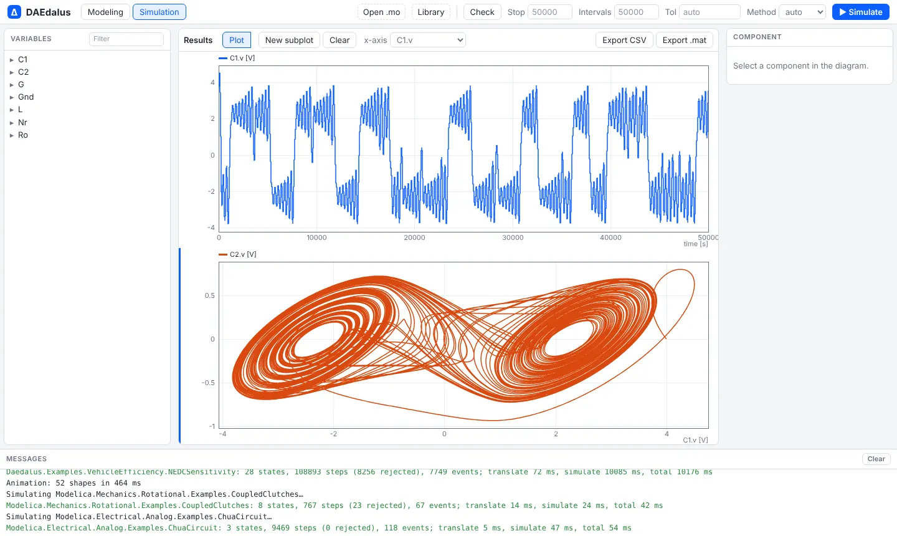
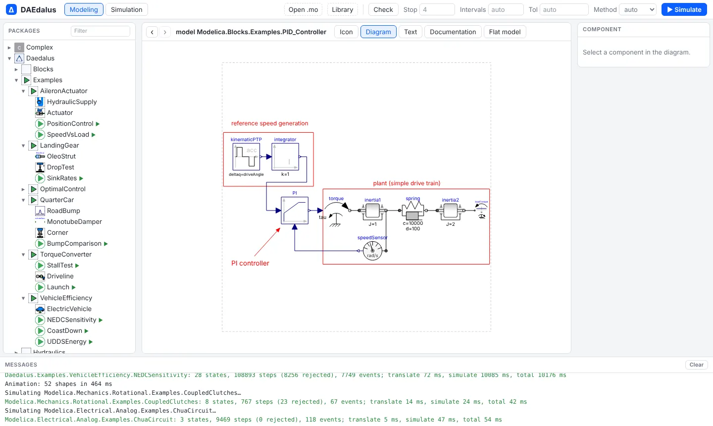
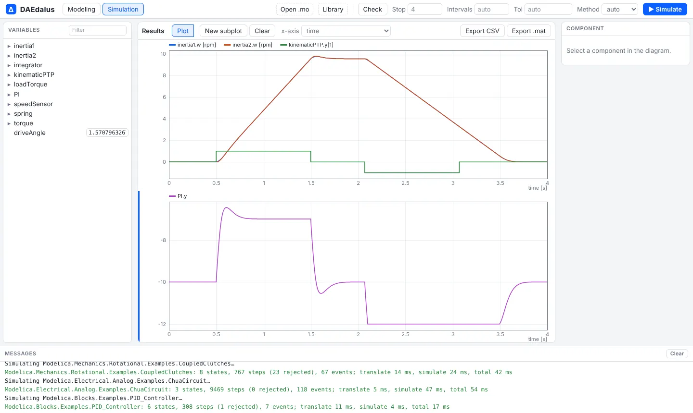
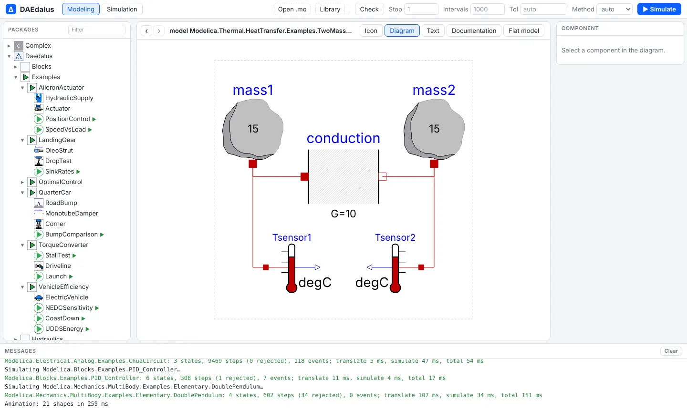
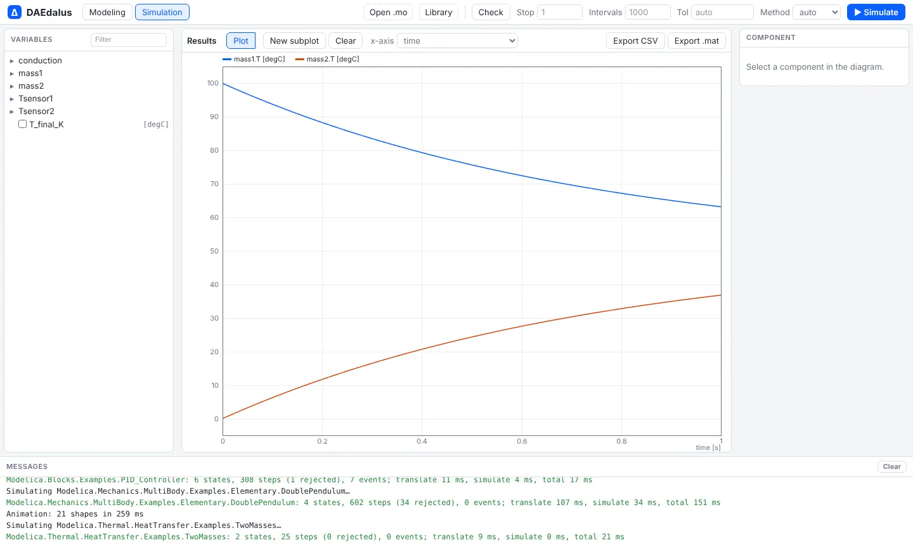
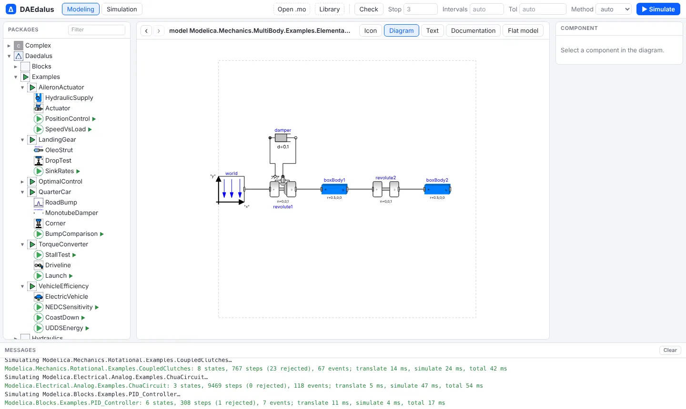
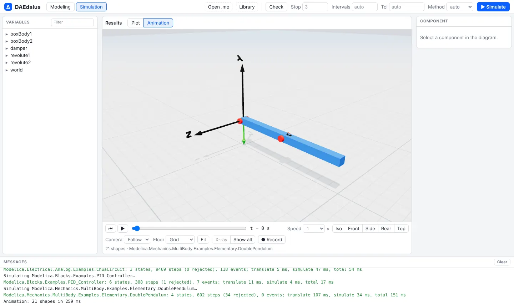

# Modelica Standard Library

The workbench ships with the Modelica Standard Library 4.1.0: `Modelica`,
`ModelicaServices` and `Complex` appear in the package browser next to the bundled
`Daedalus` library, with nothing to install. On the command line, pass an MSL checkout as
extra sources (see [Command line](cli.md#libraries)).

## Coverage

**473 of the 534** MSL 4.1.0 example models translate and simulate to the end, and
**424** of them match the Modelica Association's reference results (see below). They
include:

- `Mechanics` (Rotational, Translational, MultiBody), `Electrical` (Analog, Digital,
  Machines, QuasiStatic machines, PowerConverters, Batteries), `Thermal`, `Blocks`,
  `StateGraph` and clocked synchronous models;
- `Modelica.Media`: IF97 water, R134a, ideal-gas mixtures, moist air and reference air,
  through compiled run-time functions with exact partial derivatives;
- most `Modelica.Fluid` systems;
- `ModelicaStandardTables` lookups, replaced by native tables with linear, constant, Akima
  and Fritsch–Butland smoothness, hold, linear and periodic extrapolation, and time events
  at breakpoints.

The remaining failures, and what is being done about them, are listed in the
[Roadmap](roadmap.md#modelica-standard-library-coverage).

## Checked against the reference results

Simulating is not enough: the results have to be right. A nightly CI job simulates every
MSL 4.1.0 example and compares its comparison signals with the Modelica Association's
reference results (`MAP-LIB_ReferenceResults`, generated with Dymola), and fails if a model
that passed in the committed baseline stops passing.

| Result | Models |
| --- | ---: |
| Matches the reference results | 424 |
| Simulates, but a signal differs | 49 |
| Hits the time limit | 5 |
| Does not translate or stops | 56 |
| **Total** | **534** |

The [scoreboard](https://daedalus.apps.ezkeel.com/scoreboard.html) lists every example
with its status, the signals that differ and the error text, with a link to open it in
the workbench.

The baseline is `docs/conformance/msl-4.1.0.json`, made by `tools/refcompare.py`.

## Examples to try

Each link opens the model in the workbench; press **▶ Simulate**.

### Rotational mechanics: CoupledClutches

Four inertias coupled by three clutches that open and close at set times: a classic test
of friction events, stuck and sliding phases.

<figure></figure>
<figure></figure>

[Open Modelica.Mechanics.Rotational.Examples.CoupledClutches](https://daedalus.apps.ezkeel.com/#Modelica.Mechanics.Rotational.Examples.CoupledClutches)

### Analog electronics: ChuaCircuit

A chaotic oscillator. The second subplot plots `C2.v` against `C1.v` to show the double
scroll attractor.

<figure></figure>
<figure></figure>

[Open Modelica.Electrical.Analog.Examples.ChuaCircuit](https://daedalus.apps.ezkeel.com/#Modelica.Electrical.Analog.Examples.ChuaCircuit)

### Control: PID_Controller

A drive train under a PI speed controller, following a kinematic reference profile while
a load step hits it.

<figure></figure>
<figure></figure>

[Open Modelica.Blocks.Examples.PID_Controller](https://daedalus.apps.ezkeel.com/#Modelica.Blocks.Examples.PID_Controller)

### Heat transfer: TwoMasses

Two masses at different temperatures that equalize through a thermal conductor.

<figure></figure>
<figure></figure>

[Open Modelica.Thermal.HeatTransfer.Examples.TwoMasses](https://daedalus.apps.ezkeel.com/#Modelica.Thermal.HeatTransfer.Examples.TwoMasses)

### MultiBody: DoublePendulum

Two bodies on revolute joints, with the 3-D animation that every MultiBody result gets.

<figure></figure>
<figure></figure>

[Open Modelica.Mechanics.MultiBody.Examples.Elementary.DoublePendulum](https://daedalus.apps.ezkeel.com/#Modelica.Mechanics.MultiBody.Examples.Elementary.DoublePendulum)

For full vehicle models built on MultiBody, see [Multibody vehicles](multibody.md).

## How the browser loads it

The MSL sources are not in the repository. At build time, `web/scripts/fetch-msl.mjs`
downloads the v4.1.0 release from GitHub and packs its `.mo` and `package.order` files into
one gzip bundle (about 2.6 MB; 14.8 MB unpacked) with a content hash in its name. The
workbench downloads it after the `Daedalus` library, unpacks it with
`DecompressionStream`, and registers every file without parsing it. A light token scan
outlines each file so the package browser lists the whole library within seconds, and a
class is parsed only when it is opened, checked or simulated, together with the classes
it needs.
