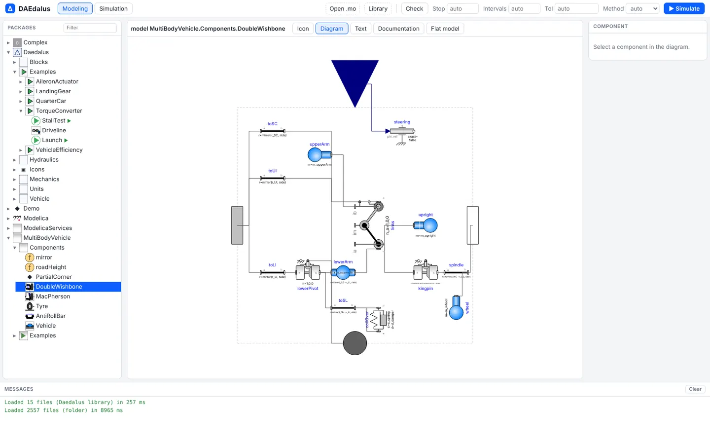
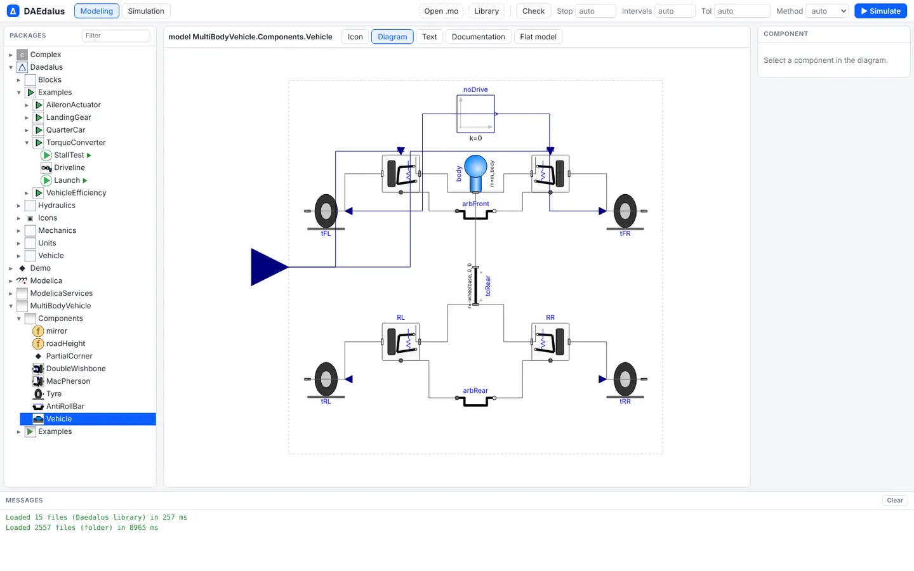
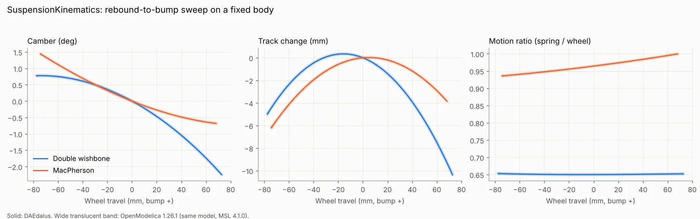
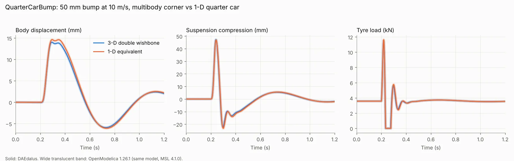
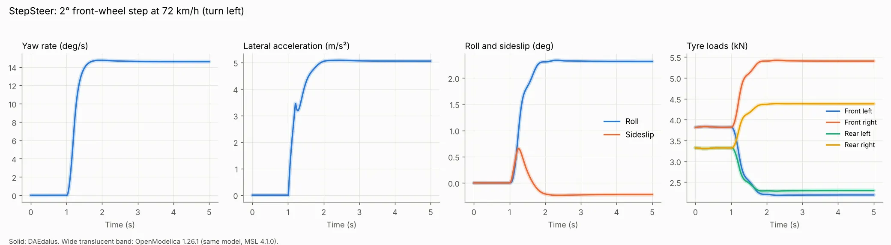
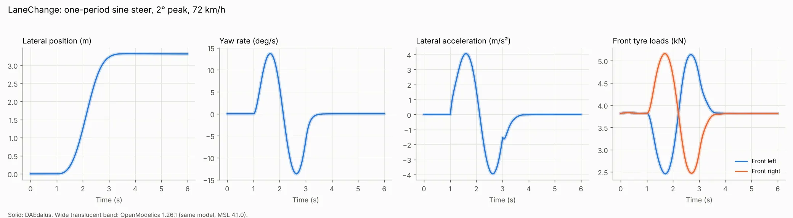
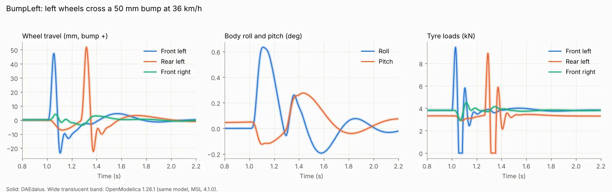
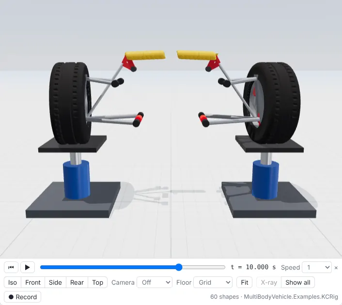
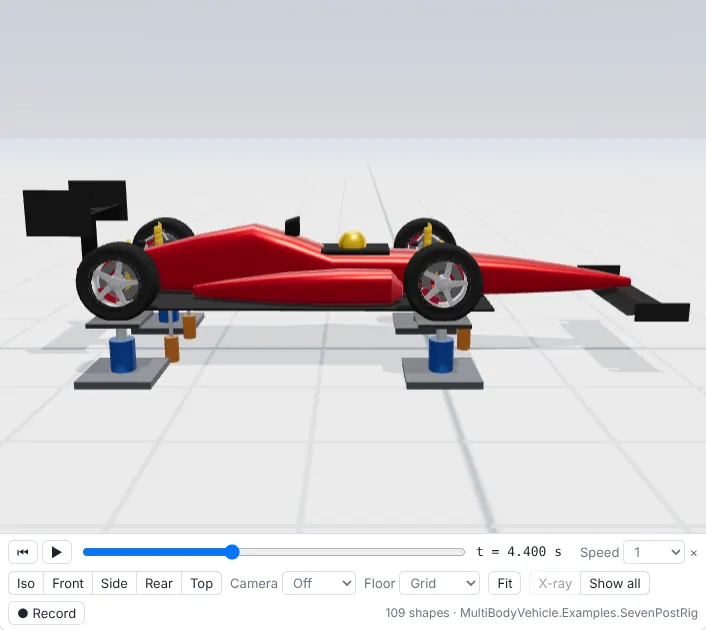

# Multibody vehicles

`library/MultiBodyVehicle` is a vehicle-dynamics library built on the Modelica Standard
Library's `Modelica.Mechanics.MultiBody`: suspension corners from hardpoints, a tyre that
can lift off, rig actuators and a full 6-DOF car. Its nine examples run from suspension
kinematics to a full car on a seven-post rig, each with a 3-D animation, and all nine
match OpenModelica.

<video src="media/kc_rig.mp4" poster="img/multibody/kc_rig.webp" controls muted loop playsinline preload="none"></video>

*KCRig: a front axle with pushrod double wishbones and an anti-roll bar on two wheel pads,
in bounce, roll and steer.*

## Running the examples

In the workbench the MSL is already loaded: open the `library/MultiBodyVehicle` folder of
a checkout or release with **Library**, pick an example under
`MultiBodyVehicle.Examples`, press **▶ Simulate**, and the **Animation** view replays it
(see [3-D animation](animation.md)).

On the command line, put MSL 4.1.0 on the source path:

```sh
MSL=path/to/ModelicaStandardLibrary   # git clone -b v4.1.0 https://github.com/modelica/ModelicaStandardLibrary
./target/release/daedalus test-library $MSL/Modelica $MSL/ModelicaServices $MSL/Complex.mo \
    library/MultiBodyVehicle -m MultiBodyVehicle
./target/release/daedalus simulate $MSL/Modelica $MSL/ModelicaServices $MSL/Complex.mo \
    library/MultiBodyVehicle -m MultiBodyVehicle.Examples.StepSteer -o stepsteer.mat
```

The library ships CAD meshes for a treaded tyre, a five-spoke rim, brake disc and caliper,
an open-wheel body and a road bump in `Resources/Shapes` (made by `generate.py` there).
They are visuals only and do not change the dynamics.

## Components

- `DoubleWishbone`: a short-long-arm corner from hardpoints, with an external
  coil-over on the lower arm and a steerable upright. The loop is closed
  analytically by a `JointRRR`, so a corner adds one state pair and no
  constraint equations.
- `DoubleWishbonePushrod`: the same linkage with an internal spring: a pushrod
  from the lower arm turns a bell-crank rocker that compresses a coil-over
  lying across the chassis. A second `JointRRR` closes the pushrod loop, so it
  still has one state pair.
- `Multilink`: a five-link rear corner (two upper links, two lower links, toe
  link) built elasto-kinematically: the upright is a free body and each link is
  a `CompliantLink`, a stiff axial spring with ball-joint ends (10 kN/mm).
- `WheelPad` and `AeroLoader`: the hydraulic wheel pad and the pull-down
  actuator of a post rig. `Tyre(usePad=true)` stands on a pad, and
  `Vehicle(onRig=true)` puts all four tyres on pads.
- `MacPherson`: a strut on a top-mount hinge with a lower control arm, closed by
  a `RevolutePlanarLoopConstraint`.
- `Tyre`: a point contact that can lift off, with a Pacejka-type lateral force
  and rolling resistance applied at the contact patch.
- `AntiRollBar`: a torsion bar between the left and right lower-arm pivots.
- `Vehicle`: a free 6-DOF sprung body on four double-wishbone corners, with
  front steering, anti-roll bars and a rear-axle speed controller. It starts in
  static equilibrium at design ride height.


<div class="pair">
<figure><figcaption>DoubleWishbone: hardpoints, arms, upright, coil-over and the JointRRR that closes the loop.</figcaption></figure>
<figure><figcaption>Vehicle: the sprung body on four corners, with steering and anti-roll bars.</figcaption></figure>
</div>

## Examples

| Example | What it shows | States | CPU |
| --- | --- | ---: | ---: |
| SuspensionKinematics | Camber, track change and motion ratio over ±75 mm travel, double wishbone vs MacPherson | 6 | 0.4 s |
| QuarterCarBump | 3-D corner vs a 1-D quarter car with the equivalent wheel rate over a 50 mm bump | 10 | 0.4 s |
| StepSteer | 2° front-wheel step at 72 km/h | 28 | 2.1 s |
| LaneChange | One-period sine steer, 2° peak, at 72 km/h | 28 | 2.6 s |
| BumpLeft | Left wheels cross a 50 mm bump at 36 km/h | 28 | 2.6 s |
| PushrodVsCoilOver | External coil-over vs pushrod, rocker and internal coil-over over ±75 mm | 6 | 0.2 s |
| MultilinkRig | Five-link corner on one wheel pad, ±70 mm bounce | 15 | 0.1 s |
| KCRig | Front axle with pushrod corners and anti-roll bar on two pads: bounce, roll, steer | 14 | 0.7 s |
| SevenPostRig | Full car on four wheel pads and three aero loaders: heave, pitch, roll, warp | 36 | 3.2 s |


### SuspensionKinematics

The double wishbone gains 2.2° negative camber at +73 mm
bump (−21°/m at design) with a near-constant 0.65 motion ratio. The
MacPherson strut gains 0.7°, with a motion ratio from 0.94 to 1.0.



### QuarterCarBump

The 3-D corner and the 1-D model with wheel rate `c·MR²`
agree to 0.4 mm in peak suspension travel (47 mm) and to 1.5 % in peak tyre
load (11.5 vs 11.6 kN). Both tyres leave the road behind the crest.



### StepSteer

The car settles at 14.6°/s yaw rate, 0.52 g and 2.3° roll.
The linear bicycle model is neutral steer for this tyre, giving `v/L` =
7.7 1/s; the multibody yaw gain is 7.5 1/s at 0.1° and 7.3 1/s at 2°.

<video src="media/stepsteer_chase.mp4" poster="img/multibody/stepsteer_chase.webp" controls muted loop playsinline preload="none"></video>



### LaneChange

The car moves 3.3 m sideways and ends on its original
heading, with lateral acceleration peaks of ±0.4 g.



### BumpLeft

The front-left and rear-left wheels travel 47 and
52 mm, 0.26 s apart. The body rolls 0.6°, and each left tyre leaves the road
for about 40 ms behind the crest.

<video src="media/bumpleft_side.mp4" poster="img/multibody/bumpleft.webp" controls muted loop playsinline preload="none"></video>



### PushrodVsCoilOver

The outboard coil-over has a near-constant 0.65
motion ratio. The rocker gives a rising rate: 0.70 in full rebound, 0.82 at
design and 1.00 at full bump, so the wheel rate doubles from 15 to 30 kN/m
over the travel with one linear spring.

<video src="media/pushrod_vs_coilover.mp4" poster="img/multibody/pushrod_vs_coilover.webp" controls muted loop playsinline preload="none"></video>

### MultilinkRig

−20°/m camber gain (+1.0° at −60 mm, −1.5° at +60 mm), and
bump steer within 0.05° in kinematics; with the bushes loaded the toe stays
between −0.44° and +0.06°. Under the static 3.4 kN load the links give
0.24° of compliance toe-out.

<video src="media/multilink_rig.mp4" poster="img/multibody/multilink_rig.webp" controls muted loop playsinline preload="none"></video>

### KCRig

In bounce the bar does not twist and the wheel gains −1.1°
camber at +43 mm. In roll (±27 mm per side) the bar carries ±475 N·m and the
pad loads split 5.8 / 2.0 kN.



### SevenPostRig

The 3.3 kN of aero load lowers the body 42 mm. The
12 mm, 1.5 Hz pad bursts excite ±18 mm of body heave, ±0.8° of pitch and
±1.8° of roll, all near resonance. Warp barely moves the body (±0.4° roll)
but swings each tyre load by about ±470 N.

<video src="media/sevenpost_rig.mp4" poster="img/multibody/sevenpost_rig.webp" controls muted loop playsinline preload="none"></video>



## Checked against OpenModelica

All nine match OpenModelica 1.26.1 running the same models on MSL 4.1.0:
the 98th-percentile difference is below 0.04 % of each signal's range
(below 0.01 % for the four rigs). The
only larger point errors are single samples at tyre lift-off and touchdown.
In OpenModelica the full-car examples take 7 to 16 s of simulation time,
against 1.1 to 2.0 s in DAEdalus (including the animation shapes).
