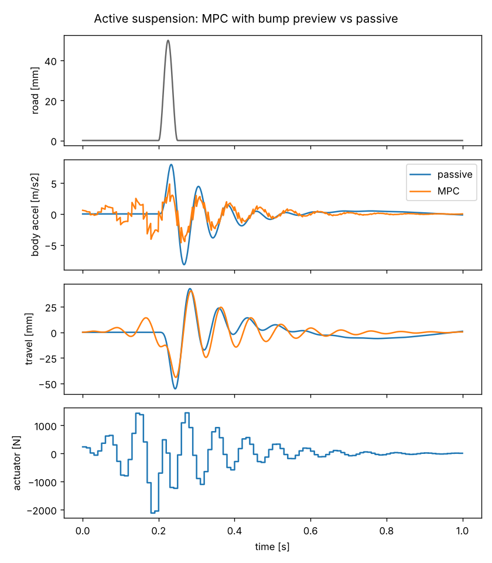
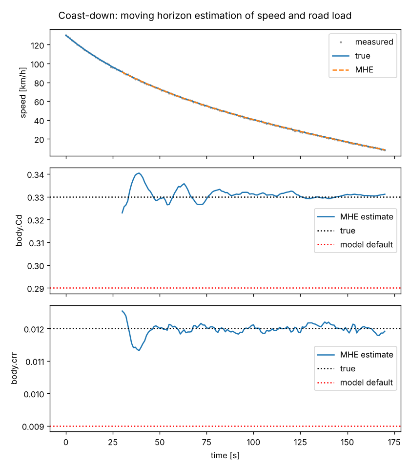

# Optimal control, MPC and estimation with CasADi

DAEdalus can hand any model it translates to [CasADi](https://web.casadi.org),
the open-source framework for nonlinear optimization and optimal control. On top
of that, the `daedalus_casadi` Python package (in `python/`) solves three kinds
of problem:

- **optimal control problems** (OCP), such as a minimum-time move;
- **model predictive control** (MPC): an OCP re-solved in a closed loop;
- **moving horizon estimation** (MHE) of states and parameters from measurements.

The model stays in Modelica. Inputs that the optimizer may choose are
top-level `input` variables, and every other model variable can appear in a
cost or a constraint by its name.

## How it works

```
.mo ──► DAEdalus frontend + backend ──► daedalus export-casadi ──► JSON ──► daedalus_casadi ──► CasADi / IPOPT
        (alias elimination, index                                            (SX expressions,
         reduction, BLT, tearing)                                             direct collocation)
```

`daedalus export-casadi` writes the model as DAEdalus compiles it for
simulation. That is a semi-explicit DAE of index 1:

```
der(x) = f(t, x, z, u, p)
     0 = g(t, x, z, u, p)
```

| Symbol | What it holds |
| --- | --- |
| `x` | The states DAEdalus selected, including dummy-derivative state selection after index reduction. |
| `z` | The tearing variables of the algebraic loops. Models without loops have no `z`: the problem is a plain ODE. |
| `u` | Top-level `input` variables. |
| `p` | Public parameters with a literal value. These are the ones a user can change. Other parameters are expressions of them. |

The hard symbolic work therefore happens before CasADi sees the model:
- alias elimination;
- Pantelides index reduction;
- BLT sorting and tearing.

The optimizer gets a small, well-posed system. For example, the hydraulic
aileron actuator has 6 states and 2 algebraic unknowns, out of a few hundred
flat equations.

The JSON document also holds the value of every variable after DAEdalus' own
initialization. These values give a consistent initial state, and guesses for
`z`, even when the model initializes from steady-state initial equations.

**Conversions.**
- Event relations become `if_else` expressions.
- Tables become piecewise polynomials with the same interpolation and
  extrapolation as the simulator.
- `when`-clauses are not part of a continuous optimization problem. They are
  left out with a warning. Discrete variables, and `pre()` of non-continuous
  variables, keep their initial values.
- `delay()`, clocked equations and functions with `while`-loops are reported
  as unsupported.

## Setup

```sh
cargo build --release                  # builds target/release/daedalus
pip install casadi numpy matplotlib    # matplotlib only for the example plots
```

The package is plain Python. Either:
- run the examples from the repository;
- add `python/` to `PYTHONPATH`;
- or install it with `pip install -e python`.

It finds the `daedalus` executable in this order:
1. `$DAEDALUS_BIN`;
2. `PATH`;
3. `target/release` of the checkout.

## Export

From the command line:

```sh
./target/release/daedalus export-casadi library/Daedalus \
    -m Daedalus.Examples.OptimalControl.AileronServo -o servo.json [-p name=value ...]
```

From Python:

```python
import daedalus_casadi as dc

m = dc.export("Daedalus.Examples.OptimalControl.AileronServo")   # or dc.load("servo.json")
m.x_names, m.z_names, m.u_names, m.p_names
m.ode, m.alg                 # casadi.SX in m.t, m.x, m.z, m.u, m.p
m["delta_deg"]               # any variable as an expression of t, x, z, u, p
m.x0, m.z0, m.u0, m.p0       # values after DAEdalus' initialization
m.dae_function()             # Function(t, x, z, u, p) -> (ode, alg)
m.jacobians()                # linearization (A, B), with z eliminated
dc.simulate(m, t_grid, u=..) # CasADi IDAS / CVODES, inputs held per interval
```

## Optimal control

**The problem in symbols.** An optimal control problem chooses the inputs $u(t)$ (and the
free end time $T$, if asked) that minimize a cost while the model and the limits hold:

$$
\begin{aligned}
\min_{x,\,z,\,u,\,T}\quad & \int_0^T L(x, z, u)\,dt \\
\text{subject to}\quad & \dot{x} = f(t, x, z, u, p), \qquad 0 = g(t, x, z, u, p), \\
& x(0) = x_0, \qquad u_{\min} \le u(t) \le u_{\max}
\end{aligned}
$$

A minimum-time move has $L = 1$ and a free $T$: the optimizer finds the shortest time that
reaches the target. Collocation turns the continuous problem into a large but sparse nonlinear
program, which IPOPT solves.

`dc.OCP` transcribes the model by direct collocation:
- inputs are constant on each interval;
- states follow polynomials through Radau IIA points, which are stiffly
  accurate and suit DAEs;
- algebraic variables are unknowns at every collocation and mesh point.

Unknowns are scaled by each variable's `nominal` attribute or initial magnitude.
IPOPT then sees numbers of order one, even for pressures in pascal.

```python
ocp = dc.OCP(m, N=40, free_time=True, T_guess=0.06)   # or T=0.1 for a fixed horizon
ocp.bound("u", -1, 1)                                  # inputs, or any variable on the mesh
ocp.subject_to(ocp.final("delta_deg") == 10, ocp.final("aileron.w") == 0)
ocp.minimize(ocp.T)                                    # or ocp.integral(m["..."]**2), ...
ocp.guess(dc.simulate(m, t_grid, u=feedback_law))      # optional initial guess
sol = ocp.solve()
sol.T, sol.t, sol.u, sol["act.cylinder.pA"]
```

The building blocks are:
- `ocp.at(name, k)`, `ocp.initial(name)`, `ocp.final(name)`,
  `ocp.trajectory(name)`;
- `ocp.integral(expr)`, by the collocation quadrature;
- `ocp.input(name)`.

`ocp.opti` is the underlying `casadi.Opti`, for anything else.

`free_params=[...]` turns parameters into decision variables, for design
optimization or parameter estimation.

**Kinks.** Saturations, dead zones and valve metering edges are `min`/`max`/`abs`
in the model. An optimum often sits exactly on such a kink, for example a valve
held at zero opening, and IPOPT then fails to converge.
`dc.export(..., smooth=1e-3)` replaces those kinks by smooth approximations of
that width. `smooth_if=True` also blends the branches of `if a < b` expressions.
The aileron example solves on the smoothed model, then replays the optimal
command on the exact model to show the difference is negligible.

## Model predictive control

At every sampling instant the controller takes the measured state $\hat{x}(t)$, solves the
optimal control problem over the next $N\,\Delta t$ seconds, and applies only the first piece of
the answer. Then it measures again and solves again. This receding horizon is what makes MPC
robust: a disturbance is corrected at the next step, not at the end of a fixed plan.

$$
u_{\mathrm{applied}}(t_k) = u^\star_0(\,\hat{x}(t_k);\; t_k,\, t_k + N\,\Delta t\,)
$$

```python
mpc = dc.MPC(m, N=25, dt=0.01, degree=2)
o = mpc.ocp
mpc.bound("F_act", -2500, 2500)
mpc.minimize(o.integral(m["a_body"]**2) + 10*o.integral((m["travel"]/0.03)**2)
             + o.integral((m["F_act"]/2500)**2))
u0 = mpc.step(x_measured, t)          # one solve, warm-started from the previous one
closed_loop = mpc.run(t_end=1.0)      # closed loop against the model (or plant=...)
```

The initial state and start time are parameters of one NLP that is built once.
Each step warm-starts from the previous solution, shifted by one interval.
Time-varying model inputs, such as a road profile given as a function of
`time`, are therefore previewed by the prediction.

## Moving horizon estimation

The estimator is the mirror image of MPC: it looks back over a window of the last $N$ intervals
and finds the states and parameters that best explain the measurements. Its objective is a
weighted least-squares fit,

$$
\min\ |x_0 - \bar{x}|^2_P + |p - \bar{p}|^2_{P_p} + \sum_k |y_k - h(x_k, z_k, u_k, p)|^2_R + \sum_k |w_k|^2_Q
$$

where $\bar{x}$ and $\bar{p}$ are the prior estimates (the *arrival cost*), $w_k$ are process
disturbances, and $R$, $Q$, $P$ are weights set from standard deviations in each variable's own
units. After each window the prior moves to the new estimate, one interval later.

```python
mhe = dc.MHE(m, N=30, dt=1.0, measurements=["v_kmh"], meas_std=[0.3],
             process_std=[1e-3, 0.05], estimate_params=["body.Cd", "body.crr"],
             param_prior_std=[0.01, 0.001])
x_end, p_est = mhe.step(y_window, t0)       # y_window: (N + 1) x n_measurements
t_est, x_est, p_est = mhe.run(t, y)         # one window per new sample
```

Each window is a weighted least-squares problem over:
- the initial state;
- a disturbance on the state at every mesh point;
- the chosen parameters.

It is constrained by the model, with an arrival cost that carries the previous
estimate forward. Known inputs are passed with `u=`.

## Examples

The plants are in `Daedalus.Examples.OptimalControl`. The scripts are in
`python/examples/`, and each takes `--plot out.png`.

| Script | Plant | Problem | Result |
| --- | --- | --- | --- |
| `ocp_aileron.py` | `AileronServo`: 3000 psi supply, servo valve, cylinder, aileron with hinge moment; valve command `u` ∈ [-1, 1] | Fastest 10° deflection that ends at rest | 41.7 ms, full-open then a reverse braking pulse; 36 IPOPT iterations, about 1 s |
| `mpc_active_suspension.py` | `ActiveSuspension`: quarter car, soft damper, force actuator `F_act` | MPC every 10 ms over a 0.25 s horizon that previews a 50 mm bump | Body acceleration −35 % rms and −41 % peak, suspension travel −20 % against the passive car; median solve 23 ms |
| `mhe_coastdown.py` | `CoastDownTest`: a 1650 kg car coasting from 130 km/h | Estimate speed, `Cd` and `crr` from speed readings with 0.3 km/h noise | `Cd` 0.331 (true 0.33), `crr` 0.0119 (true 0.012), speed error 0.06 km/h rms |






The MHE measurements come from DAEdalus itself, which simulates the "real" car
with different coefficients from those of the model being estimated.

The numbers were measured on a 4-core cloud container with CasADi 3.8 and
IPOPT with MUMPS.

## Tests

```sh
cargo test --release -p daedalus-core --test library casadi
python -m pytest python/tests
```

The Python tests check four things:
- every exported variable evaluates to DAEdalus' initialized value;
- CasADi simulations of the exported models match DAEdalus simulations;
- tables interpolate as in the simulator;
- each of the three problems reaches its expected result.
