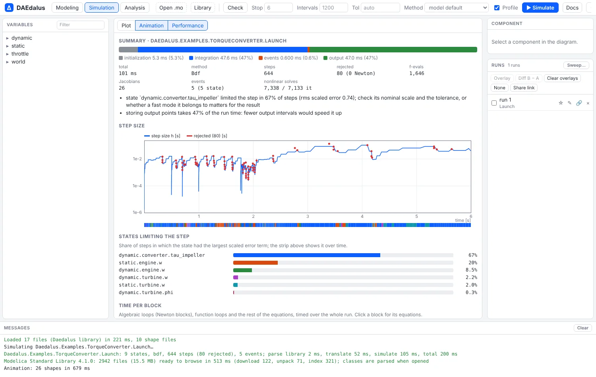
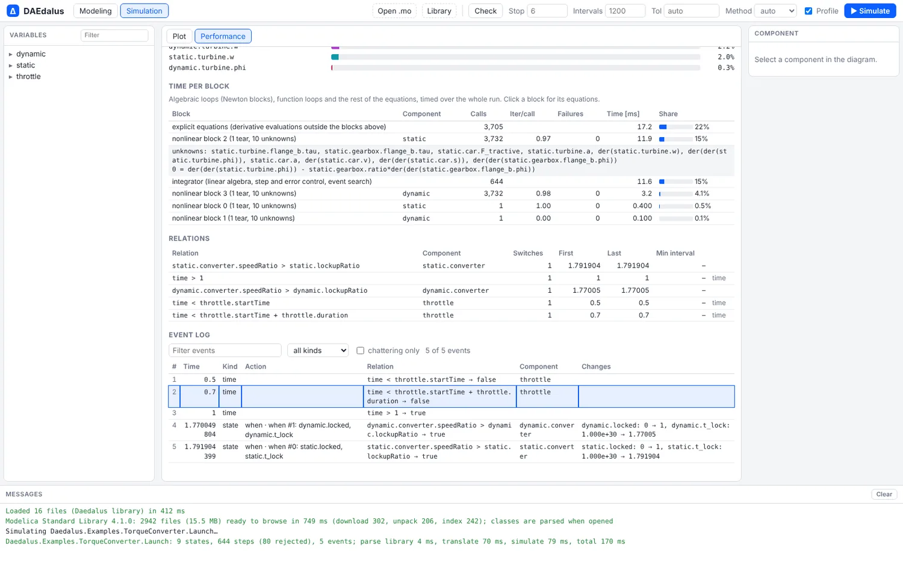
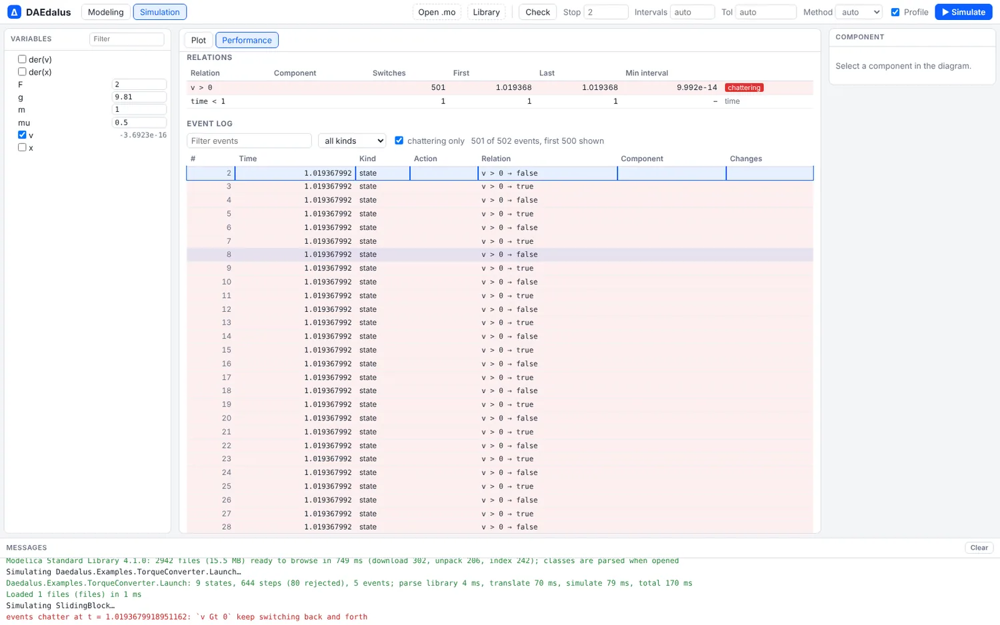
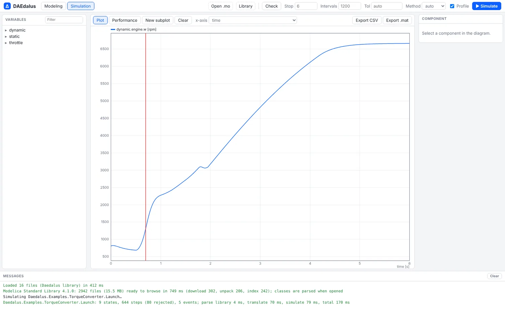

# Performance analyzer

Why is my model slow, and why does it chatter? Tick **Profile** next to **Simulate**, or
pass `--profile` to `daedalus simulate`, and DAEdalus records where the solver spent its
steps and its time, like Dymola's Simulation Analysis or Amesim's Performance Analyzer.



## What a profile records

- **Step size** over time on a log scale, with rejected steps in red, and a strip that
  colours each step by the state that limited it.
- **States limiting the step**: the state with the largest scaled error term in each
  step, as a share of all steps.
- **Time per block**: the calls, iterations, failures and time of each algebraic loop and
  of the explicit equations and the integrator. Click a block for its equations.
- **Relations**: how often each relation switched, when first and last, and the shortest
  interval. A relation that switches 20 times in a row, each within 0.05 % of the
  simulated interval of the last, is flagged as chattering.
- **Event log**: each event's time, whether a state or a time event triggered it, the
  relations that switched (with their source text and component), the `when` clauses that
  fired and the values that changed. Clicking an event marks its time in the plot.
- **Hints** in plain language, and the time split between initialization, integration,
  events and output.

<div class="pair">
<figure><figcaption>Block costs, relations and the event log of the launch: throttle ramp, then the lock-up clutches closing.</figcaption></figure>
<figure><figcaption>A sliding block: <code>v &gt; 0</code> switched 501 times within 50 picoseconds and is flagged as chattering.</figcaption></figure>
</div>



## On the command line

```sh
daedalus simulate library/Daedalus -m Daedalus.Examples.TorqueConverter.Launch \
    --profile launch-profile.json   # summary on stdout, the full profile as JSON
daedalus simulate model.mo -m M --events   # the event log
```

```
Performance profile of Daedalus.Examples.TorqueConverter.Launch (Bdf)
  steps: 644 accepted, 80 rejected (0 Newton); 1,646 f-evals, 26 Jacobians, 241 LU; 5 events (5 state events); 7,338 nonlinear solves, 7,134 iterations
  step size: 1.659e-6 .. 1.063e-1
  states limiting the step (largest error term):
      67%  dynamic.converter.tau_impeller           430 steps, rms scaled error 0.739
      20%  static.engine.w                          130 steps, rms scaled error 0.422
       9%  dynamic.engine.w                         55 steps, rms scaled error 0.351
  relations: 5 switched, 0 chattering
          1x  static.converter.speedRatio > static.lockupRatio  (static.converter)  t = 1.79190439891876 .. 1.79190439891876
          1x  time > 1  t = 1.0000000000001 .. 1.0000000000001
          ...
  hints:
    - state `dynamic.converter.tau_impeller` limited the step in 67% of steps (rms scaled error 0.74); check its nominal scale and the tolerance, or whether a fast mode it belongs to matters for the result
    - storing output points takes 71% of the run time: fewer output intervals would speed it up
```

The impeller torque build-up of the dynamic converter model is the fast mode here: it
sets the step size for two thirds of the run.

## Cost

Profiling is off by default, and then nothing is recorded. Results with and without it
are bit-identical. With it on, a run is about 10 to 35 % slower (TorqueConverter.Launch:
4.5 ms to 6.5 ms; the 1,000-mass chain: 344 ms to 453 ms).

To see where the time goes before the solver starts, the [structure view](structure.md)
shows the algebraic loops and the stiffness; to try another integrator, see
[Solvers](solvers.md).
