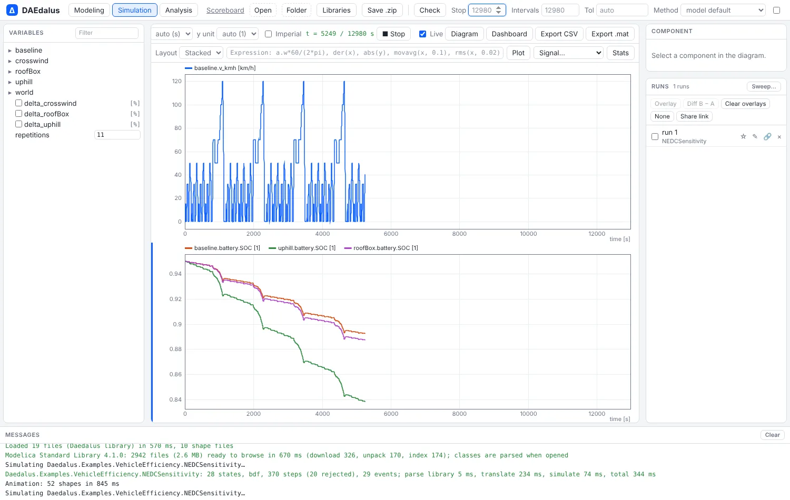
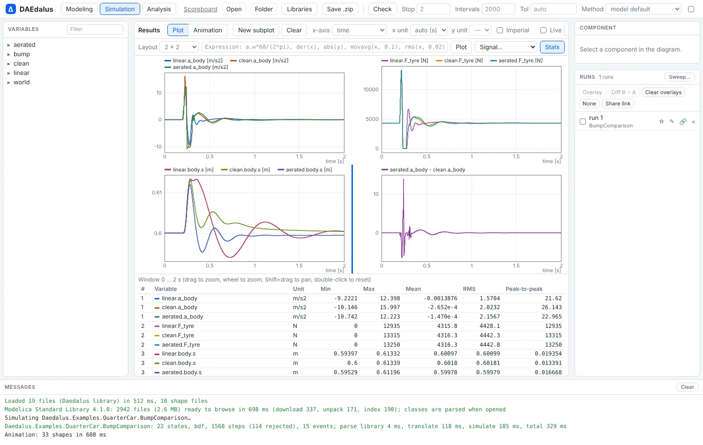
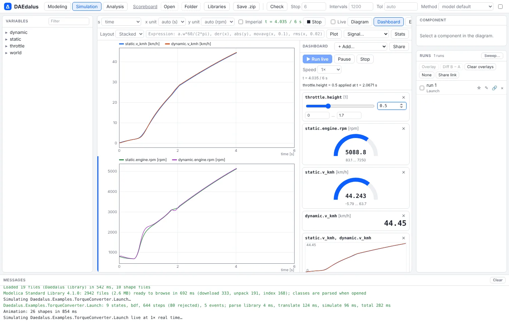

# Live plots and dashboards

Results stream into the plot while a simulation runs. A dashboard of sliders and gauges
can change parameters during the run without restarting it. The plot window itself has
matrix layouts, expressions, FFTs and statistics.

## Live plotting

With **Live** ticked (the default), a simulation streams its rows into the plot as it
runs, on a fixed time axis from start to stop time. **■ Stop** ends the run and keeps the
rows computed so far. The worker advances the run in slices of about 120 ms of wall-clock
time. The solver takes exactly the steps of a run in one go, so the result is identical;
only the plotted variables' new rows cross to the page after each slice.

## Plots next to the diagram

Once a model has results, a plot strip below the diagram in the Modeling page shows the
same plot as the Simulation page, and curves added in one appear in the other. Drag its
top edge to resize it, or collapse it.

**Click to plot.** Click a component in the diagram to get a menu of its variables, first
its own and then its connectors'. Click a connection to list the across and flow variables
of both connectors.

## Layouts, expressions and statistics

- **Layout** arranges the subplots in rows and columns, from 1 × 2 to 3 × 3. All time
  subplots share one time axis. Drag to zoom, use the wheel to zoom around the cursor,
  Shift+drag to pan and double-click to reset. The cursor readout shows the same time in
  every subplot.
- **Expressions.** The expression field plots a formula over result variables, evaluated
  again after every run. Examples are `inertia.w*60/(2*pi)`, `abs(a - b)`, `der(x)`,
  `integral(x)`, `movavg(x, T)` and `rms(x, T)`. `min`, `max`, `pow`, `atan2`, the usual
  elementary functions, `pi`, `e` and `time` also work.
- **FFT.** `fft(x)` plots the amplitude spectrum of the visible time window in a
  frequency subplot. The window is resampled uniformly to a power of two, with a Hann
  window.
- **Signal…** applies one of these operators to every variable of the active subplot.
- **Stats** shows the min, max, time-weighted mean, RMS and peak-to-peak of every curve
  over the visible window, and updates as you zoom.
- **Units**: each axis can be shown in any unit its quantity converts to, and **Imperial**
  switches the defaults; see [Unit checking](units.md#display-units).

## Dashboards

**Dashboard** opens a panel of widgets bound to the open model: sliders on free Real
parameters, gauges, numeric displays and mini plots of variables.

- **Run live** paces the simulation against wall-clock time, from 0.1× to 200×.
  **Pause**, **Stop** and the speed apply during the run.
- Moving a slider during the run changes the parameter at the time reached, without
  restarting. Parameters bound to it are evaluated again, an event iteration settles the
  discrete variables, and the integrator restarts from the current states. Only free
  Real parameters can change this way; others need a new run.
- A slider moved while nothing runs sets the value for the next run.
- Layouts are saved per model in the browser, and **Share** copies a link that opens the
  model with its dashboard.

## How it works

`sim::Incremental` (`advance(t, wall_budget)`, `set_params`, `results`, `finish`) is the
core of both live plotting and dashboards. `crates/daedalus-core/tests/incremental.rs`
checks three things: that budget slices reproduce a full run bit for bit, that time
slices see every event, and that mid-run parameter changes propagate.
`web/scripts/e2e-plotting.mjs` exercises the plot features in Chromium.
