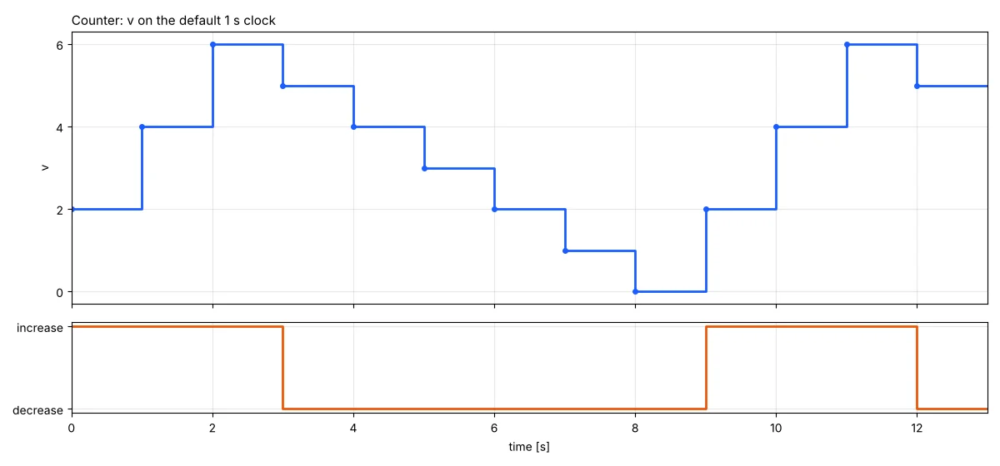

# State machines

The state machines of Modelica 3.6 (chapter 17 of the specification) translate and
simulate, natively and in the browser. This is the example from
`ModelicaReference.StateMachines`, run as written:

```modelica
model Counter
  inner Integer v(start = 0);
  block Increase
    outer output Integer v;
  equation
    v = previous(v) + 2;
  end Increase;
  Increase increase;
  block Decrease
    outer output Integer v;
  equation
    v = previous(v) - 1;
  end Decrease;
  Decrease decrease;
equation
  initialState(increase);
  transition(increase, decrease, v >= 6, immediate = false);
  transition(decrease, increase, v == 0, immediate = false);
end Counter;
```

On its default 1 s clock, `v` counts up by two to 6, down by one to 0, and up again:

```
t  0  1  2  3  4  5  6  7  8  9  10  11  12
v  2  4  6  5  4  3  2  1  0  2   4   6   5
```



## What is supported

### Operators

All the chapter 17 operators work:
- `transition(from, to, condition, immediate, reset, synchronize, priority)`,
  where the last four arguments must be parameter expressions;
- `initialState`, `activeState`, `ticksInState()` and `timeInState()`.

### Transitions

- Immediate transitions fire in the tick where their condition holds. Delayed
  transitions take effect at the next tick.
- When several transitions could fire, the one with the lowest `priority`
  number wins.
- With `synchronize = true`, a transition waits until every state machine
  inside its from-state is in a final state.

### Hierarchy

Machines nest inside states, and several machines can run in
parallel in one state. An inner machine pauses while its enclosing state is
inactive. When the enclosing state is re-entered, the inner machine resumes
where it stopped, or restarts in its initial state if the transition resets
it.

### Variables

- An `outer output` variable defined in several states gets one merged
  definition: `v = if activeState(s1) then e1 elseif ... else previous(v)`.
- `inner outer output` variables pass the merged value of the inner states up
  to the enclosing machine.
- Variables of an inactive state hold their values.
- A reset transition reinitializes the variables of its target state to
  their start values.

### Clock

A state machine runs on the clock inferred for its partition. If no
clock can be inferred, as in the example above, it runs on a default periodic
clock of 1 s.

Inside clocked partitions, `time` is now the nominal instant of the tick
(`start + k·interval`), not the slightly later instant at which the event was
located. This makes `timeInState()` and comparisons against `time` exact.

### Limitations

- `ticksInState()` and `timeInState()` can only be used in transition
  conditions.
- Each equation in a state must be solvable for the variable it defines.
- An immediate transition whose condition reads a variable computed by its
  from-state in the same tick forms an algebraic loop, which is rejected.

## How it works

After flattening, `statemachines.rs` replaces each state machine by the clocked equations
of section 17.3.4 of the specification: `selectedState`, `activeState`, `nextState` and
their resets per machine, plus the merged definitions of the variables the states define.
The clock partitioning in `clocks.rs` then runs them like any other synchronous model.
The test models are in `crates/daedalus-core/tests/models/statemachines.mo`.
