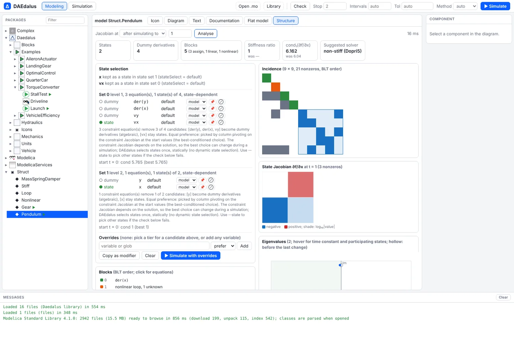
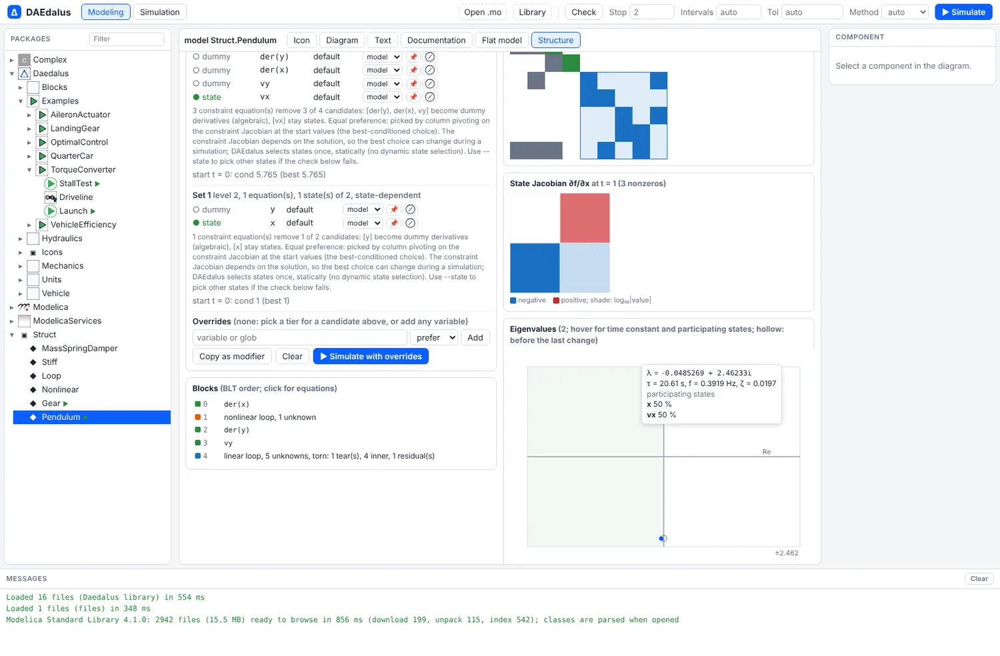
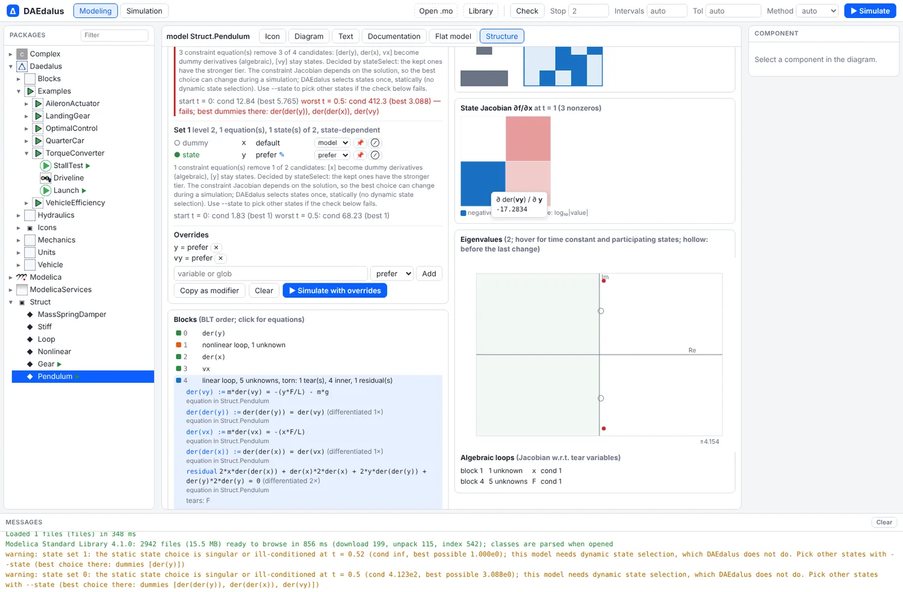
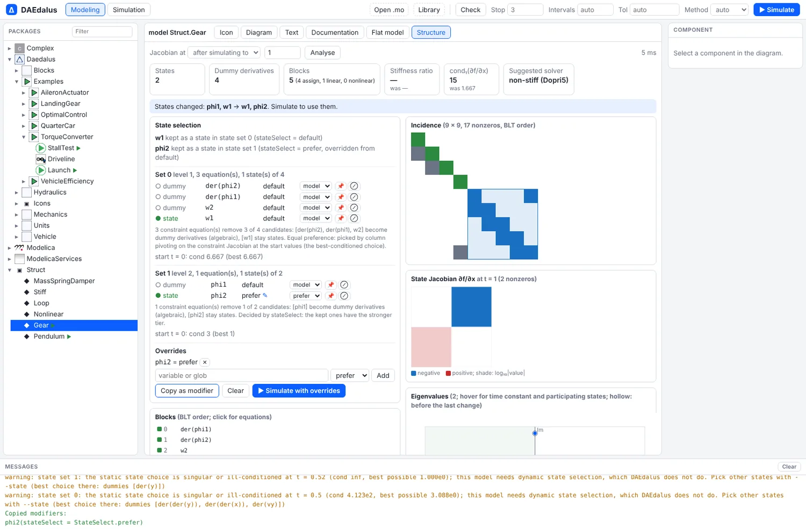
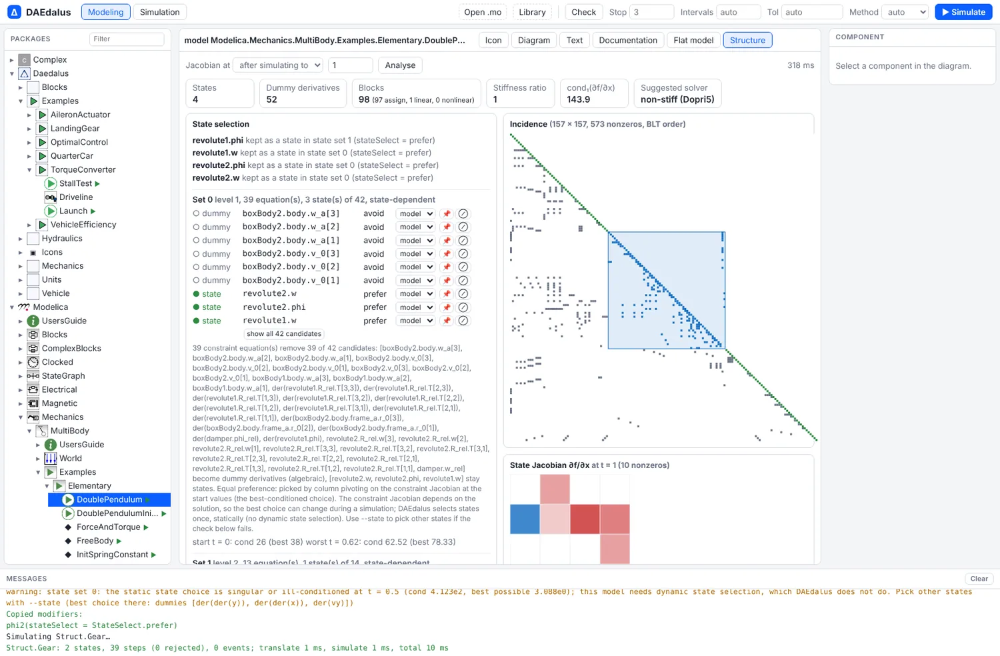

# Structure and state selection

Before it simulates anything, DAEdalus works out the order in which the equations must be
solved, and picks the **states**: the variables the solver steps forward in time, such as a
position or a temperature. Some equations constrain each other, and DAEdalus rewrites them
so the solver can handle them (this is called index reduction). The **Structure** view and
`daedalus structure` show the result of each step and explain why each state was chosen.
You can also choose other states without editing the model.


[Open TorqueConverter.Launch](https://daedalus.apps.ezkeel.com/#Daedalus.Examples.TorqueConverter.Launch)
and pick the **Structure** tab next to **Flat model**.

## What it shows

- **Variable roles**: state, derivative, dummy derivative, algebraic, alias, parameter or
  discrete.
- **BLT blocks** in evaluation order: which equation computes which unknown and, for
  linear and nonlinear loops, the tear variables, the inner equations and the residuals.
  A block is a group of equations that must be solved together, such as a loop. Click a
  block for its equations.
- **The incidence matrix**: a grid that shows which equation uses which variable, reordered
  so the blocks sit along the diagonal.
- **State selection**: for each candidate set of the dummy-derivative method, which
  variables stayed states and which became dummy derivatives, their `stateSelect` tiers,
  and the reason.
- **The state Jacobian** `df/dx` at the start or after simulating to a time: a heatmap of
  its entries, its sparsity and 1-norm condition number, and the eigenvalues in the
  complex plane. Hover an eigenvalue for its time constant, frequency, damping and the
  states that take part in it.
- **Stiffness**: the ratio of the fastest to the slowest mode, with a stiff or non-stiff
  solver suggestion, and the condition number of each algebraic loop's Jacobian with
  respect to its tear variables.

<div class="pair">
<figure><figcaption>A pendulum in cartesian coordinates (index 3): two state sets, the torn linear loop for the rod force, and the 2 × 2 state Jacobian.</figcaption></figure>
<figure><figcaption>Hovering an eigenvalue: time constant, frequency, damping and the states that participate.</figcaption></figure>
</div>

## Choosing states

DAEdalus selects states once, statically. When the best choice depends on the solution,
as it does for the cartesian pendulum, a fixed choice can degenerate partway through a
run. The structure report checks the choice along the simulated trajectory and warns
when it fails, naming the states that would work there.

In the Structure view, each state candidate has a pin (always a state) and a forbid
(never a state) button. The model is translated again at once, and the new states,
eigenvalues and stiffness show next to the old ones before you simulate. **Simulate with
overrides** runs it, and **Copy as modifier** gives the equivalent modification for your
source, such as `phi2(stateSelect = StateSelect.prefer)`. Overrides are kept per model
for the session.

<div class="pair">
<figure><figcaption>Preferring <code>y</code> and <code>vy</code>: the check along the run fails at the bottom of the swing, and the warning names the better choice.</figcaption></figure>
<figure><figcaption>Two inertias on an ideal gear: pinning <code>phi2</code> moves the state from one side of the gear to the other.</figcaption></figure>
</div>

The same works for MSL models, here `Modelica.Mechanics.MultiBody.Examples.Elementary.DoublePendulum`
with 42 candidates in its first state set:



## On the command line

```sh
daedalus structure model.mo -m MyModel [--at T] [--format json] [--no-jacobian]

# choose other states, for any command; NAME may be a glob
daedalus simulate model.mo -m MyModel --state body.v=prefer --state 'arm.*.phi=avoid'
```

`--state NAME=always|prefer|default|avoid|never` sets the `stateSelect` of the matching
variables before alias elimination and index reduction. Later overrides win, and one that
matches nothing is reported. It works with `check`, `dump`, `simulate`, `linearize`,
`structure`, `fmu` and `export-casadi`.

For the cartesian pendulum of `crates/daedalus-core/tests/models/structure.mo`:

```sh
daedalus structure crates/daedalus-core/tests/models/structure.mo -m Struct.Pendulum --at 1
```

```
structure of Struct.Pendulum
  variables: 2 states, 4 dummy derivatives, 3 algebraic, 0 aliases, 3 parameters, 0 discrete
  blocks: 5 (3 assignments, 1 linear loops, 1 nonlinear (torn 1))
  incidence: 9 x 9, 21 nonzeros

states (2):
  x: kept as a state in state set 1 (stateSelect = default)
  vx: kept as a state in state set 0 (stateSelect = default)

blocks:
  [0] der(x) := from der(x) = vx
  [1] nonlinear loop, 1 unknowns: [y]
      residual: x^2 + y^2 = L^2
  [2] der(y) := from der(x)*2*x + der(y)*2*y = 0
  [3] vy := from der(y) = vy
  [4] linear loop, 5 unknowns, torn: 1 tears, 4 inner, 1 residuals: [der(vy), der(der(y)), der(vx), der(der(x)), F]
  ...

state Jacobian df/dx at t = 1:
  2 x 2, 3 nonzeros (75.0 %), cond_1 = 6.162e0
  stiffness ratio: 1.000e0
  suggested solver: non-stiff (...; an explicit method (Dopri5) is efficient)

  modes (eigenvalue, time constant, top states):
    -4.852380e-2 - 2.462335e0i       tau 2.061e1 s    vx 50%, x 50%
    -4.852380e-2 + 2.462335e0i       tau 2.061e1 s    vx 50%, x 50%
```

Forcing `y` and `vy` as states with `--state y=prefer --state vy=prefer --at 2` makes the
check fail where the pendulum passes the bottom:

```
    check at start: t = 0, cond = 1.284e1 (best choice 5.765e0)
    check worst: t = 1.52, cond = 4.617e2 (best choice 3.078e0) FAILS

warning: state set 0: the static state choice is singular or ill-conditioned at t = 1.52
(cond 4.617e2, best possible 3.078e0); this model needs dynamic state selection, which
DAEdalus does not do. Pick other states with --state (best choice there: dummies
[der(der(y)), der(der(x)), der(vy)])
```

The structure report is also a tool of the [AI assistant](assistant.md)
(`model_structure`), so it can explain why a model is stiff or which states it chose.
