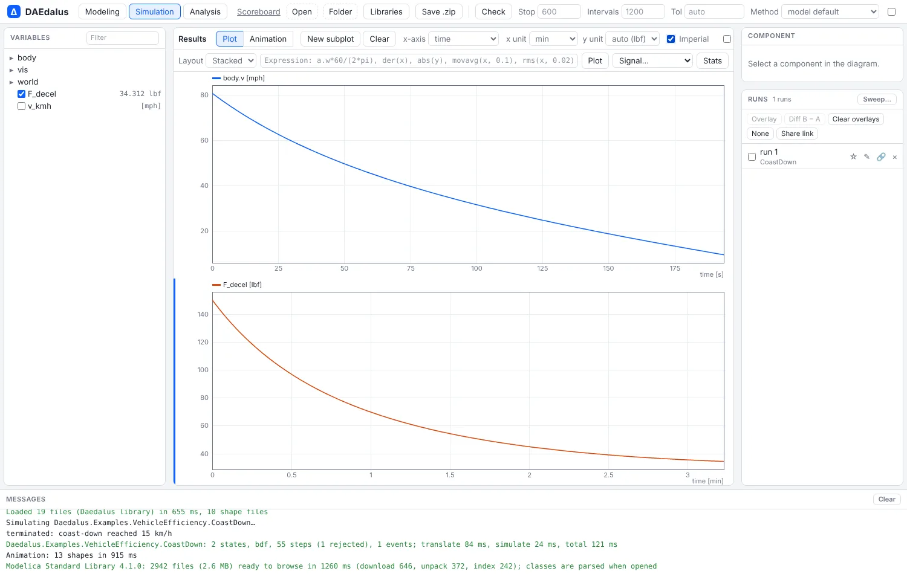

# Unit checking

DAEdalus checks the physical units of every equation, infers units for variables that
have none, and shows each variable in the unit you choose. Findings are warnings, never
errors, and the rules are tuned so that the Modelica Standard Library's own idioms stay
quiet.

## Checking a model

```sh
daedalus units model.mo -m MyModel          # every variable's unit, then the issues (--json, --all)
daedalus check model.mo -m MyModel --units  # translate as usual and print unit issues as warnings
```

A tank drained through an orifice, with a mistake in the outflow equation:

```modelica
model Tank "a tank drained through an orifice"
  parameter Real A(unit = "m2") = 2 "tank cross-section";
  parameter Real a(unit = "m2") = 0.01 "orifice area";
  parameter Real q_in(unit = "m3/s") = 0.05 "inflow";
  parameter Real g(unit = "m/s2") = 9.81;
  Real h(unit = "m", start = 1, fixed = true) "level";
  Real q_out(unit = "m3/s") "outflow";
  Real v "outflow velocity";
equation
  A * der(h) = q_in - q_out;
  v = sqrt(2 * g * h);
  q_out = a * v + h;
end Tank;
```

```
model Tank
  A      m2             declared
  a      m2             declared
  q_in   m3/s           declared
  g      m/s2           declared
  h      m              declared
  q_out  m3/s           declared
  v      m/s            inferred
1 unit issues; 6 declared, 1 inferred, 0 unknown; 7 equations, 3 passes, 0.1 ms
warning: unit mismatch (equation) in equation in Tank: `q_out` has unit m3/s but `h` has unit m; equation: q_out = h + v*a
```

The velocity `v` had no unit, and DAEdalus inferred `m/s` from `sqrt(2 g h)`. The extra
`+ h` in the outflow equation adds a height to a flow, so the checker reports it.

In the workbench, **Check** lists the unit issues in the Messages panel.

## The rules

- `unit` strings follow the grammar of the Modelica specification (section 19.1):
  `"kg.m2"`, `"rad/s"`, `"W/(m2.K)"`, `"s-1"` and SI prefixes. The checker also knows
  `degC`, `bar`, `rpm`, `l`, `min`, `h` and the Imperial `ft`, `in`, `lbf`, `psi`, `mph`,
  `hp`, `degF` and more.
- The terms of a sum, the two sides of an equation, the branches of an `if`, the operands
  of a relation and the arguments of `min` and `max` must agree. Products combine units,
  `der()` divides by seconds and `sqrt` halves the exponents. The arguments of `sin`,
  `exp` and similar functions must be dimensionless.
- Functions are checked through their inlined bodies, with the units of the actual
  arguments.
- Numeric literals take any unit (`x + 1`, `1.5*R`), as do variables declared
  `unit = "1"` such as gains. Each branch of an if-equation is checked on its own, and
  `log` takes any unit.
- When a clash involves an inferred unit, the checker drops that inference rather than
  reporting it.
- Rotations count as dimensionless when checking, so `rad/s` agrees with `Hz`, but not
  when converting for display.

On the 509 MSL 4.1.0 examples that flatten and the 19 examples of the bundled libraries,
it reports no issue. It costs about 1 % of the flattening time.

## Display units

Plots show each variable in its `displayUnit`. Without one, they use a Dymola-style
default: rpm, deg, bar, degC, l/min or kJ. The plot toolbar picks the unit of the x and y
axes from the units that convert. **Imperial** switches the defaults to ft, lbf, lbf.ft,
psi, mph, degF, hp, gal/min and similar units. Variables whose unit was inferred are
plotted with that unit too.



Parameter data imported from CSV is converted to the declared units the same way; see
[Libraries, packages and parameter data](libraries.md#parameter-data).
