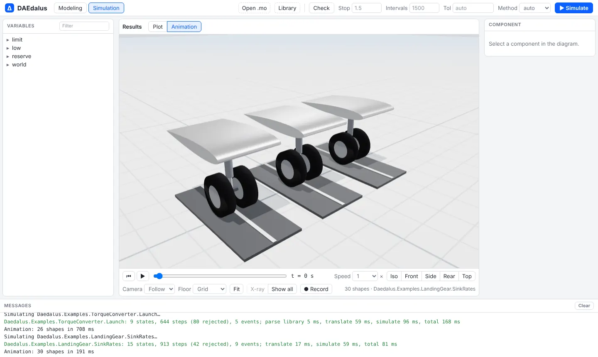
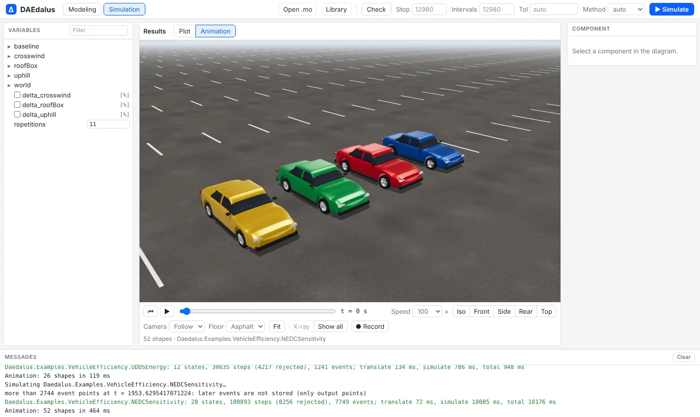
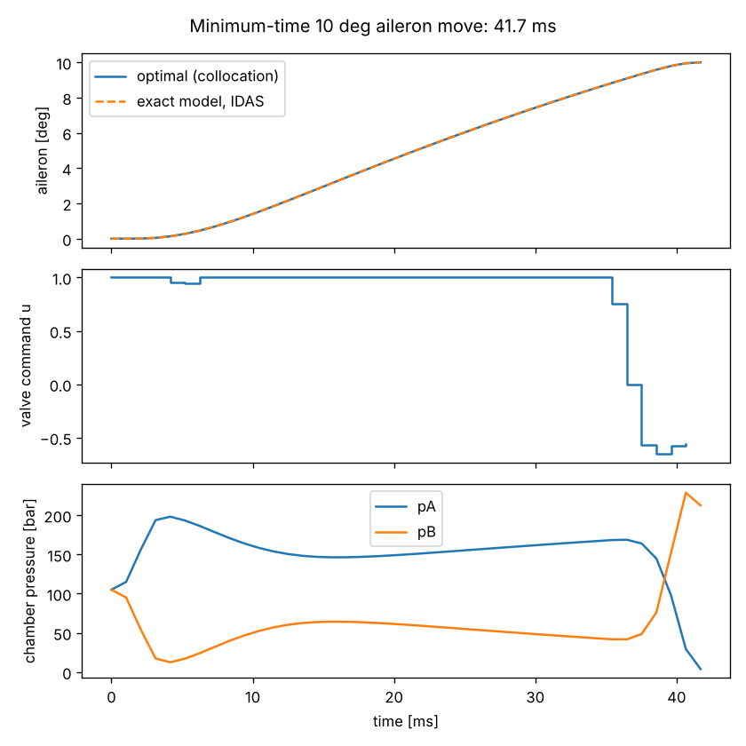

# What's new

The most recent additions, newest first. Each links to the page that covers it in full.

## State machines

The state machines of Modelica 3.6 chapter 17 now translate and simulate. The
example from `ModelicaReference.StateMachines` runs as written:

```modelica
model Counter
  inner Integer v(start = 0);
  block Increase
    outer output Integer v;
  equation
    v = previous(v) + 2;
  end Increase;
  Increase increase;
  block Decrease
    outer output Integer v;
  equation
    v = previous(v) - 1;
  end Decrease;
  Decrease decrease;
equation
  initialState(increase);
  transition(increase, decrease, v >= 6, immediate = false);
  transition(decrease, increase, v == 0, immediate = false);
end Counter;
```

What is supported:

**Operators.** All the chapter 17 operators work:
- `transition(from, to, condition, immediate, reset, synchronize, priority)`,
  where the last four arguments must be parameter expressions;
- `initialState`, `activeState`, `ticksInState()` and `timeInState()`.

**Transitions.**
- Immediate transitions fire in the tick where their condition holds. Delayed
  transitions take effect at the next tick.
- When several transitions could fire, the one with the lowest `priority`
  number wins.
- With `synchronize = true`, a transition waits until every state machine
  inside its from-state is in a final state.

**Hierarchy.** Machines nest inside states, and several machines can run in
parallel in one state. An inner machine pauses while its enclosing state is
inactive. When the enclosing state is re-entered, the inner machine resumes
where it stopped, or restarts in its initial state if the transition resets
it.

**Variables.**
- An `outer output` variable defined in several states gets one merged
  definition: `v = if activeState(s1) then e1 elseif ... else previous(v)`.
- `inner outer output` variables pass the merged value of the inner states up
  to the enclosing machine.
- Variables of an inactive state hold their values.
- A reset transition reinitializes the variables of its target state to
  their start values.

**Clock.** A state machine runs on the clock inferred for its partition. If no
clock can be inferred, as in the example above, it runs on a default periodic
clock of 1 s.

Inside clocked partitions, `time` is now the nominal instant of the tick
(`start + k·interval`), not the slightly later instant at which the event was
located. This makes `timeInState()` and comparisons against `time` exact.

**Limitations.**
- `ticksInState()` and `timeInState()` can only be used in transition
  conditions.
- Each equation in a state must be solvable for the variable it defines.
- An immediate transition whose condition reads a variable computed by its
  from-state in the same tick forms an algebraic loop, which is rejected.

## 3-D animation for every example

After **Simulate**, models with shapes open in the new **Animation** view: a WebGL scene
with studio lighting, camera presets, follow and chase cameras, X-ray selection and WebM
recording. It draws every `Modelica.Mechanics.MultiBody` shape in a result, including STL
and OBJ meshes, and the bundled examples got their own visuals through
`Daedalus.Visualizers`: cars that drive the cycles side by side, the landing gear dropping
onto the runway, the aileron turning on its hinge.

<div class="pair">
<figure></figure>
<figure></figure>
</div>

See [3-D animation](animation.md).

## Multibody suspensions, rigs and a full car

`library/MultiBodyVehicle` builds vehicle models on `Modelica.Mechanics.MultiBody`:
double-wishbone, pushrod, multilink and MacPherson corners, an anti-roll bar, a tyre with
lift-off, wheel pads and aero loaders, and a 6-DOF car. Nine examples cover suspension
kinematics, a K&C rig, a seven-post rig, step steer, lane change and a one-sided bump, and
all nine match OpenModelica 1.26.1 to within 0.04 % of each signal's range while running
several times faster.

<video src="media/sevenpost_rig.mp4" poster="img/multibody/sevenpost_rig.webp" controls muted loop playsinline preload="none"></video>

See [Multibody vehicles](multibody.md).

## Back and forward between classes

Every class you open is a browser history entry with its own address
(`/#Package.Model`), so Back and Forward, Alt+← and Alt+→, mouse side buttons and the
arrows next to the class name walk through them, and a link opens a class directly. The
workbench colours now follow the light or dark system theme everywhere, diagrams included.
See [Workbench](workbench.md).

## Release binaries

Pushing a version tag builds and publishes a
[GitHub Release](https://github.com/ferax564/DAEdalus/releases) with the CLI, the FMI
runtime and the example library for Linux, macOS (Apple Silicon and Intel) and Windows,
plus the `daedalus-casadi` Python wheel. See [Getting started](getting-started.md#2-release-binaries).

## Optimal control, MPC and estimation with CasADi

`daedalus export-casadi` hands the index-reduced DAE to CasADi, and the `daedalus_casadi`
Python package solves optimal control problems by direct collocation, runs model
predictive control and estimates states and parameters with moving horizon estimation,
all referring to model variables by their Modelica names.



See [Optimal control](optimal-control.md).

## Modelica Standard Library 4.1.0 in the browser

The workbench loads MSL 4.1.0 (`Modelica`, `ModelicaServices`, `Complex`) out of the box.
The package browser lists all of it within seconds, and a class is parsed only when it is
opened or simulated. A nightly job compares every MSL example with the Modelica
Association's reference results. See [Modelica Standard Library](msl.md).

## Linearization

`daedalus linearize` gives the exact state-space matrices A, B, C and D around the initial
point or after simulating to a time, as text, JSON or an OpenModelica-style
`linearized_model`. See [Linearization](linearize.md).

## FMI 2.0 export

`daedalus fmu` writes one FMU with both Model Exchange and Co-Simulation, validated with
FMPy in CI. See [FMI 2.0 export](fmi.md).

## Multibody closed loops

Planar kinematic loops on a free body, driven loops and steady-state initialization now
work, which is what the suspension models above are built on.

## In progress

These are being built now and get their pages here when they land:

- an accuracy scoreboard against OpenModelica and the MSL reference results;
- a Python API for scripting simulations, and `.mos` scripts;
- steady-state (trim) solving, then lookup-table and state-machine work;
- from the competitor survey: a Jacobian and structure view, state selection control,
  more solvers and sensitivity analysis.

The longer-term plan is in the [Roadmap](roadmap.md).
