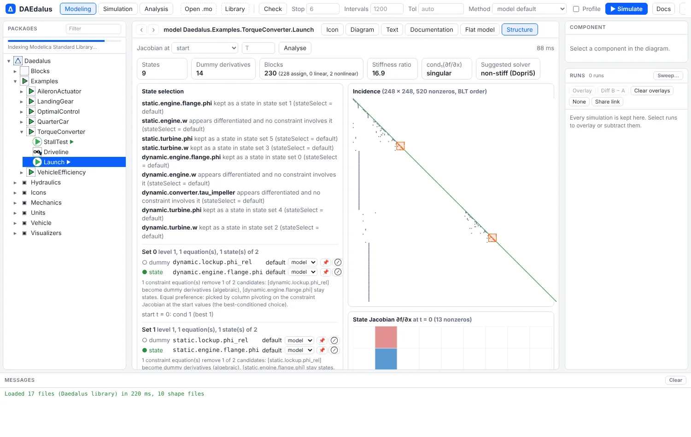
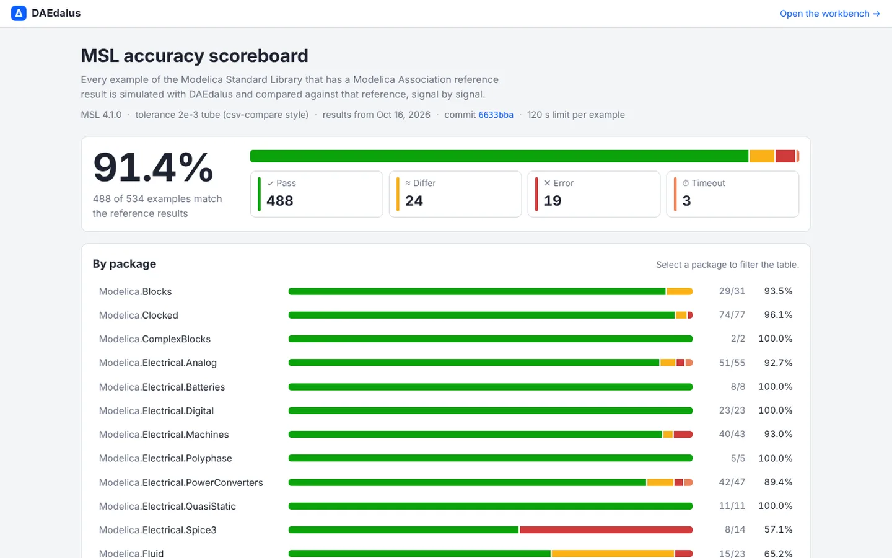

# What's new

The most recent additions, newest first. Each links to the page that covers it in full.

## MSL: 488 of 534 examples match the reference results

Up from 445. Fixes span the whole library:

- **Events:** one event iteration solves the relations together with the equations they
  switch, at fixed `pre()`, after the when-clauses fire; relations inside their
  hysteresis band keep their value, and cycling modes are resolved by a mode search. This
  ends the chattering of stuck clutches, brakes, lossy gears, bearing friction and tank
  overflows.
- **Solvers:** each state's absolute tolerance is `tolerance * |nominal|`; a Newton solve
  that stalls on a fold of a piecewise-linear characteristic searches for a sign change;
  BDF no longer fails on a first step below the time resolution.
- **State selection:** `reinit(x, ...)` makes `x` a state (`stateSelect = always`), alias
  classes keep the declared `stateSelect` of their members, and `stateSelect = prefer`
  wins over default choices (machine currents, spring-damper states).
- **Language:** `final` modifiers from outer modifications, redeclared records and model
  modifiers, constraining-clause modifiers, functions nested in functions, records built
  from arrays of records, event clocks that tick at initialization, run-time index slices
  in algorithms, and minimum-norm least squares (`dgelsy`).

See the [scoreboard](https://daedalus.apps.ezkeel.com/scoreboard.html) and
[Modelica Standard Library](msl.md).

## Embedded C code and processor in the loop

`daedalus codegen-c` turns a controller block into portable, allocation-free C99 that
steps it at a fixed rate, and `daedalus hil` closes the loop between that code and a
plant simulated by DAEdalus: on your computer, on an Arduino Uno emulated in simavr, on an
ESP32 emulated in QEMU, or on a real board over its serial port. CI runs the whole ladder
on every change. `daedalus autotune` tunes the controller's gains on the closed loop
against a step-response specification first. See
[Embedded C and processor in the loop](embedded.md).

## Scientific machine learning

`daedalus.sciml` finds the physics a model is missing from measured data, turns it into a
formula by symbolic regression, and learns neural surrogates that export back to
Modelica (and from there to embedded C), in NumPy only. See
[Scientific machine learning](sciml.md).
## State machines

The state machines of Modelica 3.6 chapter 17 now translate and simulate. The
example from `ModelicaReference.StateMachines` runs as written:

```modelica
model Counter
  inner Integer v(start = 0);
  block Increase
    outer output Integer v;
  equation
    v = previous(v) + 2;
  end Increase;
  Increase increase;
  block Decrease
    outer output Integer v;
  equation
    v = previous(v) - 1;
  end Decrease;
  Decrease decrease;
equation
  initialState(increase);
  transition(increase, decrease, v >= 6, immediate = false);
  transition(decrease, increase, v == 0, immediate = false);
end Counter;
```

What is supported:

**Operators.** All the chapter 17 operators work:
- `transition(from, to, condition, immediate, reset, synchronize, priority)`,
  where the last four arguments must be parameter expressions;
- `initialState`, `activeState`, `ticksInState()` and `timeInState()`.

**Transitions.**
- Immediate transitions fire in the tick where their condition holds. Delayed
  transitions take effect at the next tick.
- When several transitions could fire, the one with the lowest `priority`
  number wins.
- With `synchronize = true`, a transition waits until every state machine
  inside its from-state is in a final state.

**Hierarchy.** Machines nest inside states, and several machines can run in
parallel in one state. An inner machine pauses while its enclosing state is
inactive. When the enclosing state is re-entered, the inner machine resumes
where it stopped, or restarts in its initial state if the transition resets
it.

**Variables.**
- An `outer output` variable defined in several states gets one merged
  definition: `v = if activeState(s1) then e1 elseif ... else previous(v)`.
- `inner outer output` variables pass the merged value of the inner states up
  to the enclosing machine.
- Variables of an inactive state hold their values.
- A reset transition reinitializes the variables of its target state to
  their start values.

**Clock.** A state machine runs on the clock inferred for its partition. If no
clock can be inferred, as in the example above, it runs on a default periodic
clock of 1 s.

Inside clocked partitions, `time` is now the nominal instant of the tick
(`start + k·interval`), not the slightly later instant at which the event was
located. This makes `timeInState()` and comparisons against `time` exact.

**Limitations.**
- `ticksInState()` and `timeInState()` can only be used in transition
  conditions.
- Each equation in a state must be solvable for the variable it defines.
- An immediate transition whose condition reads a variable computed by its
  from-state in the same tick forms an algebraic loop, which is rejected.

## Structure explorer and state selection

The new **Structure** tab and `daedalus structure` show the BLT blocks, the incidence
matrix, why each state was chosen, and the state Jacobian's eigenvalues and stiffness.
States can be pinned or forbidden there, or with `--state NAME=prefer` on any command,
without editing the model, and a check along the run warns when a static choice breaks
down. See [Structure and state selection](structure.md).



## Radau, ESDIRK and automatic switching

Two more stiff solvers, Radau IIA (order 5) and ESDIRK (order 4), and `auto`, which
switches between Dopri5 and BDF as the model turns stiff and back. The implicit methods
use an exact Jacobian from the compiled model, and the workbench recommends another
method when a run's statistics show it is using the wrong kind. See [Solvers](solvers.md).

## Sensitivity, uncertainty, calibration and optimization

The **Analysis** mode and `daedalus sensitivity | montecarlo | gsa | calibrate | optimize`:
exact sensitivities, Monte Carlo prediction bands, Sobol and Morris indices, fitting
parameters to measured data with standard errors, and design optimization. See
[Sensitivity and calibration](analysis.md).

<div class="pair">
<figure></figure>
<figure></figure>
</div>

## Experiments, sweeps and share links

Every simulation is kept in the **Runs** pane to overlay or subtract, **Sweep…** runs a
parameter grid on all cores in the browser, `daedalus sweep` does the same on the command
line, and **Share link** copies an address that reruns the experiment. See
[Experiments and sweeps](experiments.md).

## Performance analyzer

**Profile** (or `--profile`) records the step sizes, the states that limit them, the time
in each algebraic loop, the event log and chattering relations, with hints in plain
language. See [Performance analyzer](performance.md).

## Graphical editing

The Diagram view is now an editor for your own models: drag components in, connect them,
rotate, flip and set parameters, with undo. Edits change only the text they must. See
[Workbench](workbench.md#graphical-editing).

## AI assistant and MCP server

**✦ Assistant** in the workbench is a chat with Claude that can read, write, check and
simulate models and read the structure and profile reports, with your own API key.
`daedalus mcp` gives Claude Code and other MCP clients the same tools. See
[AI assistant and MCP](assistant.md).

## MSL accuracy scoreboard

The [scoreboard](https://daedalus.apps.ezkeel.com/scoreboard.html) compares every MSL
4.1.0 example with the Modelica Association's reference results, signal by signal:
**424 of 534 match**, 49 run but differ somewhere, 56 fail and 5 hit the time limit.
It breaks the results down by package, shows the signals that differ and the error
text for each model, and links each example to the workbench.



See [Modelica Standard Library](msl.md#checked-against-the-reference-results).

## Python API

The `daedalus` Python package (`crates/daedalus-py`, built with maturin) runs the compiler
in-process, with no server and no licence: load a model, change parameters, simulate to
NumPy arrays or pandas, linearize and export FMUs.

```python
import daedalus

m = daedalus.Model("library/Daedalus", "Daedalus.Examples.TorqueConverter.StallTest")
m.set_parameters({"engine.J": 0.3})
r = m.simulate(stop=2.0, vars=["rpm_engine"])
r.time, r["rpm_engine"]
```

See [Python API](python.md), which also maps OMPython and Dymola calls onto it.

## `.mos` scripts, steady states and trim

`daedalus run script.mos` runs Dymola and OpenModelica regression scripts:
`loadModel`, `simulateModel`, `simulate`, `simulateExtendedModel`, `linearizeModel`,
`val`, loops and conditionals. `daedalus steady` finds equilibria with an exact Jacobian
and reports their stability, and with `--free` and `--target` it trims, for example the
input that holds an output at a set value. See [Scripts and steady states](scripting.md).

## 3-D animation for every example

After **Simulate**, models with shapes open in the new **Animation** view: a WebGL scene
with studio lighting, camera presets, follow and chase cameras, X-ray selection and WebM
recording. It draws every `Modelica.Mechanics.MultiBody` shape in a result, including STL
and OBJ meshes, and the bundled examples got their own visuals through
`Daedalus.Visualizers`: cars that drive the cycles side by side, the landing gear dropping
onto the runway, the aileron turning on its hinge.

<div class="pair">
<figure></figure>
<figure></figure>
</div>

See [3-D animation](animation.md).

## Multibody suspensions, rigs and a full car

`library/MultiBodyVehicle` builds vehicle models on `Modelica.Mechanics.MultiBody`:
double-wishbone, pushrod, multilink and MacPherson corners, an anti-roll bar, a tyre with
lift-off, wheel pads and aero loaders, and a 6-DOF car. Nine examples cover suspension
kinematics, a K&C rig, a seven-post rig, step steer, lane change and a one-sided bump, and
all nine match OpenModelica 1.26.1 to within 0.04 % of each signal's range while running
several times faster.

<video src="media/sevenpost_rig.mp4" poster="img/multibody/sevenpost_rig.webp" controls muted loop playsinline preload="none"></video>

See [Multibody vehicles](multibody.md).

## Back and forward between classes

Every class you open is a browser history entry with its own address
(`/#Package.Model`), so Back and Forward, Alt+← and Alt+→, mouse side buttons and the
arrows next to the class name walk through them, and a link opens a class directly. The
workbench colours now follow the light or dark system theme everywhere, diagrams included.
See [Workbench](workbench.md).

## Release binaries

Pushing a version tag builds and publishes a
[GitHub Release](https://github.com/ferax564/DAEdalus/releases) with the CLI, the FMI
runtime and the example library for Linux, macOS (Apple Silicon and Intel) and Windows,
plus the `daedalus-casadi` Python wheel. See [Getting started](getting-started.md#2-release-binaries).

## Optimal control, MPC and estimation with CasADi

`daedalus export-casadi` hands the index-reduced DAE to CasADi, and the `daedalus_casadi`
Python package solves optimal control problems by direct collocation, runs model
predictive control and estimates states and parameters with moving horizon estimation,
all referring to model variables by their Modelica names.


See [Optimal control](optimal-control.md).

## Modelica Standard Library 4.1.0 in the browser

The workbench loads MSL 4.1.0 (`Modelica`, `ModelicaServices`, `Complex`) out of the box.
The package browser lists all of it within seconds, and a class is parsed only when it is
opened or simulated. A nightly job compares every MSL example with the Modelica
Association's reference results. See [Modelica Standard Library](msl.md).

## Linearization

`daedalus linearize` gives the exact state-space matrices A, B, C and D around the initial
point or after simulating to a time, as text, JSON or an OpenModelica-style
`linearized_model`. See [Linearization](linearize.md).

## FMI 2.0 export

`daedalus fmu` writes one FMU with both Model Exchange and Co-Simulation, validated with
FMPy in CI. See [FMI 2.0 export](fmi.md).

## Multibody closed loops

Planar kinematic loops on a free body, driven loops and steady-state initialization now
work, which is what the suspension models above are built on.

## In progress

This is being built now and gets its page here when it lands:

- external C libraries (`Modelica.Utilities`, `Math.Random` and friends) and more
  lookup-table support.

The longer-term plan is in the [Roadmap](roadmap.md).
