# Workbench

The workbench is a Dymola-style modeling and simulation environment that runs in the
browser. The compiler and solvers are the same Rust code as the command line, compiled to
WebAssembly and run in a Web Worker, so the page stays responsive while a model
translates or simulates. Simulation in the page or via `daedalus serve` stays on the
machine; **✦ Assistant** sends the text it reads and the numbers it asks for to Anthropic.

[Open the workbench](https://daedalus.apps.ezkeel.com/#Daedalus.Examples.TorqueConverter.StallTest)

## Layout


- **Toolbar.** **Modeling**, **Simulation** and **Analysis** switch modes. **Open**,
  **Folder** and **Libraries** load your own files, a library folder, or a package from
  the index. **Save .zip** downloads the open model with the files and resources it needs.
  **Check** translates the model and reports its statistics. **Stop**, **Intervals**,
  **Tol** and **Method** override the model's `experiment` annotation for the next run,
  and **▶ Simulate** (Ctrl+Enter) runs it. On a narrow window, **More** holds Open,
  Folder, Libraries, Save .zip and those experiment fields.
- **Packages** (left). Every loaded library: `Daedalus`, the MSL (`Modelica`,
  `ModelicaServices`, `Complex`) and whatever you opened. Models with a ▶ can be simulated.
  The filter box narrows the tree to matching classes. On a phone the pane starts
  collapsed behind its title, so the diagram is the first screen.
- **Class views** (centre). The open class in one of eight views — **Icon**, **Diagram**,
  **Text**, **Documentation**, **Flat model**, **Structure**, **Linear** and **Diff** —
  with Back and Forward arrows next to its name.
- **Component** (right). Click a component in the diagram to see its class, description
  and parameter values; **Open** jumps to that class.
- **Messages** (bottom). Translation statistics, timings, warnings and errors.

## Class views

<div class="pair">
<figure>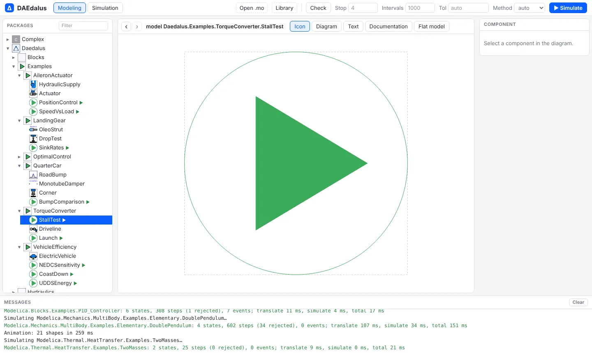<figcaption>Icon: the class's icon layer.</figcaption></figure>
<figure>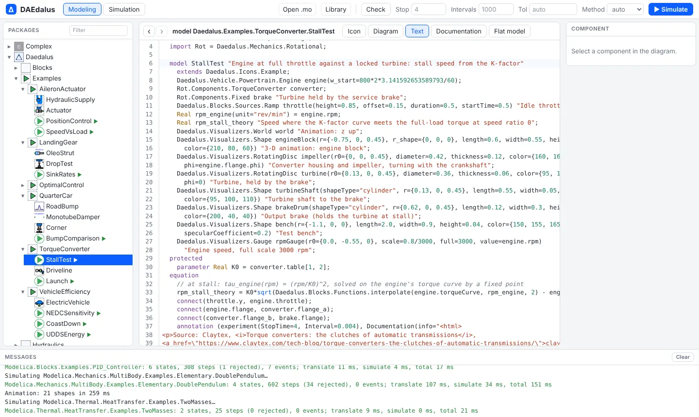<figcaption>Text: the Modelica source in an editor with syntax highlighting, search and undo. Edits are re-parsed as you type, syntax errors show in Messages, and the next Check or Simulate uses them.</figcaption></figure>
<figure>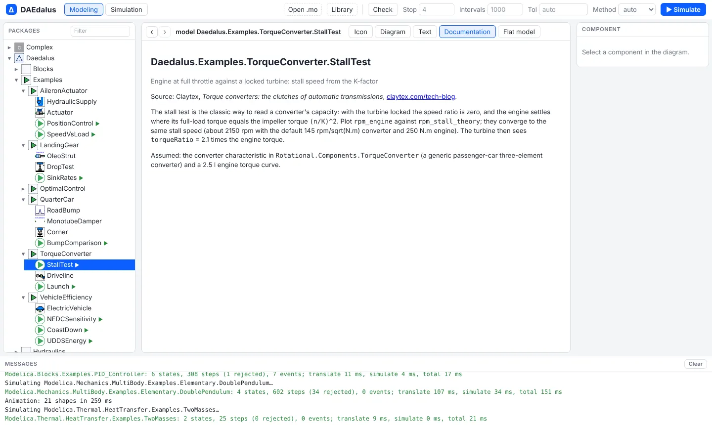<figcaption>Documentation: the class's HTML documentation annotation.</figcaption></figure>
<figure>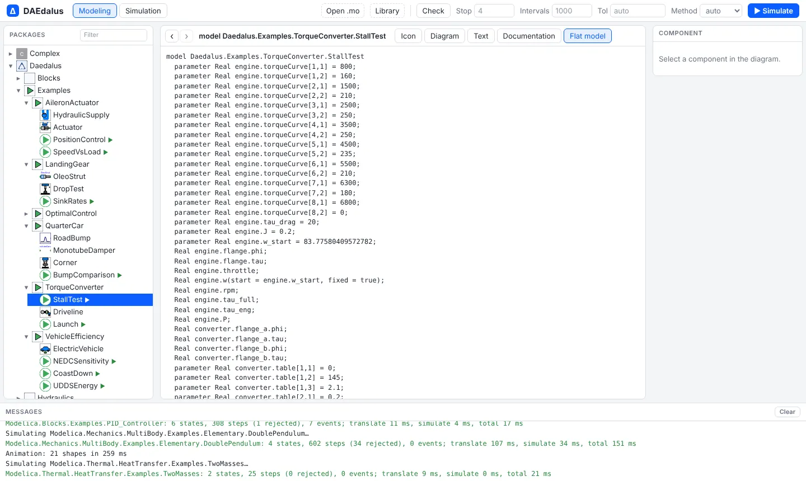<figcaption>Flat model: every scalar variable and equation after flattening.</figcaption></figure>
</div>

The **Diagram** view draws components, connections and graphics from their annotations,
with zoom and pan (wheel and drag). It works for the bundled library and for the MSL:

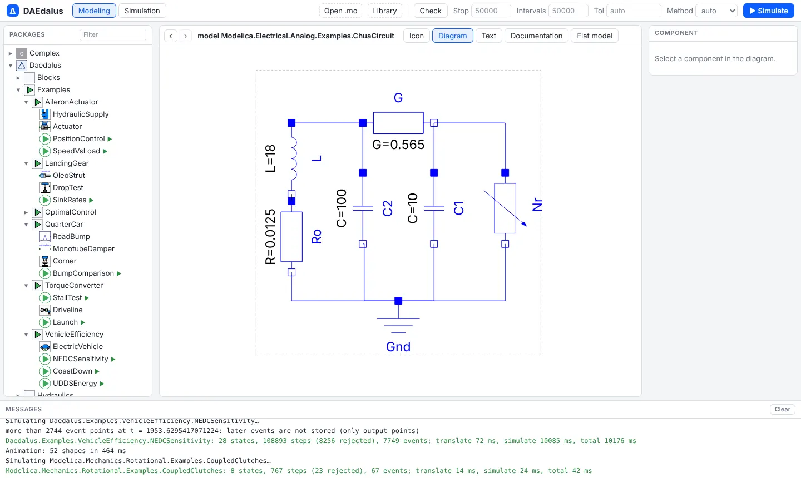

## Filtering the package browser

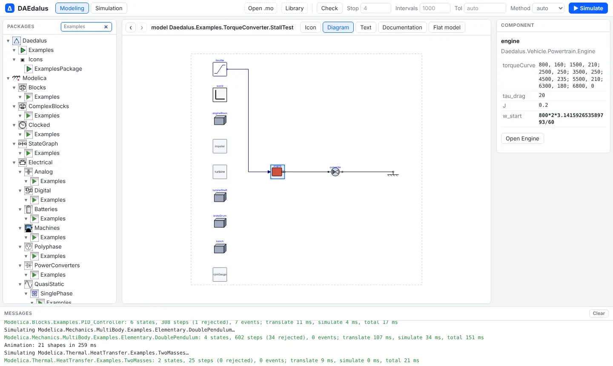

## Graphical editing

Classes in your own documents can be edited in the Diagram view. The bundled `Daedalus`
library and the MSL are read-only: **Duplicate to my models** copies the open class into
`MyModels.mo`, with every class name it uses written in full, and opens the copy.
**New model** adds an empty model there. `MyModels.mo` is kept in the browser. The
editor's **Save .mo** downloads that file; the toolbar's **Save .zip** downloads the
open model with the files and resources it needs.

<div class="pair">
<figure>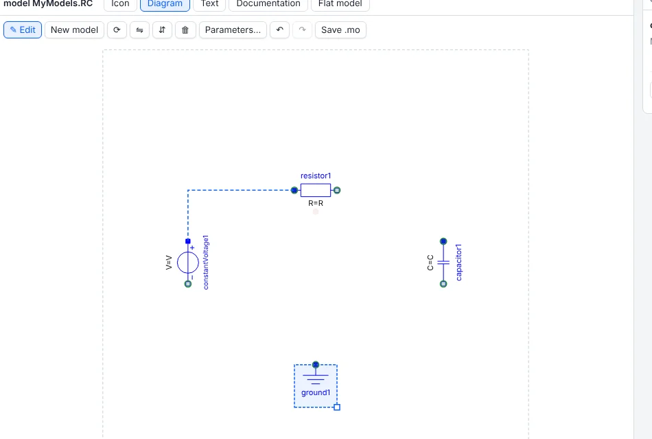<figcaption>Dragging a connection: the compatible connectors light up.</figcaption></figure>
<figure>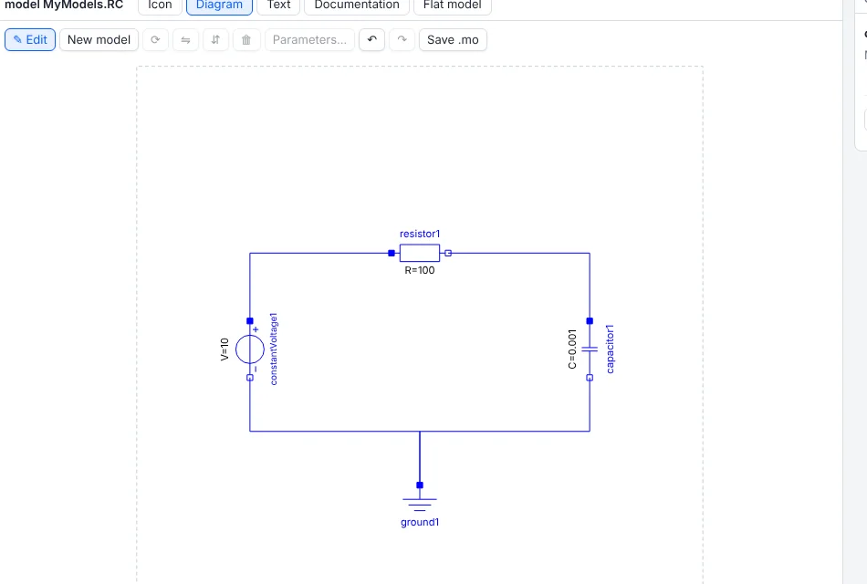<figcaption>An RC circuit built from MSL components, with R set in the parameter dialog.</figcaption></figure>
</div>

With **✎ Edit** on:

- drag a class from the package browser onto the diagram to add a component;
- click or rubber-band to select, Shift to add, drag to move, arrow keys to nudge;
- **R** rotates by 90°, **H** and **V** flip, **Del** deletes components with their
  connections, and the corner handle resizes;
- drag from one connector to another to connect. Compatible connectors (same class,
  same members, or one family such as `RealOutput`/`RealInput` or
  `PositivePin`/`NegativePin`) light up, and the line is routed orthogonally;
- double-click a component for its parameters: name, value, unit, description and the
  class default. Values are written as modifiers, and emptying a field removes one;
- **Ctrl+Z** and **Ctrl+Y** undo and redo.

Each gesture edits only the tokens it has to, so comments, layout and other annotations
in the source stay as written, and the Text view, **Check** and **Simulate** use the
edited text at once.

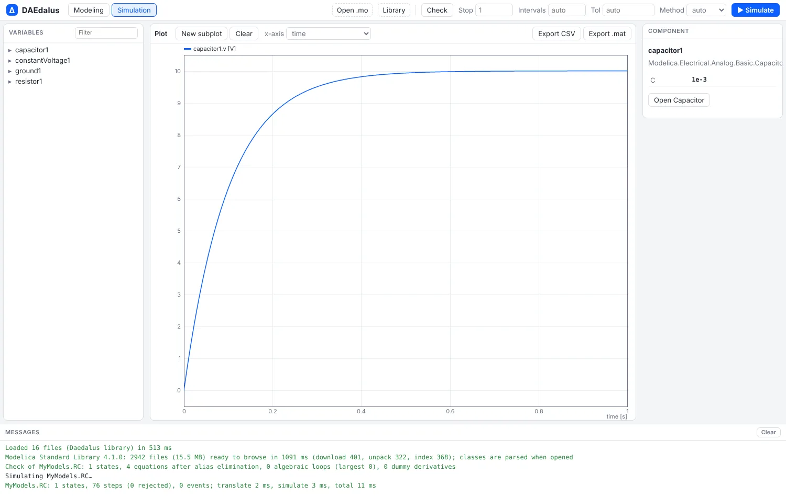

## Simulation and the variable browser

**▶ Simulate** compiles the model in the worker and switches to Simulation mode. The left
pane becomes the variable browser: the result's component tree, with each variable's
value at the end of the run and its display unit. Typing in the filter keeps the matching
variables. Ticking a variable plots it.

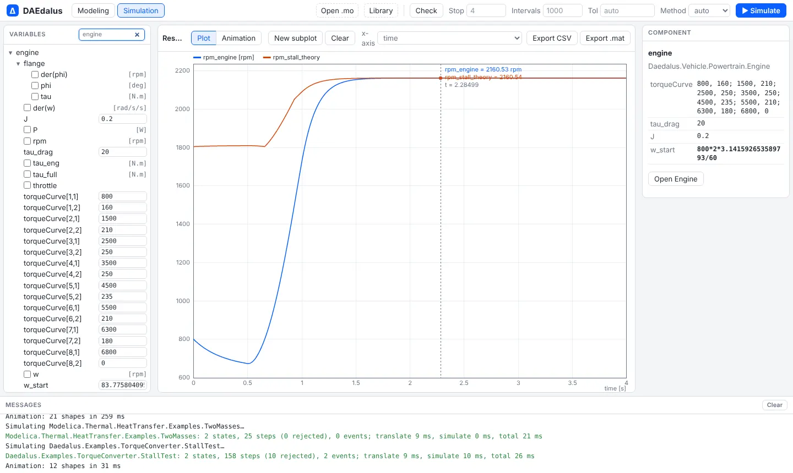

Parameters are editable in the variable browser: change a value and simulate again, and
the run uses the new value without touching the source. Overrides belong to the model they
were made on and are cleared when you open another class.

Simulating the same model again reuses its translation when only parameters or run
settings changed, so the second run starts at once. Any edit to a source translates it
again.

## Speed: compiled tapes and the local engine

The equations run as compiled code, not through an interpreter: each model's hot tapes
(derivatives, outputs, zero crossings and algebraic loops) become a small WebAssembly
module that the browser compiles to machine code. Multibody models run about 1.5 to 2
times faster this way. The results are bit for bit the same as interpreting the tapes.

**Local engine** goes further on a desktop. Start the engine that ships with the command
line tool:

```sh
daedalus serve
```

It prints a one-time token. Press **Local engine** in the toolbar and paste that token
(it is remembered next to the engine address). Simulations, analyses and experiment runs then
go to the native process on your computer, which is faster again than the browser, uses
every core for experiments and has no 4 GB memory limit. The class tree, diagrams and
editing stay in the page, and every document and library you load is sent to the engine,
so both always see the same sources. It gives the same numbers as `daedalus simulate`.
The button shows the number of cores when it is connected; press it again to go back to
the browser. The choice is remembered, and `?engine=URL` connects to another address.

The engine listens on 127.0.0.1 only (port 7878, `--port` to change it). A browser may
call it only from this site or from localhost (`--allow-origin ORIGIN` adds another),
and every request needs the token as `Authorization: Bearer`. Your models stay on your
computer either way.

## Plots

The plot window draws thousands of points per series smoothly and has:

- **Display units**, as in Dymola: `rad/s` shows as `rpm`, `rad` as `deg`, `Pa` as
  `bar`, `K` as `degC`, `m3/s` as `l/min` and `J` as `kJ`;
- **subplots** (**New subplot**) that share the time axis and zoom together;
- **parametric plots**: choose a variable as the **x-axis** of a subplot to plot one
  variable against another, such as a damper's force against its velocity;
- a **crosshair readout** of every series under the mouse, and drag-to-zoom;
- **Export CSV** and **Export .mat** of the plotted variables.

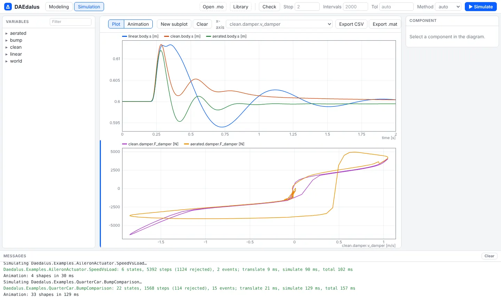

## Structure, analysis and experiments

The **Structure** tab next to **Flat model** shows the equation structure, state selection
and Jacobian ([Structure and state selection](structure.md)). **Analysis** in the toolbar
runs sensitivities, Monte Carlo, calibration and optimization
([Sensitivity, uncertainty and calibration](analysis.md)). Every run is kept in the
**Runs** pane for overlays, differences, sweeps and share links
([Experiments](experiments.md)), and **Profile** adds a **Performance** tab
([Performance analyzer](performance.md)). **✦ Assistant** opens a chat with Claude that
can use all of these ([AI assistant](assistant.md)).

## Animation

Models that contain MultiBody shapes, or the visualizers of the bundled examples, open in
the **Animation** view after a simulation. See [3-D animation](animation.md).

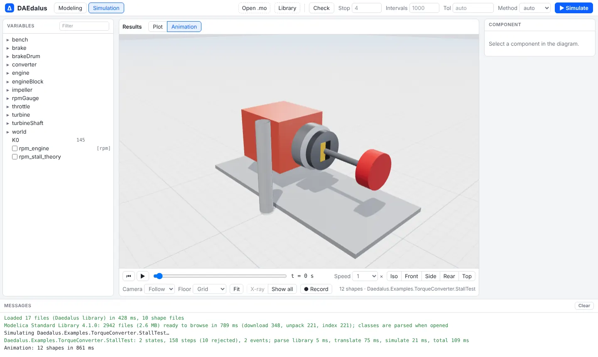

## Dark mode

The workbench follows the system's light or dark theme. Diagrams keep their hues with
inverted lightness, so MSL icons stay readable.

<div class="pair">
<figure>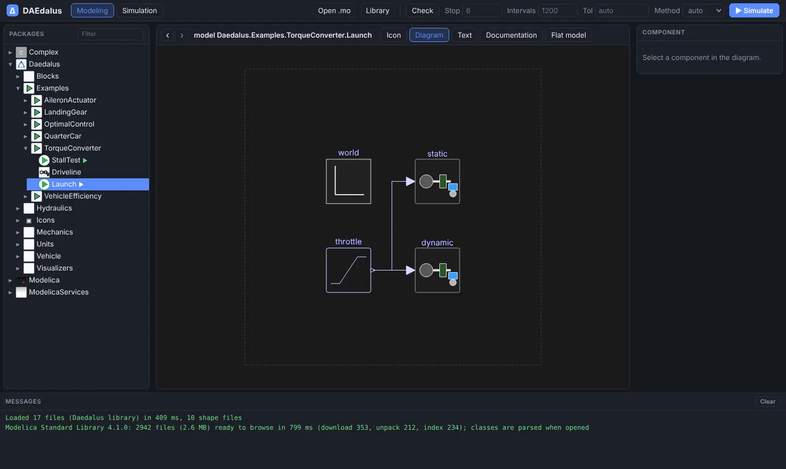</figure>
<figure>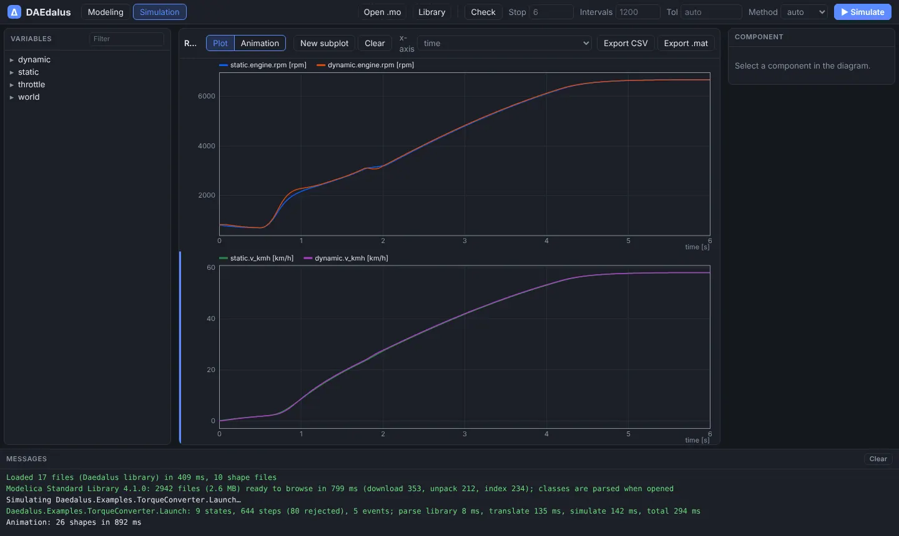</figure>
</div>

## Navigation and links

Each class you open is a browser history entry with its own address, `/#` followed by the
class name. Back and Forward, Alt+← and Alt+→, the mouse side buttons and the arrows next
to the class name walk through them. A link to `/#Some.Class` opens that class, including
MSL classes, which open once the library has loaded. Every example on these pages links to
its model this way.

## How loading works

The page loads the bundled `Daedalus` library, then downloads the MSL bundle (about
2.6 MB, 14.8 MB unpacked) and unpacks it with `DecompressionStream`. A light token scan
outlines every file so the package browser can list the whole library within seconds; a
class is parsed only when it is opened, checked or simulated, together with the classes
it needs.
